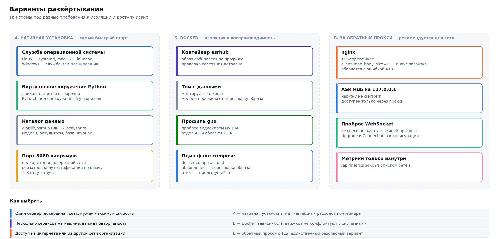

# Установка



## Выбор способа

| | Нативная установка | Docker |
|---|---|---|
| Скорость на GPU | максимальная | та же (`--gpus all`) |
| Обновление | `update.sh` со снимком и откатом | пересборка образа |
| Изоляция | виртуальное окружение Python | полная |
| Ставится за | 10–40 минут | 5 минут + сборка образа |
| Apple Silicon (Metal) | да | **нет** — Docker на macOS не даёт доступа к Metal |
| Подходит для | выделенного сервера, рабочей станции, MacBook | кластера, CI, нескольких экземпляров |

> **Рекомендация.** На отдельной машине с видеокартой и на macOS ставьте нативно: разница в производительности на Apple Silicon разительная, а откат обновления встроен в скрипт. Docker берите там, где важна воспроизводимость или экземпляров больше одного.

## Профили установки

Профиль определяет, какие движки ставятся и какие веса загружаются сразу. Если профиль не указан, он подбирается по обнаруженному железу.

| Профиль | Что ставится | Диск | Кому |
|---|---|---|---|
| `light` | сервер + faster-whisper small | ~1 ГБ | проверка, слабая машина, контейнер в CI |
| `cpu` | faster-whisper small (int8) + GigaAM v3 CTC, движок Vosk | ~4 ГБ | сервер без видеокарты |
| `standard` | GigaAM v3 + faster-whisper | ~8 ГБ | **умолчание для машины с GPU** |
| `full` | все движки и основные модели | 60+ ГБ | исследование, сравнение моделей |
| `apple` | whisper.cpp на Metal + GigaAM v3 CTC | ~3 ГБ | MacBook на Apple Silicon |
| `russian` | GigaAM v3, T-one, Vosk | ~3 ГБ | только русский язык |

Профиль не запирает вас: любую модель можно доустановить позже командой `scripts/models.sh download <модель>`.

## Linux

### Установка

```bash
git clone <репозиторий> asr-hub && cd asr-hub
sudo bash scripts/install.sh
```

Без ключей запускается **мастер**: он определяет железо и задаёт семь вопросов, у каждого из которых уже подставлен разумный ответ. Нажимать Enter семь раз — рабочая стратегия.

```
Установка ASR Hub
Enter принимает предложенное значение — оно подобрано по вашему железу
────────────────────────────────────────────────────────────────────
  Обнаружено: linux/x86_64, видеокарта NVIDIA, 64 ГБ памяти, 412 ГБ свободно

Что установить?
   1) Минимум — проверить, что всё работает
      ~1 ГБ. faster-whisper small. Годится, чтобы посмотреть интерфейс
   2) Сервер без видеокарты
      ~4 ГБ. int8-квантизация. Час записи обрабатывается за час-полтора
 ▸ 3) Стандартный набор
      ~8 ГБ. GigaAM v3 + faster-whisper. Лучший выбор для машины с GPU
   4) Только русский язык
   5) MacBook на Apple Silicon
   6) Всё сразу
Выбор [3]:
```

Мастер спрашивает: что установить, куда, на каком порту, кто сможет подключаться, что ещё включить (автозапуск, выравнивание, отправку метрик, распознавание на лету, разделение по говорящим) и токен Hugging Face. Перед началом работы он показывает сводку и просит подтверждения — до этого момента на диске ничего не меняется.

⚠️ Ключи командной строки мастер не отменяет: `--profile`, `--host`, `--engines`, `--no-service` он подставляет в свои умолчания, а не затирает. Если вы задали `--host 127.0.0.1`, сервер не окажется выставленным в сеть после того, как вы семь раз нажали Enter.

Он же предупреждает о том, что иначе всплыло бы на седьмом шаге: не хватает места под выбранный профиль, видеокарта не обнаружена, а профиль рассчитан на неё, порт занят. Каждое предупреждение сопровождается предложением исправить выбор.

**Без вопросов** — если установка идёт из скрипта или Ansible:

```bash
# посмотреть план, ничего не меняя — на диске не появится ни одного каталога
bash scripts/install.sh --profile standard --dry-run

# установка без единого вопроса
sudo bash scripts/install.sh --profile standard --port 8080 --yes
```

Мастер не запускается, когда задан `--yes`, `--no-interactive` или когда ввод идёт не с терминала, — поэтому существующие скрипты автоматизации продолжают работать без изменений.

Без `sudo` установка пройдёт в домашний каталог пользователя — это рабочий вариант, если сервер нужен только вам.

### Что делает скрипт

Каждый шаг с проверкой и понятным сообщением об ошибке. Число шагов зависит от состава установки — счётчик в углу показывает фактическое:

1. **Проверка окружения** — версия Python (от 3.10 до 3.13), свободное место, свободный порт, доступность индекса пакетов, права на каталоги. Определяются дистрибутив, пакетный менеджер, архитектура и ускоритель. Место считается под выбранный профиль (с `--skip-models` — без весов) и отдельно под код с окружением Python, а если каталоги на одном разделе — суммой. Индекс проверяется тот, которым пользуется pip (`PIP_INDEX_URL` или `pip.conf`), и неудача — только предупреждение: в автономный режим установщик сам не переходит. Машина без сети ставится из заранее скачанных колёс: `pip download -d КАТАЛОГ …`, затем `install.sh --offline --wheels КАТАЛОГ` (на Windows — `install.ps1 -Offline -Wheels КАТАЛОГ`; `-Offline` без `-Wheels` установщик останавливает с подсказкой, а не падает на первом пакете).
2. **Системные зависимости** — ffmpeg, git, python3-venv, при необходимости cmake и libsndfile. Скрипт знает имена пакетов для apt, dnf, yum, pacman, zypper, apk, brew, choco и winget и предлагает поставить недостающие.
3. **Видеокарта** — карта ищется на шине PCI, и если драйвера нет, он ставится. Подробности ниже.
4. **Каталоги** — `PREFIX` для кода, `DATA_DIR` с подкаталогами `uploads`, `results`, `models`, `logs`, `tmp` и правами 0750.
5. **Копирование файлов** приложения в `PREFIX`: `server`, `scripts`, `config`, `requirements`, `docker`, `examples`, `agent` (агент для АТС, его ставят на саму АТС командой `agent/install.sh`), `docs` (руководство — его показывает раздел «Документация»; свой путь — переменная `ASRHUB_DOCS_DIR`), `VERSION`, `README.md`. Каждый каталог сначала копируется рядом под временным именем и подменяется целиком; прежний откладывается до конца установки, и сбой посередине возвращает его. Из каталога `docker` сохраняются свои `.env`, `certs` и `data`. Непустой `PREFIX`, который не похож на установку ASR Hub (`--prefix /opt`), установщик не трогает — только с `--force`.
6. **Виртуальное окружение и пакеты** — PyTorch ставится с индекса, соответствующего найденному ускорителю (CUDA 12.4/12.1, ROCm, CPU), CTranslate2 закрепляется на версии, совместимой с найденной cuDNN.
7. **Конфигурация** — пишется короткий `config.yaml`: модель, адрес и порт, устройство и точность под найденное железо, выравнивание и отправка метрик, если их выбрали. Рядом ложится `config.example.yaml` — полный справочник со всеми параметрами, описаниями и значениями по умолчанию (несколько тысяч строк); из него переносят в `config.yaml` то, что нужно поменять. Строки, которые YAML прочёл бы иначе (`on`, `no`, `08080`, путь с `#` или `:`), берутся в кавычки — и в `config.yaml`, и в справочнике. Файл пишется с правами 0640 от имени владельца каталога данных: установщик, запущенный от root, не идёт по символической ссылке, подложенной в этот каталог.
8. **Загрузка моделей** профиля и всего, что перечислено в `--models`.
9. **Служба автозапуска** — systemd (системная или пользовательская).
10. **Проверка** — сервер поднимается, опрашивается `/api/health`, выводится итог.

⚠️ Каждый шаг регистрирует действие отмены. Если что-то падает на восьмом шаге, предыдущие откатываются: созданные каталоги удаляются, прежний код и окружение Python возвращаются, старая конфигурация тоже. Откат, который сам не удался целиком, так и называется — «выполнен не полностью», а не «система возвращена». Пробный запуск (`--dry-run`) откатывать нечего: прерванный, он ничего не удаляет. Обработчик `ERR` печатает команду, код возврата, номер строки и расшифровку кода (127 — команда не найдена, 137 — процесс убит по нехватке памяти, и так далее).

Пути `--prefix` и `--data` можно задавать от домашнего каталога (`~/asrhub`) — тильда раскрывается; относительный путь установщик отвергает, а не кладёт установку внутрь текущего каталога.

### Повторный запуск и `--force`

Установщик запускают повторно — доставить движок, починить окружение, обновить зависимости. Повторный запуск поверх стоящей установки:

- **берёт адрес, порт и пользователя службы у неё**, если они не заданы ключами: из юнита systemd (или plist на macOS), а если юнита нет — из `config.yaml`. Флаги в строке запуска перекрывают `config.yaml`, и до 3.1.12 умолчания установщика молча переносили сервер с 8081 на 8080 или открывали в сеть сервер, поставленный с `--host 127.0.0.1`. Другое значение — ключом `--port`, `--host`, `--user`;
- **не трогает `config.yaml`** — ключи доступа, ключи интеграций и агентов, токен Hugging Face и все настройки остаются как были;
- **перезапускает службу** в конце: иначе работал бы старый код над новыми файлами. Порт, занятый своим же сервером, — не повод переезжать на соседний; мастер тоже предлагает прежний.

`--force` — рецепт починки окружения, который дают подсказки установщика и самопроверки («undefined symbol», «No module named …»): **окружение Python собирается заново**, даже при той же версии Python. Прежнее не удаляется сразу, а откладывается в `venv.before-force` и удаляется в конце успешной установки; сорвётся сборка — откат вернёт его на место. На время сборки нужно место ещё под одно окружение.

Заменить `config.yaml` шаблоном можно только отдельным ключом — `--reset-config`. Прежний файл остаётся рядом копией `config.yaml.bak.<дата>`. До 3.1.12 это делал `--force`: стирал ключи интеграций и агентов, токен и настройки, а `result_retention_days: 0` («хранить бессрочно») превращал в тридцать дней — и почасовая уборка начинала удалять архив.

На Windows то же самое: `-Force` и `-ResetConfig`.

### Каталоги по умолчанию

| | От root | От пользователя |
|---|---|---|
| Код | `/opt/asrhub` | `~/.local/share/asrhub-app` |
| Данные | `/var/lib/asrhub` | `~/.local/share/asrhub` |
| Конфигурация | `/var/lib/asrhub/config.yaml` | `~/.local/share/asrhub/config.yaml` |
| Журналы | `<данные>/logs/` | то же |

Файл конфигурации сервер ищет по порядку: путь из ключа `--config` или переменной `ASRHUB_CONFIG`; `config.yaml` и `config/config.yaml` в текущем каталоге; `config.yaml` в каталоге данных; `/etc/asrhub/config.yaml`. Берётся первый найденный. Установщик пишет его в каталог данных — служба находит его там, потому что получает `ASRHUB_DATA_DIR`. Каталога `~/.config/asrhub` сервер не читает.

### Видеокарта: обнаружение и драйвер

Установщик не спрашивает `nvidia-smi`, есть ли видеокарта. Этот вопрос бесполезен ровно там, где он важнее всего: на свежей системе драйвера ещё нет, `nvidia-smi` не существует, и ответ «видеокарты нет» получала машина с картой внутри. Дальше всё собиралось под процессор — и потом выяснялось на первой же часовой записи.

Поэтому карта ищется на шине PCI, в `/sys/bus/pci/devices`: там она видна всегда, независимо от драйверов. Читаются класс устройства (`0x0300xx` — видеоадаптер, `0x0302xx` — 3D-контроллер без видеовыхода, как у Tesla), идентификатор производителя и размер окна памяти.

**Дискретная или встроенная.** Различать обязательно: встроенная графика для расчётов не годится, а набор драйверов для неё занял бы несколько гигабайт впустую. Признак — окно памяти: у дискретной карты оно от гигабайта, у встроенной 256 МБ и меньше. Дополнительно учитывается положение на шине.

**Что ставится.**

| Найдено | Что делает установщик |
|---|---|
| NVIDIA, дискретная | Драйвер: `ubuntu-drivers install`, а где его нет — репозиторий NVIDIA и `nvidia-open` (открытые модули ядра). На Fedora — RPM Fusion и `akmod-nvidia`, на RHEL — `nvidia-driver:latest-dkms`, на Arch — `nvidia-dkms`, на openSUSE — `nvidia-video-G06` |
| AMD, дискретная | `amdgpu-install` с repo.radeon.com, затем `amdgpu-dkms` и `rocm`. Пользователь службы добавляется в группы `render` и `video` — без них процесс получит отказ на `/dev/kfd` и молча уедет на процессор |
| Intel Arc | **Ничего**, если не задан `--gpu-driver intel`. Карта хорошая, но ни один движок ASR Hub пока не считает на XPU: сервер знает устройства `cuda`, `rocm`, `mps` и `cpu`. Ставить набор Intel ради неиспользуемой возможности незачем |
| Только встроенная | Ничего. Драйвер для неё уже в ядре |
| Драйвер уже работает | Ничего не ставит, только настраивает |

**Настройка после установки.** Включается постоянный режим видеокарты (`nvidia-smi -pm 1`) — без него драйвер выгружается между заданиями, и первое распознавание после паузы теряет секунды на инициализацию. В `config.yaml` записываются `device` и `compute_type` под объём памяти карты: `float16` при 8 ГБ и больше, `int8_float16` при меньшем. Для потребительских Radeon, которые ROCm считает неподдерживаемыми, в `env.sh` добавляется `HSA_OVERRIDE_GFX_VERSION` — стандартный способ заставить их работать.

**Перезагрузка.** Модуль ядра собирается под текущее ядро и загружается только после перезагрузки. Установщик доводит установку до конца — сервер работает и на процессоре — и говорит об этом последней строкой, чтобы это не потерялось в выводе.

**Secure Boot.** Собранный на месте модуль не подписан и после перезагрузки не загрузится, а узнали бы вы об этом по неработающей карте. Поэтому при включённом Secure Boot установщик драйвер не ставит, а показывает, что сделать: отключить Secure Boot либо зарегистрировать ключ MOK. Ключ `--force-gpu-driver` снимает эту защиту, если вы знаете, что делаете.

**Ключи.**

```bash
bash scripts/install.sh                          # найти и поставить (по умолчанию)
bash scripts/install.sh --no-gpu-driver          # не трогать драйвер
bash scripts/install.sh --gpu-driver intel       # поставить набор Intel
bash scripts/install.sh --dry-run                # показать, что было бы сделано
```

Посмотреть, что видит установщик, не запуская его:

```bash
bash scripts/doctor.sh --hardware
```

Он различает три разных случая, которые раньше сливались в одно «видеокарта не обнаружена»: карты нет вовсе; карта есть, но драйвера нет; драйвер есть, но модуль не загружен.

### Видеокарта NVIDIA: тонкости

```bash
nvidia-smi                       # драйвер и версия CUDA
bash scripts/doctor.sh --hardware
```

Для CUDA 12.x подходящие версии подбираются автоматически. Самая частая проблема — несовместимость cuDNN с CTranslate2; таблица соответствий встроена в подсказку к ошибке и в раздел [11. Устранение неполадок](11-troubleshooting.md).

Отдельный случай — установка драйвера в том же запуске, что и всего остального. Колёса PyTorch выбираются под найденную на шине карту, а не под ту, что отвечает прямо сейчас: иначе до перезагрузки поставился бы процессорный `torch`, и после перезагрузки сервер всё равно считал бы процессором.

### Видеокарта AMD (ROCm)

```bash
rocm-smi
bash scripts/install.sh --profile standard
```

PyTorch ставится с индекса ROCm. GigaAM и faster-whisper работают; NeMo на ROCm официально не поддерживается.

Версия ROCm задана переменными `ASRHUB_ROCM_VERSION` и `ASRHUB_ROCM_PKG` в `scripts/lib/gpu.sh` — при выходе новой правятся эти две строки:

```bash
ASRHUB_ROCM_VERSION=7.3.0 ASRHUB_ROCM_PKG=7.3.0.70300-1 bash scripts/install.sh
```

## macOS

```bash
# Homebrew, если его ещё нет
/bin/bash -c "$(curl -fsSL https://raw.githubusercontent.com/Homebrew/install/HEAD/install.sh)"
brew install ffmpeg python@3.12

cd asr-hub
bash scripts/install.sh --profile apple
```

На Apple Silicon доступны два ускорителя:

- **MPS** — Metal Performance Shaders для PyTorch. Работает с GigaAM и движками на PyTorch (transformers). Включается автоматически при `device: auto`. faster-whisper на Mac считает только процессором: у CTranslate2 нет бэкенда Metal.
- **whisper.cpp на Metal** — считает на видеоядре без PyTorch и даёт лучшее соотношение скорости и энергопотребления, особенно на ноутбуке от батареи. Neural Engine через Core ML подключается, только если рядом с весами лежит сконвертированный энкодер `ggml-<модель>-encoder.mlmodelc` (его делают сценарием `models/generate-coreml-model.sh` из самого whisper.cpp); без него всё считается на Metal.

Служба регистрируется в launchd как пользовательский агент:

```bash
bash scripts/service.sh install
bash scripts/service.sh status
launchctl list | grep asrhub
```

⚠️ На macOS файлы, загруженные из интернета, помечаются карантином Gatekeeper. Если бинарник whisper.cpp не запускается — снимите метку: `xattr -d com.apple.quarantine <путь>`.

## Пароль первого запуска

Учётная запись `admin` заводится при первом старте сервера со **случайным паролем**: он лежит в `admin-password.txt` в каталоге данных (права `0600`) и печатается в итоговой сводке установщика строкой «Вход admin / …». После смены пароля файл удаляется. Свой пароль первого запуска — переменной `ASRHUB_ADMIN_PASSWORD` в окружении службы (образ, установка без участия человека). До 3.1.29 пароль первого запуска был `admin123`.

## Установка пакетом (pip)

`pip install .` в клоне (или колесо `pip wheel .`) ставит сервер как пакет `asrhub` с командой `asrhub`. Агент станции, сценарий отправки диалплана и руководство в колесе лежат данными пакета — в `<prefix>/share/asrhub/agent` и `<prefix>/share/asrhub/docs`; сервер ищет их там после дерева программы, так что «скачать агента», «Скачать сценарий» и раздел «Документация» работают и у установки пакетом. Свои пути — переменными `ASRHUB_AGENT_DIR` и `ASRHUB_DOCS_DIR`.

## Windows

PowerShell **от имени администратора**:

```powershell
cd asr-hub
powershell -ExecutionPolicy Bypass -File scripts\install.ps1
```

Как и на Linux, без ключей запускается мастер с теми же вопросами. Без вопросов:

```powershell
powershell -ExecutionPolicy Bypass -File scripts\install.ps1 -Profile standard -Port 8080 -Yes
```

Скрипты рассчитаны на Windows PowerShell 5.1 — тот, что идёт в комплекте с Windows 10 и 11. Ставить PowerShell 7 не нужно.

Файлы сценариев сохранены в UTF-8 **с меткой порядка байтов** (BOM). Без неё Windows PowerShell 5.1 читает файл в кодовой странице ANSI, и кириллица превращается в мусор с «умными» кавычками, которые PowerShell принимает за настоящие: сценарий не разбирается вовсе, с ошибками вида «Unexpected token» или «Missing closing '}'». До 3.1.12 так и было — со всеми восемью сценариями. Если вы правите сценарий сами, сохраняйте его в «UTF-8 с BOM» (в Блокноте — «UTF-8 с BOM», в VS Code — «Save with Encoding → UTF-8 with BOM»).

Установка без прав администратора ставит данные в `%LOCALAPPDATA%\ASRHub\data` и заводит задачу планировщика; задаче передаётся `--config` с путём к `config.yaml` этого каталога — иначе сервер из задачи работал бы с `%PROGRAMDATA%\ASRHub`: с пустой базой и новым ключом.

Служба регистрируется через NSSM, если он найден, иначе создаётся задача планировщика с запуском при входе в систему:

```powershell
.\scripts\service.ps1 install
.\scripts\service.ps1 status
.\scripts\service.ps1 logs -Follow
.\scripts\service.ps1 backup
.\scripts\service.ps1 restore -From D:\ASRData\backups\asrhub-….db
```

`backup` и `restore` — как у `service.sh`: копия командой SQLite через пакет этой установки, восстановление — с остановкой сервера и проверкой, что он действительно остановлен.

`status` спрашивает сервер по порту и адресу из строки запуска самой службы (или задачи), а не 8080: раньше при любом другом порте работающий сервер объявлялся недоступным. Ответ 503 выводится отдельно — «отвечает, но сообщает о неисправности».

**Учётная запись службы.** Служба NSSM работает не от LocalSystem, а от собственной виртуальной учётной записи `NT SERVICE\ASRHub`. Сервер принимает файлы из сети и разбирает их десятком библиотек, и от LocalSystem любая уязвимость в них — это вся машина. У виртуальной записи нет ни пароля, ни лишних прав: установщик выдаёт ей изменение каталога данных, чтение каталога программы и базового Python. Если служба от неё не поднимается (политика безопасности запрещает такой вход; Python, которому она не может прочитать собственные библиотеки), установщик дожидается этого по ответу сервера, возвращает LocalSystem и говорит об этом: работающая служба важнее. Вернуть LocalSystem руками — `sc.exe config ASRHub obj= LocalSystem`.

**Каталог данных закрыт от остальных пользователей.** `%ProgramData%` по умолчанию читают все пользователи машины, и каталог данных, созданный там, наследовал это право: `api-key.txt`, `config.yaml` с токеном и ключами интеграций, база со всеми расшифровками были открыты любому, кто вошёл в систему. Установка от администратора оставляет доступ администраторам, SYSTEM, установившему и учётной записи службы. Так же закрываются `docker\.env` с токеном Hugging Face и снимок перед обновлением, где лежит копия `config.yaml`.

**Задача планировщика** (без прав администратора или без NSSM) запускает сервер через `pythonw.exe` — без окна консоли. Раньше окно открывалось при каждом входе в систему, и закрыть его значило погасить сервер. Вывод сервера в этом случае идёт в `logs\service.log` каталога данных. Задача срабатывает при входе только того пользователя, который её завёл, а не любого.

**Брандмауэр.** Сервер, открытый в сеть (`0.0.0.0` или адрес в сети), без правила из сети не виден: Windows молча отбрасывает входящие. Установщик от администратора заводит правило «ASR Hub (порт)» для частных и доменных сетей, без прав администратора — печатает команду. Удаление убирает правило своей установки. `doctor.ps1` спрашивает о правиле только у сервера, открытого в сеть; раньше предупреждение звучало и у сервера на `127.0.0.1`.

**Каталог программы вне Program Files** (`C:\ASRHub`, `D:\ASRHub`) наследовал от корня диска право «изменение» для всех прошедших проверку: любой пользователь машины мог подменить код, исполняемый службой. Установщик от администратора снимает наследование и оставляет администраторам и SYSTEM полный доступ, остальным — чтение.

**Повторная установка** (`-Force` — рецепт починки окружения) берёт адрес, порт **и каталог данных** у стоящей службы, метки установки или `config.yaml`, а не умолчания скрипта: раньше сервер переезжал на 8080 и открывался в сеть на `0.0.0.0`, а установка из нового дистрибутива поверх стоящей с `-DataDir D:\ASRData` заводила пустой `C:\ProgramData\ASRHub`. Порт, занятый сервером этой же установки, считается своим — установщик больше не уводит службу на соседний. Свой автозапуск установщик останавливает до копирования файлов (Windows не даёт удалить каталог, текущий у работающего процесса) и запускает снова при откате. Пути `-Prefix` и `-DataDir` приводятся к полному виду от текущего каталога PowerShell, хвостовая `\` не мешает; совпадающие каталоги программы и данных установщик не принимает. Запущенный из самой установки (`"C:\Program Files\ASRHub\scripts\install.ps1" -Force`), он ставит поверх неё же, со своим каталогом данных.

**Обновление контейнерной установки** (`update.ps1`) сохраняет `docker\.env`, `certs` и `data`, без `.env` останавливается до первого изменения, а откат пересобирает контейнер; остальное — как в разделе [«Если обновление сорвалось»](#если-обновление-сорвалось).

**Одна служба на машину.** Имена службы («ASRHub») и задачи («ASRHub Server») на Windows общие, поэтому вторая установка в свой каталог автозапуск первой не пересоздаёт: установщик останавливается с объяснением ещё до первого изменения на диске. Вторую ставят с `-NoService` и своим портом.

**Python.** Берётся версия из проверенного диапазона 3.10–3.13; если на машине только более новая, установщик идёт на ней с предупреждением и советом `winget install Python.Python.3.13` (почему так — в разделе [«Версия Python»](#версия-python)).

**git.** GigaAM, T-one и Moonshine ставятся прямо из своих репозиториев, и без git pip обрывался на клонировании. Установщик ставит git через `winget`, если его нет.

Что стоит знать:

- **Видеокарта.** Установщик находит её через саму Windows (`Win32_VideoController`) — этот источник отвечает и тогда, когда драйвера производителя нет и система показывает стандартный видеоадаптер Microsoft. Именно этот случай и означает «драйвера нет»; тогда драйвер ставится через `winget`. Кандидатов на пакет несколько, и перед установкой каждый проверяется в каталоге: пакеты winget переименовываются и исчезают, а у AMD собственного пакета с драйвером может не быть вовсе. Если не нашёлся ни один, скрипт даёт прямую ссылку на сайт производителя и напоминает, что драйверы видеокарт приходят и через Windows Update. Отключается ключом `-NoGpuDriver`.
- **ffmpeg** ставится через `winget install Gyan.FFmpeg` (от администратора — с `--scope machine`, для всех пользователей: иначе он ложится в профиль администратора, и служба его не видит) или `choco install ffmpeg`. Без него принимаются только файлы WAV.
- **Выравнивание** (`-Alignment whisperx` или пункт мастера) ставит движок и пишет `alignment_backend` в `config.yaml`; раньше ключ только показывался в сводке.
- **Длинные пути.** Кеш моделей Hugging Face легко переваливает за 260 символов. Включите поддержку длинных путей: `New-ItemProperty -Path 'HKLM:\SYSTEM\CurrentControlSet\Control\FileSystem' -Name LongPathsEnabled -Value 1 -PropertyType DWORD -Force`.
- **Антивирус.** Проверка каждого файла в каталоге моделей заметно замедляет загрузку — добавьте каталог данных в исключения.
- **WSL2** — рабочая альтернатива: внутри работает установка для Linux, видеокарта NVIDIA пробрасывается.
- **Клон репозитория.** Git для Windows обычно стоит с `core.autocrlf=true` и превращает концы строк в CRLF. Для сценариев bash это смертельно (`$'\r': command not found`), а `docker/entrypoint.sh` из такого клона не давал контейнеру стартовать вовсе. Файл `.gitattributes` в корне держит LF у всего, что исполняет bash или sh, на любой машине.

## Docker

### Быстрый запуск

```bash
cd asr-hub/docker
docker compose up -d                    # процессор
docker compose -f docker-compose.yml -f docker-compose.gpu.yml up -d   # NVIDIA
docker compose -f docker-compose.yml -f docker-compose.proxy.yml up -d # только за nginx
docker compose --profile proxy up -d    # nginx рядом с открытым портом сервера
```

Сервер за прокси — надстройкой `docker-compose.proxy.yml`: она снимает публикацию порта сервера, и до него можно достать только через nginx. С одним `--profile proxy` сервер по-прежнему слушает `0.0.0.0:8080` рядом с nginx — ограничение раздела мониторинга (`/api/monitoring/…`) по сетям и TLS обходятся обращением на 8080 напрямую. Надстройкам нужен Compose 2.24 или новее (`!reset`).

nginx передаёт серверу адрес клиента как `X-Forwarded-For: $remote_addr` — затирает, а не дописывает: заголовок, присланный клиентом, иначе оказывался первым в цепочке, и подменой адреса обходились предел попыток входа и ограничения по сетям. Подробности — в главе [«Доступ»](29-access.md).

Вариант с видеокартой — файл-надстройка, а не отдельный профиль. Раньше он был вторым сервисом с профилем `gpu`, и получалось так: сервис без профиля поднимается всегда, поэтому `--profile gpu up` запускал оба контейнера, и второй падал с «port is already allocated». Надстройка подменяет параметры того же сервиса, и контейнер остаётся один.

Профиля `cpu` нет и не было: сервис без профиля и есть процессорный вариант.

### Сборка образа

```bash
docker build -t asrhub:latest --build-arg PROFILE=standard -f docker/Dockerfile .

docker build -t asrhub:cuda \
  --build-arg PROFILE=full \
  --build-arg ACCEL=cuda \
  --build-arg TORCH_INDEX=https://download.pytorch.org/whl/cu124 \
  -f docker/Dockerfile .

docker build -t asrhub:свой --build-arg ENGINES=gigaam,vosk -f docker/Dockerfile .
```

| Аргумент | Что задаёт | По умолчанию |
|---|---|---|
| `PROFILE` | набор движков: `minimal`, `light`, `cpu`, `apple`, `standard`, `russian`, `full` | `standard` |
| `ENGINES` | явный список движков через запятую — **важнее `PROFILE`** | пусто |
| `ACCEL` | что записать в метку образа и в `ASRHUB_BUILD_ACCEL` | `cpu` |
| `TORCH_INDEX` | индекс пакетов PyTorch: `…/whl/cpu`, `…/whl/cu128`, `…/whl/rocm6.2` | `…/whl/cpu`; в `docker-compose.gpu.yml` — `ASRHUB_TORCH_INDEX` из `.env`, без него `…/whl/cu128` |
| `PYTHON_VERSION` | версия базового образа `python:<версия>-slim` | `3.12` |
| `VERSION` | версия в метке `org.opencontainers.image.version` | из файла `VERSION` |

`ACCEL` сам по себе ничего не переключает — он только виден в `docker inspect` и в выводе контейнера. Ускоритель определяется индексом `TORCH_INDEX`, из которого приезжает PyTorch, и наличием драйвера на хосте. Надстройка `docker-compose.gpu.yml` задаёт оба параметра сразу, поэтому руками их указывать нужно только при сборке без Compose.

Имена движков в `ENGINES` пишутся как файлы в `requirements/engines/`; подчёркивания приводятся к дефисам, так что `faster_whisper` и `faster-whisper` равнозначны. Неизвестное имя не роняет сборку: оно пропускается с предупреждением. А вот движок, названный в `ENGINES` явно и не установившийся, сборку останавливает: раньше образ собирался «успешно» без него, а контейнер рапортовал, что движок есть. В наборе профиля отказ одного движка — предупреждение. В список «Движки в образе» попадает только то, что встало и импортируется: в конце сборки движки проверяются так же, как их проверяет сервер.

PyTorch ставится один раз, первым, и его версия закрепляется для всех движков: движок с собственными требованиями больше не перетягивает torch с общего индекса PyPI — то есть не подменяет колёса под CUDA процессорными.

### Что входит в образ

Набор движков образа совпадает с набором обычной установки, кроме двух списков — оба записаны прямо в `docker/Dockerfile` и сверяются тестом, так что разойтись молча они больше не могут.

**Не входят в образ** (ставятся явным `ENGINES`):

| Движок | Почему |
|---|---|
| `whisper_cpp` | собирается из исходников, требует cmake и полгигабайта инструментов сборки |
| `nemo` | несколько гигабайт зависимостей и собственный пин protobuf |
| `whisperx` | тянет pyannote вторым экземпляром поверх `diarization` |
| `qwen3_asr` | веса грузятся только из сети при первом запуске |

**Входят дополнительно** — `vad`, `postprocess`, а в профиле `full` ещё и `diarization`. При обычной установке это «дополнения» из мастера, а не движки; в образе мастера нет, спросить некого, и без них молча отключились бы нарезка по тишине, расстановка знаков препинания и разделение по говорящим.

Движок ставится в образ так же, как при обычной установке, — всеми тремя файлами требований: основным, `no-deps/<движок>.txt` с ключом `--no-deps` (там сам пакет GigaAM: его собственные требования прибивают версии, под которые нет колёс) и необязательной частью `optional/<движок>.txt`, отказ которой движок не роняет. До 3.1.19 образ ставил только основной файл, и GigaAM — главный движок для русского — в образ не попадал вовсе: его окружение ставилось, а сам пакет нет.

Установщик пишет `ASRHUB_ENGINES` в `docker/.env` только тогда, когда список движков задан ключом явно; иначе образ собирает набор своего профиля (с дополнениями выше). На Windows раньше писался всегда — и образ терял `vad`, `postprocess` и `diarization`, а в «full» тянул `nemo` и `qwen3_asr`, которых в образе нет нарочно. Установка под CUDA подключает `docker-compose.gpu.yml` сразу, а не с первого обновления.

Что именно попало в конкретный образ, контейнер сообщает первой же строкой при запуске:

```
ASR Hub 3.1.29 — запуск контейнера
Сборка: профиль russian, ускоритель cpu
Движки в образе: gigaam,tone,vosk,vad,postprocess
```

### Тома и переменные

Каталог данных монтируется одним томом — внутри него сервер сам заводит подкаталоги `uploads`, `results`, `models`, `logs`, `tmp` и базу:

```yaml
volumes:
  - "${ASRHUB_DATA:-./data}:/data"
environment:
  ASRHUB_DATA_DIR: /data
  ASRHUB_SERVER_PORT: 8080
  ASRHUB_MAX_CONCURRENT_JOBS:   # без значения — только если задано в .env
  ASRHUB_UID: 1000              # владелец каталога на хосте
  ASRHUB_GID: 1000
```

Параметры берутся из файла `docker/.env`. Установщик пишет в него `ASRHUB_PORT`, `ASRHUB_HOST`, `ASRHUB_DATA`, `ASRHUB_PROFILE`, `ASRHUB_ENGINES`, `ASRHUB_ACCEL`, `ASRHUB_TORCH_INDEX` (под CUDA — по версии драйвера), `ASRHUB_UID`/`ASRHUB_GID` и, если задан, `HF_TOKEN`; остальные строки дописываются руками. Повторная установка строки, дописанные руками, сохраняет, а токен без нового `--hf-token` оставляет прежний.

Число заданий, уровень журнала, адрес языковой модели, устройство и точность (`ASRHUB_MAX_CONCURRENT_JOBS`, `ASRHUB_LOG_LEVEL`, `ASRHUB_LLM_URL`, `ASRHUB_DEVICE`, `ASRHUB_COMPUTE_TYPE`) передаются в контейнер **только если заданы в `.env`**. Переменная окружения важнее `config.yaml`, и прежние умолчания прямо в Compose (2, `INFO`, `cuda`, `float16`) после каждого перезапуска перекрывали то, что сохранили в интерфейсе.

| Переменная | Что делает |
|---|---|
| `ASRHUB_PORT` | порт на хосте, по умолчанию `8080` |
| `ASRHUB_HOST` | **адрес публикации.** `127.0.0.1` — сервер доступен только с этой машины; `0.0.0.0` (по умолчанию) — со всех интерфейсов |
| `ASRHUB_DATA` | каталог данных на хосте, по умолчанию `./data` |
| `ASRHUB_PROFILE` | профиль сборки |
| `ASRHUB_ENGINES` | явный список движков; пусто — берётся набор профиля |
| `ASRHUB_ACCEL` | ускоритель, найденный при установке. Compose его не читает: по `cuda` сценарий обновления сам подключает `docker-compose.gpu.yml` |
| `ASRHUB_MAX_CONCURRENT_JOBS` | сколько заданий сервер считает одновременно; не задано — из `config.yaml` (по умолчанию 2). Прежнее имя `ASRHUB_WORKERS` тоже понимается |
| `ASRHUB_LOG_LEVEL` | подробность журнала; не задано — из `config.yaml` |
| `ASRHUB_LLM_URL` | адрес сервера языковой модели. `127.0.0.1` в контейнере — сам контейнер; Ollama на хосте — `http://host.docker.internal:11434` (имя хоста заведено в Compose и на Linux) |
| `ASRHUB_TORCH_INDEX` | индекс PyTorch для сборки с видеокартой (`docker-compose.gpu.yml`) |
| `ASRHUB_TAG` | метка образа: по умолчанию `latest`, с видеокартой — `cuda` |
| `ASRHUB_UID` / `ASRHUB_GID` | владелец тома; установщик подставляет того, кто вызвал `sudo` |
| `ASRHUB_MEMORY_LIMIT` | предел памяти контейнера, по умолчанию `16G` |
| `ASRHUB_HTTP_PORT` / `ASRHUB_HTTPS_PORT` | порты прокси nginx (`--profile proxy`), по умолчанию `80` и `443` |
| `ASRHUB_CERTS` | каталог с сертификатами для nginx, по умолчанию `./certs` |
| `GPU_COUNT` / `NVIDIA_VISIBLE_DEVICES` | сколько видеокарт отдать контейнеру и какие (`docker-compose.gpu.yml`), по умолчанию `1` и `all` |
| `HF_TOKEN` | токен Hugging Face для моделей с ограниченным доступом |

Точка входа перед стартом создаёт подкаталоги тома, приводит их владельца к `ASRHUB_UID:ASRHUB_GID` и проверяет запись от имени будущего пользователя — иначе сервер падал с «Permission denied» ещё до вывода ключа доступа. Владелец проверяется у каждого подкаталога и у `config.yaml` с `api-key.txt` отдельно: каталог на хосте, созданный заранее с верным владельцем, не спасал подкаталоги, которые потом создал root. Смена владельца пропускается, если он уже верный: на каталоге моделей рекурсивный проход занимает минуты. Домашний каталог и кеши (`HOME`, `XDG_CACHE_HOME`, `NUMBA_CACHE_DIR`, `MPLCONFIGDIR`) — на томе, в `cache/`: после `gosu` `HOME` оставался `/root`, и всё, что пишет в `~/.cache`, упиралось в закрытый каталог. Затем точка входа понижает права через `gosu` и сообщает, виден ли ускоритель.

На свежем томе точка входа создаёт `config.yaml` — от имени рабочего пользователя. Без него сервер жил на умолчаниях, и всё, что сохраняют в интерфейсе (ключи доступа, приёмники метрик, правила тревог, станции АТС), пропадало при пересоздании контейнера. Установщик в режиме Docker пишет `config.yaml` сам — **до сборки и запуска**, с владельцем `ASRHUB_UID:ASRHUB_GID` и без путей хоста: `data_dir`, `models_dir`, `temp_dir`, адрес и порт задаёт контейнер, а путь вида `/var/lib/asrhub/models` внутри него вёл мимо тома.

В образ входит и каталог `agent/` — агент для АТС ставится из того же дистрибутива.

⚠️ Образ **не собирался** в среде, где готовилась эта документация: реестры образов там закрыты сетевой политикой, а без базового слоя `python:3.12-slim` сборка не начинается. Проверено без сборки то, что проверяется без неё: файлы Compose разобраны настоящим `docker compose config`, а команда выбора движков из `Dockerfile` исполняется тестами как обычный shell — с подменой `pip` на запись в файл. Первый запуск у вас всё равно стоит начать с `docker compose up` без `-d`, чтобы видеть вывод.

## Управление службой

```bash
bash scripts/service.sh install     # зарегистрировать
bash scripts/service.sh start
bash scripts/service.sh stop
bash scripts/service.sh restart
bash scripts/service.sh status
bash scripts/service.sh logs -n 200 -f
bash scripts/service.sh backup              # копия базы
bash scripts/service.sh restore --from ПУТЬ  # восстановление из копии
bash scripts/service.sh uninstall
```

```powershell
powershell -ExecutionPolicy Bypass -File scripts\service.ps1 -Action status
powershell -ExecutionPolicy Bypass -File scripts\service.ps1 -Action logs -Lines 200
powershell -ExecutionPolicy Bypass -File scripts\service.ps1 -Action backup
powershell -ExecutionPolicy Bypass -File scripts\service.ps1 -Action restore -From ПУТЬ
```

Одинаковые команды на всех системах: под ними systemd на Linux, launchd на macOS, NSSM или планировщик задач на Windows.

`systemctl reload asrhub` у службы не предусмотрен: сервер не перечитывает настройки по сигналу, и прежняя строка `ExecReload` посылала ему SIGHUP — uvicorn на него завершается, то есть «перечитать настройки» гасило сервер. Настройки из интерфейса применяются сразу, правку `config.yaml` руками — `service.sh restart`. Системная или пользовательская служба определяется по тому, где лежит её юнит, — у установки от root, запущенной позже из обычной учётной записи, команды не уходят в пустую пользовательскую службу. Если systemd на машине не работает (контейнер, WSL без systemd), `service.sh install` так и говорит и подсказывает запуск вручную.

На Windows служба NSSM пишет оба потока сервера в один `logs\service.log`, с ротацией на ходу; `-Action logs` показывает самый свежий непустой из журналов. Служба работает от виртуальной учётной записи `NT SERVICE\ASRHub`: ей открывается чтение каталога программы и базового Python из `pyvenv.cfg` (Python, поставленный «для текущего пользователя», лежит в профиле установившего, куда учётной записи службы иначе не попасть). После перехода на эту запись `service.ps1` ждёт ответа сервера; если сервер молчит и в журнал не попало ни строки, служба возвращается на LocalSystem с объяснением. Python из Microsoft Store службе недоступен вовсе — нужен Python с python.org «для всех пользователей». ffmpeg, только что поставленный установщиком, служба видит без перезагрузки: ей передаётся свежий PATH машины.

`service.sh install` перезапускает службу, а не только включает: `systemctl enable --now` у уже работающей службы не делает ничего, и новый порт или адрес из юнита вступали в силу при случайном перезапуске.

### Устройство в конфигурации выбирается с проверкой

Установщик пишет в `config.yaml` не «что нашлось», а «что работает». Карту находит `nvidia-smi`, но считать будет torch — и разойтись они могут в первый же день: драйвер поставлен, карта видна, а колёса PyTorch приехали процессорные.

Поэтому перед записью `device: cuda` установщик спрашивает у того самого python из виртуального окружения, видит ли он карту. Не видит — строка не пишется, остаётся `device: auto`, и причина называется вслух.

Разница принципиальная. `device: cuda` означает «работать только на карте»: уход на процессор отключён, и на такой машине падает каждое задание при внешне исправной установке. `device: auto` в том же положении — сервер, который работает медленно и возьмёт карту, как только она отзовётся.

В конце установки устройство проверяется ещё раз, вместе с остальными проверками: порт отвечает и на машине, где распознавание не работает вовсе — `/api/health` видеокарту не спрашивает, а первое задание спросит.

## Обновление

```bash
bash scripts/update.sh --check          # что изменится
bash scripts/update.sh                  # обновить
bash scripts/update.sh --engines-only   # только пакеты движков
bash scripts/update.sh --rollback       # вернуть предыдущую версию
```

### Видеокарта проверяется до первого изменённого файла

Обновление начинается с вопроса, который раньше никто не задавал: **видит ли карту тот процесс, который будет распознавать?** Спрашивается не `nvidia-smi`, а тот самый python из виртуального окружения — эти двое расходятся, и заданию важен первый.

Расходятся они в трёх случаях, и каждый снаружи выглядит исправной системой: драйвер, обновлённый без перезагрузки; карта, отвалившаяся на ходу (после неё ошибка CUDA липкая и уходит только с перезапуском службы); чужой номер карты в `CUDA_VISIBLE_DEVICES` или в `device: cuda:N`.

Проверка стоит **до снимка**, потому что обновление этого не лечит, а проверка работоспособности в конце ничего не заметит: служба поднимется, `/api/health` ответит двумястами, и падать будет каждое задание по отдельности — текстом про загрузку модели, из которого причина не следует.

Если карта настроена жёстко (`device: cuda`) и недоступна, скрипт называет причину, даёт команды и спрашивает, обновляться ли всё равно, — с умолчанием «нет»:

```
✕ Настроено «device: cuda», но карта процессу недоступна.
  CUDA не отвечает на перечислении устройств: Error 101: invalid device ordinal
! Драйвер обновлён без перезагрузки: модуль в памяти 595.91.07, на диске 595.99.02.
  Перезагрузка поможет: sudo reboot
```

Разница между «перезагрузка поможет» и «не поможет» считается, а не угадывается. Скрипт сравнивает версию модуля в памяти (`/proc/driver/nvidia/version` — он отвечает и тогда, когда `nvidia-smi` уже нет) с той, что лежит на диске, и различает четыре случая:

| Приговор | Что это значит | Что делать |
|---|---|---|
| версии сходятся | дело не в драйвере | смотреть остальные причины: `CUDA_VISIBLE_DEVICES`, Xid, номер карты |
| новый модуль под работающим ядром | обновили драйвер, не перезагрузились | `sudo reboot` |
| новый модуль под **другим** установленным ядром | с драйвером приехало и новое ядро | загрузиться в него, либо `dkms autoinstall -k "$(uname -r)"` |
| нового модуля нет ни под одним ядром | DKMS не собрал | `linux-headers-$(uname -r)`, затем `dkms autoinstall`; если новой версии нет и в `dkms status` — приехали только библиотеки |

Третья строка — не теоретическая: `modinfo nvidia` смотрит только на работающее ядро и про модуль, собранный под соседнее, честно молчит. Без обхода `/lib/modules/*` скрипт отправлял бы пересобирать модуль, который уже собран.

Пятый случай — «сравнить нечем»: нет `modinfo` (пакет kmod). Тогда так и говорится, а не выдаётся за вывод.

При `device: auto` отказа нет: сервер сам уйдёт на процессор. Но об этом говорится прямо — молчаливый уход выглядит как «сервер без причины стал медленным».

Обойти проверку — `--skip-gpu-check`. У `--check` для этого случая свой код возврата **3**: задача в cron должна отличать «карта недоступна» от «скрипт не отработал».

После удачного обновления карта спрашивается ещё раз — уже новым кодом и после перезапуска: обновление могло подменить torch, и «до» с «после» расходятся в обе стороны.

Перед обновлением делается снимок: код, конфигурация, база заданий, каталог `docker` (без тома с данными) и список пакетов окружения (`pip freeze`). Схема базы мигрирует по версиям — переход с версии 1 на 3 добавит недостающие таблицы и колонки, не потеряв заданий. Если после обновления сервер не отвечает, `--rollback` возвращает предыдущее состояние целиком.

Веса моделей при обновлении не трогаются.

### Если обновление сорвалось

- **Файлы подменяются по одному каталогу**, через временное имя; прежний каталог откладывается до конца. Сбой посередине (нет места, отказ копирования, отказ pip) возвращает прежний код, и служба, остановленная обновлением, запускается снова — раньше она оставалась стоять над наполовину новыми файлами.
- **Свой `docker/.env`, `certs` и `data`** при обновлении остаются на месте: каталог `docker` из новой версии накладывается поверх, а не заменяет. Раньше `.env` стирался, и контейнер поднимался с умолчаниями — порт 8080 на всех адресах, пустой том, без токена.
- **Прерванное обновление** (выключили питание, убили сценарий) оставляет метку `.asrhub-update-in-progress`. Следующий запуск видит её и **не переписывает снимок**: в нём остаётся рабочая версия, а не наполовину обновлённая.
- **Сервер не ответил после обновления** — откат запускается сам. Код возврата всё равно 1, даже если откат удался: задача в cron должна видеть, что обновления не произошло.
- **`--rollback`** возвращает код, конфигурацию и базу, а ещё пакеты окружения по снимку (`pip install --no-deps -r pip-freeze.txt`; пакеты, которых в снимке не было, называются — снимать их или нет, решать вам). В режиме Docker откат пересобирает и перезапускает контейнер. В конце — проверка `/api/health`; не ответил — код 1.
- **`--no-restart`** службу не останавливает вовсе: она работает на прежнем коде до перезапуска, который вы сделаете сами. Раньше ключ останавливал службу и не запускал её.
- Проверка «сервер ответил» стучится в сервер **этой** установки: порт берётся у её службы, у процесса, запущенного из её каталога, или из её `config.yaml` — а не у первого попавшегося сервера ASR Hub на машине. Раньше при второй установке рядом проверялся чужой порт, и обновление объявлялось успешным по ответу соседа.

### Что обновление делает с окружением

Пакеты обновляются только у тех движков, что стоят. Движок узнаётся по собственному пакету — первой строке своего файла требований (у GigaAM — файла-спутника `no-deps/gigaam.txt`), а не по любой строке: общий `pyannote.audio`, который стоит ради диаризации, не делает установленным WhisperX, а общий `transformers` — Voxtral.

Затем по порядку:

1. **Версии, выбранные нами.** Движки ставятся по одному и перетягивают общие пакеты под свои пины; `requirements/overrides.txt` возвращает то, что задано сознательно (почему — в [«Версии пакетов не сходятся»](11-troubleshooting.md#версии-пакетов-не-сходятся-после-установки-или-обновления)).
2. **Оставшееся от прежних версий.** Пакеты, которые ставили прежние версии ASR Hub и которые больше не нужны, снимаются сами. Список — `scripts/lib/retired-packages.txt`, у каждого пакета пометка, когда и почему он снят; сейчас там `optimum` и `optimum-onnx` (появились в 3.1.7, сняты из требований в 3.1.8). Пакет снимается, только если его нет ни в одном списке требований и на него не опирается ничего, кроме снимаемого же. В чек-листе это заметка под выполненным пунктом, а не предупреждение:

   ```
     ✓  5. Обновление зависимостей
         · Убрано оставшееся от прежних версий: optimum, optimum-onnx
   ```

3. **Итог по версиям** — `pip check` по окружению целиком. Пакет, которого нет в наших списках и который никому не нужен, сам не снимается: в окружение сервера руками ставят и своё. Он только называется — с командой удаления, решать вам.

Так же ведут себя установка поверх прежней версии, `models.sh install-engine` и `remove-engine`, а на Windows — `install.ps1`, `update.ps1` и `models.ps1`. Кроме итога по версиям: `pip check` на Windows пока не подводится.

## Чек-лист в конце

Установка, обновление и удаление заканчиваются списком своих шагов. Каждое предупреждение и каждая ошибка привязаны к тому пункту, где случились, — искать их в сотнях строк вывода не нужно:

```
Чек-лист обновления
───────────────────
  ✓  1. Снимок текущей версии
  ✓  2. Резервная копия базы
  ✓  3. Остановка службы
  ✓  4. Обновление файлов
  !  5. Обновление зависимостей
      ! postprocess: необязательная часть не установилась: pynini
      · Причина названа выше; поставить позже: …
  ✕  6. Запуск и проверка
      ✕ Сервер не отвечает после обновления.
      · Журнал службы: bash /opt/asrhub/scripts/service.sh logs -n 200

  Есть замечания — ошибок: 1, предупреждений: 1.
  Полный журнал: /tmp/asrhub-update-20260908-010456.log
```

Значки: `✓` — выполнено, `!` — с замечаниями, `✕` — ошибка, `—` — пропущено намеренно (и тут же сказано почему: `--skip-models`, `--no-service` и подобное). Строки под пунктом — это сами сообщения; подсказка попадает в список только рядом с бедой, потому что там она и есть лечение.

Список печатается из ловушки завершения, а не последней строкой сценария: он нужен как раз тогда, когда до конца дойти не удалось. Оборванный шаг помечается ошибкой с кодом возврата, а не выдаётся за выполненный. В тихом режиме (`--quiet`) чек-лист показывается, только если есть о чём сообщить.

Не всё, что печатает установка, доходит до чек-листа, и это намеренно. В список попадает то, что верно **на конец работы**, а не по ходу. Самый заметный пример — расхождения версий: движки ставятся по очереди и перетягивают общие пакеты друг у друга, поэтому жалоба pip после третьего движка к шестому может уже не описывать окружение. Итог по версиям подводит одна проверка после всех установок; промежуточные состояния остаются в выводе pip и в журнале строками `[CONFLICT]`. Подробности — в [«Версии пакетов не сходятся»](11-troubleshooting.md#версии-пакетов-не-сходятся-после-установки-или-обновления).

## Какую установку обслуживают сценарии

Установок на машине бывает несколько: вторую заводят ключами `--prefix /opt/asrhub2 --data /var/lib/asrhub2 --name asrhub2` (на Windows — `-Prefix`, `-DataDir` и `-NoService`). Раньше сценарии обслуживания искали установку по списку стандартных каталогов, и команда из «Что дальше» второй установки — `bash /opt/asrhub2/scripts/uninstall.sh --purge` — удаляла **первую**: её каталог, базу, модели и службу. Обновление так же копировало код второй установки поверх первой. На Windows удаление установки в свой каталог и вовсе останавливало все процессы `python*.exe` на машине.

Теперь установка узнаёт себя сама:

1. Установщик и обновление кладут в каталог программы метку `.asrhub-install`: каталог данных, имя службы (пусто, если службы нет), режим — обычный или контейнер — и версию. Файл служебный, править его не нужно.
2. Сценарий, запущенный из каталога установки (`bash /opt/asrhub2/scripts/uninstall.sh`, `powershell -File "D:\ASR\scripts\update.ps1"`), берёт всё из её метки.
3. Установка без метки — поставленная до 3.1.19 и ещё не обновлявшаяся — узнаётся по службе, которая работает из её каталога, а без службы — по собранному окружению `venv` (рабочая копия исходников с `.git` установкой не считается).
4. Сценарий, запущенный из распакованного дистрибутива, обслуживает единственную известную установку. Если их несколько, он ничего не делает, перечисляет их и выходит с кодом 2: удалять или обновлять наугад нельзя. Тогда запустите сценарий из каталога нужной установки или укажите её ключом `--prefix` (`-Prefix`).

Служба — только своя: удаление установки без службы (`--no-service`) не трогает службу соседней, а процессы останавливаются только те, что запущены из её каталога программы.

## Удаление

```bash
bash scripts/uninstall.sh                      # код и служба, данные остаются
bash scripts/uninstall.sh --purge              # всё, включая модели и базу
bash scripts/uninstall.sh --purge --keep-models  # всё, кроме весов
bash scripts/uninstall.sh --purge --keep-models --models-to /mnt/архив  # веса — туда
bash scripts/uninstall.sh --dry-run            # что именно будет удалено
```

```powershell
powershell -ExecutionPolicy Bypass -File "C:\Program Files\ASRHub\scripts\uninstall.ps1"
powershell -ExecutionPolicy Bypass -File "C:\Program Files\ASRHub\scripts\uninstall.ps1" -Purge -KeepModels
powershell -ExecutionPolicy Bypass -File "C:\Program Files\ASRHub\scripts\uninstall.ps1" -DryRun
```

Порядок такой: сначала останавливается служба, потом снимается резервная копия, потом удаляются файлы. Копия — конфигурация, файл ключа и база заданий — ложится в домашний каталог (на Windows — в «Документы»), путь печатается в конце. Базу копирует сама SQLite (`backup`), а не `cp`: база работает в режиме WAL, свежие задания лежат в файле `asrhub.db-wal`, и прежняя копия одного `asrhub.db` их теряла — на проверке в такой копии не нашлось даже таблицы заданий. Если копию снять не удалось, `--purge` спрашивает, удалять ли данные без неё (умолчание — «нет»).

Без `--purge` каталог данных — а с ним и модели — остаётся целиком. `--purge` удаляет и модели, если не добавить `--keep-models` (на Windows — `-KeepModels`): тогда веса переносятся в сторону (`--models-to` — куда именно; по умолчанию `~/asrhub-models-<дата>`) и скачивать десятки гигабайт заново не придётся. До 3.1.20 здесь было написано, что модели сохраняются всегда, — а `--purge` их удалял.

`--purge` удаляет только каталог данных, подтверждённый меткой установки или её службой. Каталог, найденный лишь по стандартному пути, может принадлежать другой установке: без явного `--data` (`-DataDir`) сценарий спросит, а с `--yes` откажется с кодом 2.

Прежде чем удалять, сценарий проверяет пути — опечатка в `--prefix` раньше стоила каталога целиком:

- каталог программы должен быть установкой ASR Hub (`VERSION`, `server` или метка установки) и не может быть системным или домашним (`/`, `/opt`, `/usr`, `~`, на Windows — корень диска, `Program Files`, `Windows`, профиль); иначе — отказ с кодом 2;
- с `--purge` каталог данных должен быть похож на данные ASR Hub (`asrhub.db`, `config.yaml`, `models`…) или быть пустым;
- каталог данных, **совпадающий** с каталогом программы (или лежащий внутри), без `--purge` не трогается: программа удаляется выборочно — свои каталоги и окружение Python. Раньше совпадение путей проходило мимо проверки «данные внутри», и обычное удаление сносило базу и модели;
- общие для машины файлы (`/etc/asrhub`, `/usr/local/bin/asrctl`) удаляются только с `--purge` и только если других установок на машине нет;
- на Windows удаление службы и каталога в `Program Files` требует консоли администратора (код 13); если что-то удалить не удалось, сценарий так и говорит и завершается с кодом 1, а не печатает «ASR Hub удалён».

Контейнеры останавливаются только у установки в контейнере; пробный запуск (`--dry-run`, `-DryRun`) их не трогает — на Windows до 3.1.19 он выполнял `docker compose down` по-настоящему. Если docker не найден, удаление об этом предупреждает — контейнеры продолжают работать и держать порт — и подсказывает `docker rm -f asrhub asrhub-proxy`. Образ `asrhub` (несколько гигабайт, теги `latest` и `cuda`) удаление предлагает удалить, умолчание — «нет»; на Windows этого вопроса до 3.1.19 не было. Образ, которым пользуется контейнер другой установки, docker не отдаст.

В конце сценарий ищет остатки: снимок отката (`<каталог программы>.snapshot` и прежний общий `asrhub-snapshot`), сборку whisper.cpp, юнит **своей** службы, настройки клиента `asrctl`. В снимке лежит копия `config.yaml` — с ключами доступа и токеном, — и сценарий об этом предупреждает. `--dry-run` остатки только перечисляет; до 3.1.12 он удалял их по-настоящему и печатал «ASR Hub удалён».

## Версия Python

Проверенный диапазон — **от 3.10 до 3.13**. Ограничение не наше: колёса torch, onnxruntime, NeMo и половины остального стека выходят под новую версию Python с задержкой в месяцы, а часть пакетов жёстко фиксирует версию зависимости. GigaAM, например, требует `onnxruntime==1.23.*`, а у неё колёс новее `cp313` не выпускали — на 3.14 их взять неоткуда.

**Установщик разбирается с этим сам.** Если на машине нашёлся только слишком новый Python, он ставит проверенную версию и собирает окружение на ней:

```
! Найден только Python 3.14 — он новее проверенной версии 3.13.
? Поставить Python 3.13 и собрать окружение на нём? [Y/n]
— Устанавливаем Python 3.13 из проверенного диапазона…
✓ Дальше работаем на /usr/bin/python3.13 (Python 3.13.7)
```

Если нужной версии в репозитории нет, он спускается ниже — 3.12, 3.11, 3.10 — и берёт первую доступную. На Debian и Ubuntu вместе с интерпретатором ставятся `-venv` и `-dev`: без первого установка упрётся в `ensurepip`, без второго не соберутся пакеты с расширениями.

| Ключ | Что делает |
|---|---|
| `--python /usr/bin/python3.12` | взять этот интерпретатор. Заданный вручную не подменяется никогда — даже если он вне диапазона; будет только предупреждение |
| `--no-python-install` | не ставить ничего, работать на найденном |
| `ASRHUB_MAX_PYTHON=3.14` | сдвинуть верхнюю границу, если вы знаете, что нужные колёса уже вышли |

Готовое окружение переиспользуется, только если оно собрано **тем же** интерпретатором. Если версия сменилась, установщик пересоберёт его: иначе выбор версии не имел бы смысла — в отчёте стояла бы новая, а пакеты ставились бы в старое окружение.

Версию окружения показывает `doctor.sh` отдельной строкой, а при неудачной установке движка `models.sh` называет её как вероятную причину — вместо отсылки к журналу.

## Токен Hugging Face

Часть весов скачивается только с ним: `pyannote` для диаризации требует его всегда, отдельные сборки GigaAM и Whisper — тоже.

**Мастер спрашивает его сам** — отдельным шагом после списка дополнений. Текст вопроса зависит от ответа: если отмечено «Разделение по говорящим», токен назван обязательным (без него `pyannote` просто не скачается), иначе предлагается пропустить по Enter. Пустой ответ законен и ничего не перезаписывает. В сводке перед установкой видны только первые шесть знаков и длина — целиком токен на экран не выводится.

Без мастера — ключом:

```bash
sudo bash scripts/install.sh --hf-token hf_xxxxxxxxxxxxxxxxxxxx
sudo bash scripts/install.sh --hf-token-file ~/токен.txt   # чтобы не осталось в истории команд
```

```powershell
powershell -ExecutionPolicy Bypass -File scripts\install.ps1 -HfToken hf_xxxxxxxxxxxxxxxxxxxx
powershell -ExecutionPolicy Bypass -File scripts\install.ps1 -HfTokenFile C:\token.txt
```

Заданный ключом или взятый из окружения (`HF_TOKEN`, `HUGGING_FACE_HUB_TOKEN`) токен мастер не переспрашивает.

Куда он попадает: при обычной установке — строкой `hf_token:` в `config.yaml` каталога данных, права `0640`. Не в переменную окружения: её читает systemd, но не launchd на macOS, не служба Windows и не запуск руками, а конфигурацию читают все четыре. При установке в Docker токен идёт в `docker/.env` — контейнер получает его переменной окружения.

Для уже установленного сервера достаточно дописать строку и перезапустить службу:

```bash
sudo sed -i '/^hf_token:/d' /var/lib/asrhub/config.yaml
echo 'hf_token: "hf_xxxxxxxxxxxxxxxxxxxx"' | sudo tee -a /var/lib/asrhub/config.yaml
sudo chmod 640 /var/lib/asrhub/config.yaml
bash /opt/asrhub/scripts/service.sh restart
```

Первая строка нужна: два ключа `hf_token` в YAML — это молча выигравший последний. Переменная окружения `HF_TOKEN` тоже работает и удобна для разовой проверки, но значение из `config.yaml` имеет приоритет.

В `config.example.yaml` токена нет — там только закомментированный образец: этот файл читается всеми, и секрету в нём не место.

## Распознавание на лету

Мастер предлагает включить его последним пунктом, а без вопросов оно включено по умолчанию (выключить — `--no-stream`). В `config.yaml` это два параметра в разделе `server`:

```yaml
server:
  stream_enabled: true     # раздел «Диктовка» и WebSocket /api/stream
  stream_window_s: 4       # шаг гипотез для движков без потока
```

**Нужен ffmpeg.** Браузер записывает WebM/Opus, и разбирать его больше нечем. Без ffmpeg «Диктовка» отвечает отказом, а из своей программы поток работает только сырым PCM (моно, 16 кГц, 16 бит). `doctor.sh` говорит об этом прямо, а не просто «ffmpeg не найден».

**Микрофон требует https или localhost.** Это ограничение браузера, а не сервера: по обычному http с другой машины микрофон не отдаётся, и раздел «Диктовка» показывает неактивную кнопку с объяснением. Установщик предупреждает об этом сразу, если сервер слушает `0.0.0.0`.

Рабочие варианты:

| Что нужно | Как |
|---|---|
| Диктовать на самом сервере | Открыть `http://localhost:8080` — этого достаточно |
| Диктовать с других машин | Поставить впереди обратный прокси с сертификатом. Готовая конфигурация — `docker/nginx.conf` |
| Поток из своей программы | Работает и по http: заголовки задаёт клиент, ограничение браузера его не касается. Пример — `examples/stream_microphone.py` |

## Несколько серверов над одной базой

Сервер умеет работать в нескольких экземплярах над общим каталогом данных: задание захватывается неделимо, поэтому одно и то же не считается дважды. Устройство и требования разобраны в главе [10. Эксплуатация](10-operations.md); здесь — то, что касается установки.

**На одной машине** (например, по службе на видеокарту) ничего особенного не нужно: общий каталог данных, у каждой службы своё имя и порт.

```bash
sudo bash scripts/install.sh --profile standard --yes \
     --data /var/lib/asrhub --name asrhub-2 --port 8081
```

**На разных машинах** — с общим каталогом данных на сетевом хранилище — всем серверам нужен журнал отката вместо WAL: `db_journal_mode: delete`. WAL держит указатель журнала в общей памяти, а общая память бывает только у процессов одной машины; SQLite прямо пишет, что по сетевой файловой системе WAL не работает. Два сервера на разных машинах в режиме WAL видят базу каждый по-своему, и она портится — не сразу, а под нагрузкой. До 3.1.16 эта глава предлагала такую раскладку без оговорок.

```bash
# на каждой машине, с общим каталогом данных на сетевом хранилище
sudo bash scripts/install.sh --profile standard --yes \
     --data /mnt/общие/asrhub --name asrhub-2
# и в config.yaml КАЖДОГО сервера — до первого совместного запуска:
#   db_journal_mode: delete
```

- Хранилище должно держать блокировки между машинами: NFS — без `nolock` и `local_lock=all`, SMB — с блокировками диапазонов. Самопроверка читает параметры монтирования и называет такое хранилище ошибкой, как только над базой появляется вторая машина.
- Режим журнала — свойство файла базы, общее для всех серверов над ней. Меняют его так: остановить все серверы, задать всем одно значение, запустить. Сервер, видящий живого соседа, режим не меняет и пишет в журнал почему; соседи с разными режимами — ошибка в журнале и в самопроверке.
- Журнал отката медленнее: пока идёт запись, чтение ждёт. Для двух-трёх серверов, пишущих в базу раз в несколько секунд, это незаметно; на одной машине оставляйте WAL.
- `--name` задаёт имя службы. Без него вторая установка на той же машине перезаписала бы юнит первой.
- Установщик не отбирает общий каталог: если он принадлежит другому пользователю, вы получите вопрос, а не молчаливый `chown -R`, после которого соседи теряют доступ к собственной базе. Для общего каталога проще завести одну группу: `chgrp -R asrhub /mnt/общие/asrhub && chmod -R g+rwX /mnt/общие/asrhub`.
- `uninstall.sh` останавливает процессы только своей установки — по каталогу программы, а не по слову «asrhub» в командной строке.
- `uninstall.sh --purge` и `update.sh` сначала спрашивают базу, работает ли над ней кто-то ещё, и предупреждают до того, как что-то сделать. Видны и простаивающие соседи: каждый сервер раз в полминуты отмечается в базе, а не только тогда, когда считает задание.

## Проверка после установки

```bash
bash scripts/doctor.sh
curl http://127.0.0.1:8080/api/health
bash scripts/models.sh engines     # какие движки доступны и почему нет остальных
bash scripts/models.sh disk        # сколько занято весами
```

Раздел «Возможности» в выводе `doctor.sh` отвечает на вопросы, которые иначе выясняются опытным путём: включён ли поток и есть ли для него ffmpeg, отдаст ли браузер микрофон по текущему адресу, сколько заведено ключей и какие у них подразделения и квоты, сколько экземпляров сервера работает над базой и все ли они отвечают.

```
Возможности
───────────
  ✓ Распознавание на лету                  включено, ffmpeg на месте
  ! Микрофон в браузере                    нужен https или localhost
      По http с другой машины браузер микрофон не отдаст. Поставьте перед
      сервером обратный прокси с сертификатом — пример есть в docker/nginx.conf.
  ✓ Ключи доступа                          4 шт., подразделения: бухгалтерия,продажи, квот задано: 3
  ✓ Экземпляры сервера                     2 над общей базой, все отвечают
```

Дальше — [05. Веб-интерфейс](05-web-interface.md) или сразу [12. Сценарии настройки](12-tuning.md).
