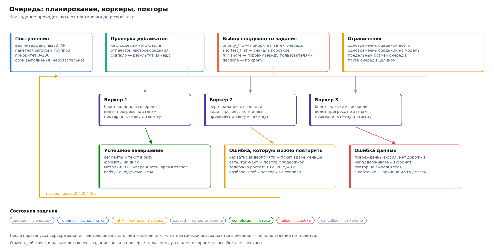

# Очередь



Очередь — то, ради чего сервер вообще нужен, если файлов больше десятка. Она переживает перезапуск, сама справляется с нехваткой памяти и позволяет запустить обработку архива на ночь, не сидя рядом.

## Состояния задания

| Состояние | Что означает |
|---|---|
| `queued` | принято, ждёт свободного воркера |
| `running` | выполняется, прогресс идёт по стадиям |
| `paused` | приостановлено вручную, место в очереди сохранено |
| `retry` | упало с восстановимой ошибкой, повтор запланирован на конкретное время |
| `completed` | готово, результаты доступны |
| `no_speech` | без речи: запись обработана, но речи в ней нет — тишина, гудки, музыка ожидания, или модель не нашла ни одного слова. Не ошибка |
| `short` | короткая запись: короче порога `audio_min_duration_s` (по умолчанию 2 с) или пустой файл. Не распознаётся. Не ошибка |
| `failed` | исчерпаны повторы или ошибка невосстановимая |
| `cancelled` | отменено пользователем |

`no_speech` и `short` — итоги, а не отказы. В ошибки, в долю отказов, в плитку «Ошибок» очереди и в кнопку «Повторить неудавшиеся» они не входят, повторов и перехода на резервную модель у них нет. Причина лежит в тех же полях, что у отказа (`error_code` — `no_speech` или `audio_too_short`, `error_message`, `error_hint`), но интерфейс показывает её как пояснение, а не как ошибку. Распознать такую запись заново можно, как и любую завершённую: например, понизив порог детектора речи или порог короткой записи. Отбор `status=empty` в списке заданий — обе категории разом.

Переход в `retry` — не то же самое, что `failed`. Ошибки делятся на восстановимые (`retryable=true`: нехватка памяти, таймаут, недоступность модели, переполнение диска) и невосстановимые (неподдерживаемый формат, файл без звуковой дорожки, неизвестная модель). Повторять второе бессмысленно, и сервер этого не делает.

## Приоритеты и порядок

Приоритет — число от 0 до 100, по умолчанию 50; больше значит раньше. При постановке значение вне этих пределов приводится к ближайшему краю; «наверх» и «вниз» в очереди — это приоритет 100 и 0. При равном приоритете работает порядок поступления.

```bash
curl -X POST http://сервер:8080/api/jobs/job_ab12/priority \
  -H "X-API-Key: ключ" -H "Content-Type: application/json" \
  -d '{"priority": 95}'

curl -X POST http://сервер:8080/api/jobs/job_ab12/top -H "X-API-Key: ключ"
```

В интерфейсе — кнопками ▲ и ▼ в строке задания раздела «Очередь»: приоритет 100 и 0. Произвольное значение задаётся только через API.

## Политики планирования

Параметр `scheduling_policy` определяет, какое из ждущих заданий берётся следующим.

| Политика | Правило | Когда выбирать |
|---|---|---|
| `priority_fifo` | приоритет, при равенстве — кто раньше пришёл | **умолчание**, предсказуемо и понятно |
| `shortest_first` | сначала самая короткая запись | много мелких файлов вперемешку с многочасовыми: средняя задержка падает в разы |
| `deadline` | сначала задания с ближайшим сроком | есть договорные сроки на выдачу результата |
| `fair_share` | круговое обслуживание владельцев | сервер общий, и один пользователь не должен занимать его целиком |

**Срок выполнения** для политики `deadline` задаётся полем формы `deadline` при постановке (`POST /api/jobs`, `/api/jobs/batch`): секунды эпохи, время ISO-8601 (`2026-11-01T18:00:00+03:00`, без пояса — местное) или «через сколько» — `+30` (минут), `30m`, `2h`, `1d`. У ждущего задания срок меняется (или снимается пустым значением) запросом `POST /api/jobs/{id}/deadline` с телом `{"deadline": "2h"}`. Раньше входа для срока не было вовсе: поле формы отвергалось как неизвестное, и политика всегда работала как `priority_fifo`. Задания без срока идут после заданий со сроком, между собой — по приоритету.

**Справедливое разделение** берёт задание того владельца, у кого сейчас меньше всего идущих, а при равенстве — кого обслуживали давнее всех; внутри владельца — по приоритету и времени постановки. Раньше второго правила не было, и при одном воркере политика была обычной очередью: отдел, поставивший пятьсот записей, держал одинокую запись соседа до конца своих. Кандидаты отбираются по нескольку старших заданий каждого владельца, а не верхом общей очереди, поэтому от `scheduling_window` политика больше не зависит.

**Старение приоритета** (`priority_aging_minutes`, при `priority_fifo`): каждые столько минут ожидания задание получает к приоритету единицу, так что архив с приоритетом 0 не ждёт сутками за потоком срочных. Ноль — выключено (умолчание). Состарившиеся задания попадают в выборку планировщика, даже если по приоритету они за пределами окна `scheduling_window`.

**Сорванные сроки видны.** Карточка задания со сроком показывает его и пометку «сорван» (`deadline_missed` в ответе API); метрики `asrhub_deadline_overdue` (в очереди с прошедшим сроком) и `asrhub_deadline_missed_day` (завершено позже срока за сутки) идут со встроенными тревогами.

> **Рекомендация.** `shortest_first` — самая недооценённая настройка на общем сервере. Пятиминутная планёрка, поставленная за трёхчасовой конференцией, при `priority_fifo` ждёт три часа; при `shortest_first` — минуту. Обратная сторона: длинные записи могут ждать неограниченно долго, если поток коротких не прекращается.

## Параллельность

`max_concurrent_jobs` — сколько заданий выполняется одновременно. Меняется на ходу:

```bash
curl -X POST http://сервер:8080/api/queue/concurrency \
  -H "X-API-Key: ключ" -H "Content-Type: application/json" -d '{"workers": 3}'
```

Как выбрать значение:

- **На видеокарте** параллельность почти не ускоряет: вычисления и так загружают устройство. Ставьте 1–2. Второй воркер помогает лишь тем, что подготовка звука одного задания идёт, пока другое считается.
- **На процессоре** ориентируйтесь на число физических ядер, поделённое на `cpu_threads` одного задания. Восемь ядер и `cpu_threads=4` → два воркера.
- **Память** — жёсткое ограничение. Каждый воркер держит свою копию модели, если модели разные. Три воркера с large-v3 на видеокарте с 12 ГБ не поместятся.

⚠️ Больше воркеров, чем помещается в память, — это не «немного медленнее», это гарантированные ошибки нехватки памяти под нагрузкой. Начните с 1, поднимайте по одному, наблюдая за графиком памяти в разделе «Сервер».

**Одна модель — один экземпляр.** Движок модели общий для всех воркеров и работает под своим замком: два воркера на одной модели считают по очереди. Второй воркер, взяв задание, ждёт модель — задание в это время показывает стадию «ожидание модели», и это время записывается в ожидание очереди (`queue_time_s`), а не в обработку (`processing_time_s`). Раньше оно входило в обработку и завышало «самые медленные задания» и длительность в метриках — ровно там, где решают, добавлять ли воркеров. Если стадия «ожидание модели» видна постоянно, второй воркер на этой модели не даёт ничего: разведите задания по разным моделям или оставьте один воркер.

**Сколько ждать.** `GET /api/queue` отдаёт `pending_audio_s` — звук всех ждущих заданий — и `eta_s` — оценку времени до опустошения очереди: звук каждой модели умножается на её среднюю скорость (RTF по истории; у модели без истории — средняя по остальным) и делится на число воркеров. Раньше оценка считалась по первым 500 заданиям очереди и одной средней скорости: на очереди в 3000 заданий ожидание занижалось вшестеро. Флаг `paused` берётся из общей базы — на сервере без воркеров (`--no-queue`) он показывает паузу, поставленную соседом.

## Повторы и защита от нехватки памяти

При восстановимой ошибке задание планируется на повтор с экспоненциальной задержкой: `retry_backoff_s × 2^номер_попытки`, умноженной на случайный множитель от 0,75 до 1,25 — чтобы одновременно упавшие задания не бросились повторяться в одну секунду.

Отдельно обрабатывается нехватка памяти на устройстве: перед повтором размер пакета делится на `oom_retry_batch_divisor` (по умолчанию 2). Пакет из 16 становится 8, потом 4, потом 2. Обычно этого достаточно, чтобы задание прошло, — вместо того чтобы уронить весь ночной прогон.

```yaml
max_retries: 3
retry_backoff_s: 10
oom_retry_batch_divisor: 2
```

## Дедупликация

При `deduplicate_jobs: true` (умолчание) сервер считает хеш содержимого файла и хеш набора настроек. Если такое сочетание уже обрабатывалось, результат возвращается из кеша мгновенно, без повторного распознавания.

Это спасает при повторной отправке того же архива и при отладке интеграции. Файл с тем же содержимым, но другими настройками, дедупликацией не считается одинаковым — меняете `beam_size`, получаете честный новый прогон. Настройки, от которых расшифровка не зависит (приоритет, повторы, адрес уведомления, «удалять исходник»), и параметры сервера в сравнении не участвуют: раньше смена ключа языковой модели или адреса АТС сбрасывала кеш целиком.

Кеш **свой у каждого владельца**. Общий на всех кеш говорил одному пользователю, что такую же запись уже присылал другой (задание готово мгновенно, стадия «из кеша»), а файлы результата приезжали под именем первого загрузившего. Теперь чужие задания в поиске не участвуют, а файлы копии переименовываются под своё задание. Содержимое файла сравнивается целиком (для файлов больше 128 МБ — начало, конец и 64 пробы из середины): прежний хеш по первому и последнему мегабайту путал две короткие записи звонков одной длины с одинаковым приветствием автоответчика.

## Групповая обработка

Файлы можно отправить одной группой — у пакета появится общий `group_id`:

```bash
curl -X POST http://сервер:8080/api/jobs/batch \
  -H "X-API-Key: ключ" \
  -F "files=@1.mp3" -F "files=@2.mp3" -F "files=@3.mp3" \
  -F 'settings={"model":"gigaam-v3-ctc"}'
```

По `group_id` фильтруется список заданий — `GET /api/jobs?group_id=…`; результаты забираются по каждому заданию. Консольный клиент отправляет каталог одной командой:

```bash
asrctl send-dir ./архив --recursive --pattern '*.mp3' --formats txt,json --priority 30
```

> **Рекомендация.** Ставьте массовым заданиям приоритет ниже стандартного (20–30). Тогда ночной прогон архива не помешает человеку, которому нужна одна расшифровка прямо сейчас.

## Управление очередью целиком

Эти четыре команды — для ключа администратора: они действуют на очередь всего сервера, и обычному ключу сервер отвечает `403`.

```bash
curl -X POST http://сервер:8080/api/queue/pause        -H "X-API-Key: ключ"
curl -X POST http://сервер:8080/api/queue/resume       -H "X-API-Key: ключ"
curl -X POST http://сервер:8080/api/queue/clear        -H "X-API-Key: ключ"
curl -X POST http://сервер:8080/api/queue/retry-failed -H "X-API-Key: ключ"
```

Пауза не трогает уже выполняющиеся задания — они доработают до конца, новые в работу не берутся. Это правильный способ подготовиться к перезапуску сервера: поставить на паузу, дождаться опустошения списка выполняемых, перезапустить.

Пауза хранится в базе: она переживает перезапуск и действует на все серверы над общей базой (каждый перечитывает её раз в две секунды). Раньше она жила в памяти одного процесса — перезапуск снимал её молча, а «Приостановить» через балансировщик останавливало один сервер из нескольких.

«Отменить все ожидающие» проходит очередь порциями, пока в ней что-то есть, и отвечает числом действительно отменённых (`{"cancelled": N}`): раньше отменялись первые десять тысяч, а в ответе было число выбранных, включая успевшие завершиться. Так же отменяется группа.

«Повторить все неудавшиеся» не обрывается на задании, которое повторить нельзя (запись удалена уборкой или АТС): ответ — `{"requeued": N, "failed": [{"id", "error"}]}`, как у пакетных действий. Раньше первый такой отказ отвечал 400, часть заданий уже стояла в очереди, остальные не трогались.

## Что происходит при перезапуске

Задания живут в SQLite, а не в памяти процесса, поэтому перезапуск ничего не теряет. Два случая различаются.

**Штатная остановка** (`systemctl restart`, обновление): идущие задания прерываются на ближайшей проверке и возвращаются в очередь **без траты попытки** — в журнале задания событие `requeued`. Задание, сидящее внутри долгого вызова движка, возвращается, когда истечёт ожидание остановки. После запуска оно досчитывается с начала.

**Задание без исполнителя.** Если запись исхода не удалась (диск полон, база занята дольше тайм-аута) или поток воркера умер, задание осталось бы «выполняется» за этим сервером до перезапуска. Служебный цикл раз в 20 секунд сверяет свои `running` с тем, что сервер действительно считает, и возвращает лишние в очередь без траты попытки (событие `requeued`); умерший поток воркера поднимается заново. Остановка возвращает и такие задания.

**Падение процесса** (нехватка памяти, сбой библиотеки движка): задание остаётся в состоянии `running`, и при следующем запуске сервер возвращает его в очередь, **засчитывая попытку** (событие `recovered`, «попытка N из M»). Когда попытки кончаются, задание снимается с ошибкой `instance_lost`: запись, на которой процесс падает сам, раньше крутилась по кругу бесконечно — перезапуск, снова первым, снова падение, — без единой записи об ошибке.

Пока задание идёт, сервер раз в 30 секунд отмечает в базе, что оно живо. На общей базе нескольких серверов по этой отметке соседи отличают живое задание от брошенного; раньше отметка ставилась только вместе с прогрессом, и задание на долгом шаге без прогресса (ожидание модели, подготовка многочасовой записи) сосед забирал себе и считал второй раз. Отмена, пришедшая на соседний сервер, останавливает задание и у того, кто его считает. Доклады прогресса пишутся в базу не чаще раза в секунду (смена стадии — сразу); полоса в интерфейсе обновляется по-прежнему с каждым докладом.

Сервер, замерший дольше отметки жизни и «оживший», когда задание уже досчитал сосед, ничего чужого не трогает: реплики пишутся одной транзакцией с отметкой «готово» и тем же условием «задание всё ещё за мной», а рабочий каталог у каждого сервера свой (`<задание>.<экземпляр>`). Раньше такой экземпляр стирал реплики готового задания соседа и его рабочий каталог.

Повтор готового задания («Распознать заново»), который отменили в последний миг или сняли с `instance_lost`, возвращает прежний результат — как и обычная неудача повтора.

**Рабочие каталоги заданий** заводятся в `temp_dir` (по умолчанию `<данные>/tmp`). Раньше параметр на них не действовал, и при каталоге данных на сетевом диске многогигабайтные подготовленные записи писались туда. Брошенное (каталоги заданий умершего процесса, выгрузки DOCX, приём записей по ссылке, черновики) убирается при запуске и часовой уборкой — старше суток и только по своим именам: `temp_dir` бывает общим системным каталогом.

Файлы загрузок и результаты лежат в каталоге данных и переживают перезапуск и обновление.

## Оповещения по webhook

У задания может быть адрес, на который сервер отправит результат по завершении:

```bash
curl -X POST http://сервер:8080/api/jobs \
  -H "X-API-Key: ключ" \
  -F "file=@запись.mp3" \
  -F "webhook_url=https://ваш-сервис/готово"
```

POST с JSON приходит и при успехе, и при ошибке, и при итогах без расшифровки. У записи без речи и у короткой поле `error` пустое, а пояснение лежит в поле `reason`: приёмник, который считает отказы по `error`, не запишет их в отказы. Задание, принятое по схеме phone_asr (`/process-call`), получает в обратном вызове `status: success` с пустым диалогом — так ответил бы на тишину и сам phone_asr. Если задан секрет (`webhook_secret`), в заголовке `X-ASRHub-Signature` передаётся HMAC-SHA256 от тела запроса — по нему принимающая сторона убеждается, что запрос действительно от вашего сервера. Недоступность вашего приёмника не влияет на само задание.

Заголовки уведомления:

| Заголовок | Что в нём |
|---|---|
| `X-ASRHub-Delivery` | номер доставки: `<id задания>.<время завершения, мс>` (id не латиницей — в кодировке адреса, `%D0%BD…`) — один на все попытки одного исхода и новый у исхода после повтора задания. По нему приёмник отбрасывает повторную доставку |
| `X-ASRHub-Event` | `job.completed`, `job.failed`, `job.no_speech`… — состояние задания |
| `X-ASRHub-Attempt` | номер попытки этого захода доставки |
| `X-ASRHub-Timestamp` | время отправки, секунды эпохи |
| `X-ASRHub-Signature-256` | `sha256=` + HMAC-SHA256 от `<Timestamp>.<тело>` секретом `webhook_secret` |
| `X-ASRHub-Signature` | HMAC-SHA256 от тела — прежняя подпись, для совместимости |

Подпись со временем защищает от повтора перехваченного уведомления: проверяйте `X-ASRHub-Signature-256` и отбрасывайте запросы, чьё время отличается от вашего больше чем на пять минут.

```python
import hashlib, hmac, time

def проверить(заголовки, тело: bytes, секрет: bytes) -> bool:
    момент = заголовки["X-ASRHub-Timestamp"]
    if abs(time.time() - int(момент)) > 300:
        return False
    ожидаемая = "sha256=" + hmac.new(секрет, момент.encode() + b"." + тело,
                                     hashlib.sha256).hexdigest()
    return hmac.compare_digest(ожидаемая, заголовки["X-ASRHub-Signature-256"])
```

**Уведомление — состояние задания** (`webhook_status`), а не разовая попытка:

| Значение | Что значит |
|---|---|
| `pending` | ждёт доставки; `webhook_next_at` — когда следующий заход, `webhook_attempts` — сколько заходов было |
| `sending` | доставка идёт прямо сейчас (брошенная падением процесса через 5 минут снова считается ждущей) |
| `ok:<код>` | приёмник ответил 2xx |
| `failed` | не доставлено и после последнего захода |
| `blocked` | адрес указывает во внутреннюю сеть — повторять незачем |

Заход — три быстрые попытки подряд; неудачный заход переносится на 1, 5, 15, 30 минут, 1, 3, 6, 12 и 24 часа, после этого — `failed`. Досылает служебный цикл, в том числе после перезапуска: уведомление, не дошедшее до остановки, уходит после запуска. Оно ставится в ту же запись, что и исход задания, поэтому процесс, упавший сразу после «готово», его тоже не теряет. Уведомление уходит и при снятии задания с `instance_lost`. Раньше всё укладывалось в пять попыток за пятнадцать секунд, а остановка посреди доставки, `instance_lost` или минутная недоступность приёмника означали, что результат не придёт никогда.

Перенаправление (301/302/303/307/308) сохраняет метод POST, тело и заголовки; адрес назначения проверяется так же, как исходный. Раньше urllib превращал POST в пустой GET, а ответ 200 записывался как `ok:200`.

## События в реальном времени

WebSocket на `/ws` шлёт события о заданиях. События **адресные**: о задании узнаёт его владелец и администратор, чужие задания подписчику не приходят. События очереди целиком (`queue.paused`, `queue.resumed`) получают все.

Поля лежат на верхнем уровне сообщения, рядом с `type` и временем `ts`:

```javascript
const ws = new WebSocket('ws://сервер:8080/ws?ticket=…');
ws.onmessage = (e) => {
  const event = JSON.parse(e.data);
  // event.type: job.queued, job.cached, job.started, job.progress,
  //             job.completed, job.retry, job.fallback, job.failed,
  //             job.cancelled, job.no_speech, job.short,
  //             queue.paused, queue.resumed
  if (event.type === 'job.progress') {
    console.log(event.id, event.progress, event.stage);
  }
};
```

Доля в `job.progress` только растёт: этапы идут подготовка → поиск речи → распознавание → выравнивание → диаризация → постобработка → полоса громкости → выгрузка, и прежние откаты с 0,82 на 0,80 и с 0,90 на 0,86 убраны.

На этом же канале работает интерфейс. Если WebSocket недоступен (например, прокси его не пропускает), интерфейс переходит на опрос — медленнее, но работает; настройка прокси описана в [10. Эксплуатация](10-operations.md).

## Ограничения и предохранители

| Параметр | Что делает |
|---|---|
| `max_queue_size` | сколько заданий принимается в очередь; сверх — ошибка 429. Действует сразу после изменения, без перезапуска. Глубина проверяется ещё раз под замком в момент заведения задания: сотня одновременных загрузок не проходит мимо предела |
| `job_timeout_s` | распознавание, идущее дольше, прерывается (ошибка `job_timeout`, без автоповтора: повтор с теми же настройками упрётся в тот же предел). Текст, который движок уже вернул, тайм-аут не выбрасывает. Ожидание модели, занятой соседним заданием, в срок не входит. Срок проверяется между фрагментами: движок, считающий файл одним вызовом, до его конца не прерывается |
| `max_upload_mb` | предел размера файла |
| `audio_max_duration_s` | предел длительности записи |
| `audio_min_duration_s` | порог короткой записи: короче — итог `short` без распознавания (не ошибка); ноль — короткими остаются только пустые файлы |
| `rate_limit_per_minute` | запросов в минуту с одного ключа |
| `disk_min_free_gb` | ниже этого порога новые задания не принимаются |

Последний предохранитель важнее, чем кажется: заполненный диск — самая частая причина, по которой сервер распознавания перестаёт работать ночью. Лучше отказать в приёме, чем потерять уже посчитанные результаты.

Задание не может ослабить эти пределы для себя. Свои `job_timeout_s` и `max_retries` у задания могут быть только меньше серверных; параметры самого сервера — очередь, каталоги, языковая модель, телефония, CRM, копии, доступ — заданием не переопределяются вовсе и в карточке задания не показываются.
