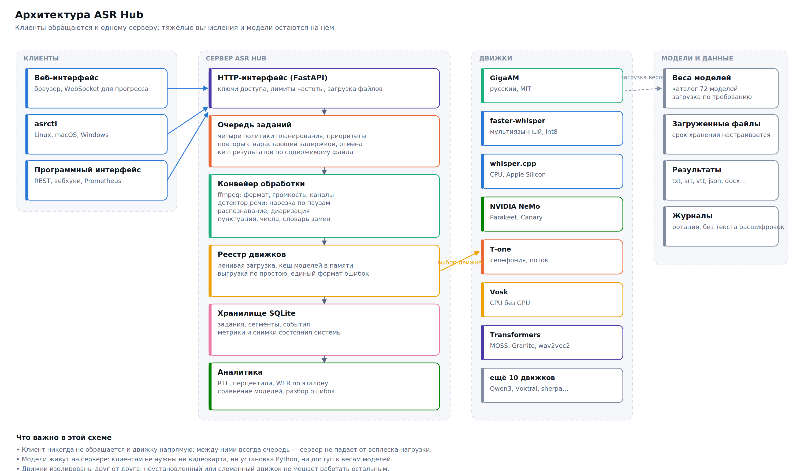
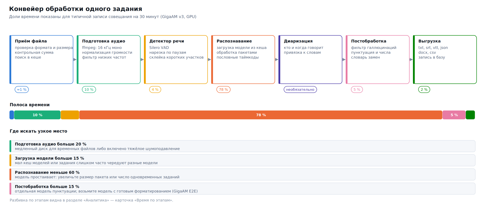
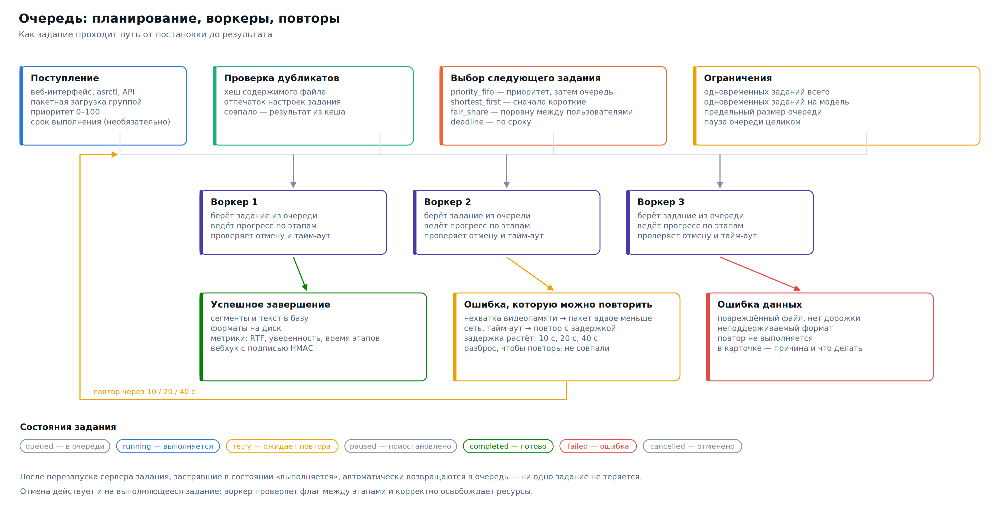
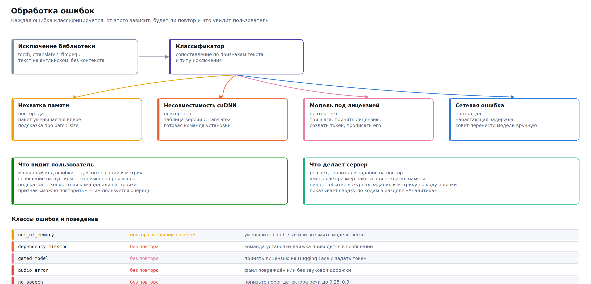
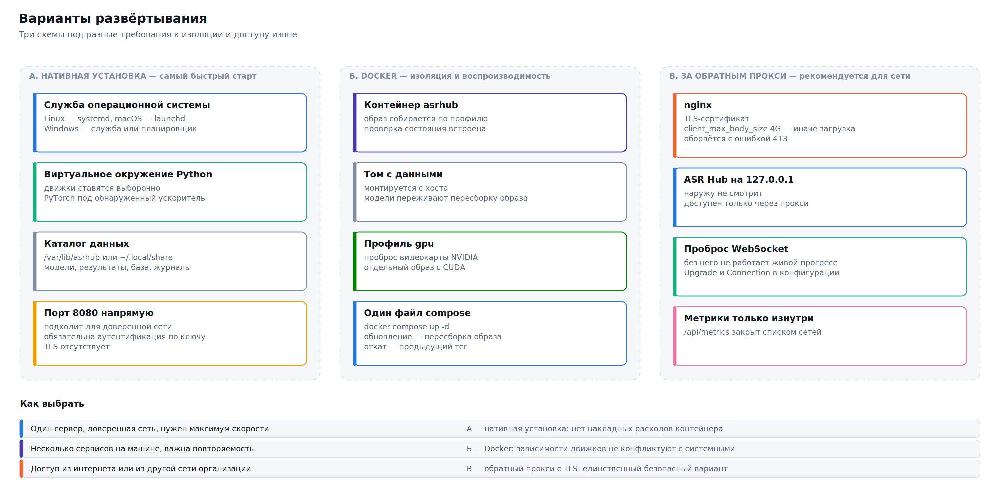

# Архитектура

## Общее устройство



Четыре слоя, каждый со своей задачей:

**Клиенты** — браузер, консольный `asrctl`, любая программа по HTTP. Все ходят через один и тот же интерфейс: веб-приложение не пользуется никакими привилегированными путями, поэтому всё, что можно сделать мышью, можно сделать и из скрипта.

**Слой API** — FastAPI: маршруты, аутентификация по ключам, ограничение частоты, WebSocket для событий. Здесь же превращение исключений в типизированные ошибки с подсказками.

**Ядро** — очередь заданий, реестр движков с кешем моделей, конвейер обработки, аналитика. Работает независимо от HTTP: тот же код можно вызвать из скрипта.

**Хранилище** — SQLite для заданий, метрик и событий; файловая система для загрузок, результатов и весов моделей.

## Раскладка кода

Пакет `server/asrhub` — по области на модуль или подпакет. Большие области разложены на примеси: класс один, файлов несколько.

| Где | Что |
|---|---|
| `api/` | сборка приложения (`app.py`), лента событий (`event_hub.py`), прослойки (`middleware.py`), веб-сокеты (`routes_ws.py`), маршруты по разделам (`routes_*.py`), вход и роли (`deps.py`) |
| `job_queue.py` | очередь: постановка, управление, выбор следующего задания; примеси — рабочий цикл (`job_queue_worker.py`), фоновое обслуживание (`job_queue_upkeep.py`), уведомления (`job_queue_notify.py`); состояния — `job_status.py`, процесс на воркер — `worker_process.py`, выход наружу — `outbound.py` |
| `db.py` | база: схема, миграции, соединения, экземпляры над общей базой, задания; примеси по областям — звонки и события станций (`db_telephony.py`), разбор содержания (`db_content.py`), языковая модель (`db_llm.py`), сотрудники, агенты и CRM (`db_people.py`), оценка разговоров и журнал доступа (`db_audit.py`), уборка и обслуживание (`db_maintenance.py`); общее — `db_util.py` |
| `engines/`, `pipeline/`, `processor.py`, `streaming.py` | движки распознавания, шаги конвейера, обработка одного задания, распознавание на лету |
| `catalog/` | модели, параметры (`params/` — по файлу на группу) и пресеты |
| `content/`, `content_index.py`, `topics.py` | разбор содержания записи правилами и словарями, фоновый проход по архиву |
| `llm/` | языковая модель: клиент, очередь и фоновый поток, задачи разбора, золотой набор, вопрос к архиву, поиск по смыслу, тренажёр |
| `telephony/` | Asterisk: журналы и AMI (`asterisk.py`), импорт (`importer.py`), станции, диалплан, события очередей и переводов, отрезки участников (`segments.py`), живые разговоры (`audiosocket.py`), сверка и разбор забора |
| `qc/` | обратный звонок с опросом: телефон SIP, шифрование звука, синтез, служба, модель автоответчика |
| `monitoring/` | метрики, пробы, тревоги, выгрузки и приёмники |
| `analytics.py`, `trends.py`, `drill.py`, `voice_period.py`, `voice_problems.py`, `insights.py` | отчёты: своды, ряды, раскрытие числа в список, голосовая аналитика за период |
| `accounts.py`, `ldap_auth.py`, `audit.py` | учётные записи, LDAP, журнал доступа |
| `backup.py`, `maintenance.py`, `selfcheck.py`, `doctor.py` | копии и восстановление, уборка, автодиагностика |
| `web/` | веб-интерфейс: `index.html`, `app.js`, `charts.js`, стили |

Прежние имена после разбора больших файлов работают: `job_queue` и `db` отдают всё, что из них вынесено. Подменять в проверках нужно там, где код живёт сейчас (глава [34](34-development.md)).

## Конвейер обработки



Задание проходит семь стадий, и время каждой записывается отдельно:

1. **Подготовка звука** — распознавание формата, извлечение дорожки из видео, приведение к 16 кГц моно, нормализация громкости, фильтры. Всё делается ffmpeg; без него принимаются только готовые WAV.
2. **Детектор речи (VAD)** — разметка на речь и тишину, нарезка на фрагменты допустимой длины. Отсюда берётся основное ускорение и главная защита от галлюцинаций. Движки со своей нарезкой по речи (GigaAM, faster-whisper, whisper.cpp, Voxtral, NeMo, WhisperX) режут сами; остальным конвейер подаёт участки речи кусками до 30 секунд (не длиннее предела модели) и сдвигает таймкоды обратно, так что параметры группы VAD действуют для всех движков. Если выбранный детектор недоступен и сработал запасной, в предупреждениях задания сказано, какой.
3. **Распознавание** — движок получает фрагменты и возвращает сегменты с текстом, таймкодами и уверенностью.
4. **Диаризация** — кто говорит в каждый момент. Может выполняться до, после или вместо распознавания в зависимости от выбранного механизма.
5. **Постобработка** — фильтр галлюцинаций, удаление слов-паразитов, пунктуация, нормализация чисел и дат, словарь замен, склейка коротких сегментов, разбиение на абзацы.
6. **Метрики** — RTF, уверенность, число слов и сегментов; при наличии эталона — WER, CER и разбор ошибок.
7. **Выгрузка** — девять форматов из одного внутреннего представления.

Каждая стадия деградирует по отдельности. Нет ffmpeg — работают только WAV, остальное отказывает с внятным сообщением. Нет silero — VAD переключается на встроенный энергетический. Нет python-docx — выгрузка в Word заменяется Markdown. Система не превращается в «всё или ничего»: недостающая часть отключает свою функцию, а не сервер.

## Реестр движков

Семнадцать движков подключены через один интерфейс: `load()`, `transcribe()`, `unload()`, `is_available()`. Различия библиотек — разные имена параметров, разные форматы результата, разные способы падать — спрятаны в адаптерах.

Ключевое свойство: **движки изолированы**. Импорт тяжёлых библиотек происходит внутри метода загрузки, а не на старте сервера. Отсутствие NeMo не мешает работать GigaAM; сломанная установка одного движка не роняет остальные. Раздел «Сервер» показывает по каждому движку, доступен ли он и почему нет.

Модели кешируются с вытеснением по давности использования и выгружаются после простоя. Компромисс здесь прямой: держать модель загруженной — тратить память, выгружать — тратить по 5–40 секунд на каждую повторную загрузку.

## Очередь



Очередь построена на пуле потоков и базе как источнике истины. Задание существует в SQLite; поток лишь исполняет его. Отсюда свойства:

- **Переживает перезапуск.** Задания в состоянии `running` при старте возвращаются в очередь.
- **Наблюдаема.** Состояние очереди — обычный SQL-запрос, а не содержимое памяти процесса.
- **Не теряет историю.** Завершённые задания остаются с метриками и лентой событий.

Четыре политики планирования, автоматические повторы с экспоненциальной задержкой, уменьшение пакета при нехватке памяти, дедупликация по содержимому — подробно в [06. Очередь](06-queue.md).

## Обработка ошибок



Исключение из любой библиотеки проходит через `classify_exception()`, который распознаёт его по типу и тексту и превращает в типизированную ошибку ASR Hub. У каждой есть код, HTTP-статус, признак «имеет ли смысл повторять» и подсказка.

Подсказка — не украшение. «Недостаточно памяти» без продолжения бесполезно; «уменьшите batch_size или выберите модель полегче, задание будет повторено автоматически с меньшим пакетом» говорит, что делать. Для рассогласования CUDA и cuDNN подсказка содержит таблицу совместимости версий — потому что это самая частая и самая непрозрачная ошибка при установке.

Признак `retryable` управляет поведением очереди: восстановимые ошибки повторяются, невосстановимые — нет. Повторять «в файле нет звуковой дорожки» бессмысленно.

## Каталог как единственный источник истины

Модели, параметры и пресеты описаны один раз, в `server/asrhub/catalog/`. Оттуда их берут:

- сервер — для проверки значений и выбора умолчаний;
- веб-интерфейс — через `GET /api/params`, вместе с описаниями и примерами;
- эта документация — разделы [03](03-models.md), [04](04-parameters.md) и [13](13-presets.md) генерируются скриптом `docs/generate.py`.

Поэтому документация не расходится с кодом: добавленный параметр появляется и в интерфейсе, и в справочнике вместе со своим описанием, рекомендацией и примерами. Тест проверяет, что у каждого параметра есть описание и хотя бы один пример.

## Хранилище

SQLite в режиме WAL, соединение на поток. Схема версионируется и мигрирует при обновлении.

| Таблица | Что хранит |
|---|---|
| `jobs` | задания: параметры, статус, времена по стадиям, метрики, текст; у записей с эталоном — счётчики ошибок по словам (для срезов, складываемых по словам) и корзины калибровки |
| `segments` | сегменты с таймкодами, говорящими и уверенностью |
| `events` | лента событий по заданиям и серверу |
| `metrics` | точечные измерения для аналитики; здесь же — задержка потоковых сессий, которые заданий не оставляют |
| `model_stats` | накопленная статистика по моделям |
| `system_samples` | замеры загрузки процессора, памяти, видеокарты, диска |
| `api_keys` | ключи доступа с ролями и лимитами |
| `benchmarks` | результаты сравнительных прогонов |
| `kv` | служебные значения |
| `content` | разбор содержания записи: свод колонками, подробности одним полем |
| `content_terms`, `content_vocab` | основы слов записей — знаменатель TF-IDF и подписи тем |
| `content_hits` | совпадения категорий обращений: по строке на пару «запись — категория» |
| `content_marks` | отметки руководителя: «разобрано» в очереди коучинга, «эталон» — переживают пересчёт разбора |
| `review_queue` | очередь ручной проверки: причина отбора, исход, кто проверял |
| `model_checks` | контрольные прогоны второй моделью: расхождение двух расшифровок одной записи |
| `llm_results` | ответы языковой модели по записи: резюме, причина, исход, действия, трекеры, скоркарта — с версией подсказок |
| `llm_cache` | ответы модели по отпечатку подсказки: та же запись с теми же вопросами второй раз не спрашивается |
| `calls` | звонки с АТС: номера, направление, очередь, оператор, итог и связь с заданием; идентификатор звонка первичным ключом — один звонок не заводится дважды |
| `segments_fts` | полнотекстовый указатель по репликам (если сборка SQLite умеет FTS5) |
| `agent_segments` | отрезки записи по участникам разговора с переводом: кто сколько звучал, слова, тональность (разрезы по сотрудникам) |
| `call_transfers`, `bridge_events` | события перевода и входы каналов в мост — по ним строятся окна участников; имён каналов и номеров вне станции в них нет |
| `queue_events` | события очередей станции (`queue_log`): вход, ответ, уход, пропуск оператором |
| `employees` | справочник сотрудников: карточка, отдел, внутренние номера, источник импорта |
| `agents` | агенты на станциях: кто, откуда, версия, счётчики и команда на следующий заход |
| `qc_surveys`, `qc_stoplist` | опросы контроля качества (ответы, оценка, запись) и список «не звонить» |
| `qc_amd_labels` | разметка записей опросов для модели автоответчика: метка и признаки первых секунд |
| `qa_reviews` | оценка разговора руководителем рядом с оценкой автомата |
| `llm_queue` | очередь запросов к языковой модели: что ждёт, что идёт, чем кончилось |
| `llm_golden`, `llm_golden_runs` | золотой набор: записи с эталонными ответами и прогоны по нему |
| `llm_versions` | история версий подсказок и модели: когда и что поменялось |
| `llm_vectors` | векторы записей для поиска по смыслу |
| `users`, `sessions` | учётные записи (пароль — хешем) и сессии входа (токен — хешем) |
| `audit` | журнал доступа: кто, когда и что сделал, с цепочкой хешей; переживает удаление того, к чему относится |
| `gpu_samples` | замеры по каждой видеокарте отдельно |

Две таблицы — с широкими строками: в `jobs` лежит расшифровка, в `llm_results` — пересказ, цитаты и JSON трекеров и скоркарты, три-четыре килобайта на ответ. Счёт и отбор по коротким полям не должны поднимать такие строки с диска, поэтому с версии схемы 32 в базе есть два узких указателя (индекса), которых запросу хватает целиком:

| Указатель | Что в нём | Зачем |
|---|---|---|
| `idx_jobs_window` | `jobs(created_at DESC, id DESC, status, source, owner)` | окно заданий по времени вместе с тем, чем его обычно сужают: статус, источник и владелец проверяются по указателю, и строка задания ради них не читается |
| `idx_llm_results_brief` | `llm_results(job_id, error, reason, outcome, resolved, version, latency_ms)` | всё, чем ответы модели считают и отбирают, — рядом с номером записи и без самого ответа |

Оба создаются сами при первом запуске после обновления: на архиве в полмиллиона записей это секунды. Сам SQLite по узкому указателю ответов не идёт — первичный ключ кажется ему не хуже, — поэтому запросы просят об этом явно (`INDEXED BY`), сначала убедившись, что указатель в базе есть (`Database.has_index`): запрос с `INDEXED BY` по указателю, которого нет, — это ошибка, а не медленный запрос.

Почему SQLite, а не PostgreSQL: нагрузка на базу здесь ничтожна по сравнению с распознаванием (десятки записей в минуту против минут вычислений на задание), а отсутствие отдельной службы кратно упрощает установку и резервное копирование. ⚠️ Единственное реальное ограничение — сетевые файловые системы. Один сервер над каталогом на NFS работает; серверы на разных машинах над общим каталогом — только в режиме журнала отката (`db_journal_mode: delete`) и на хранилище с настоящими блокировками: журнал WAL держится на общей памяти одной машины и по сети не работает (глава [10. Эксплуатация](10-operations.md)).

## Тренды

Ряды по времени для всех измеримых величин собираются **одним запросом на источник**, а не запросом на показатель: шестьдесят два показателя из шести таблиц — это шесть запросов. База группирует по корзине выражением `CAST((ts - начало) / шаг AS INTEGER)` и отдаёт сырые суммы; сами показатели считаются из них уже в питоне.

Иначе не сходятся доли: доля успешных за сутки — это сумма успешных, делённая на сумму всех, а не среднее долей по часам. Разница между этими числами тем больше, чем неравномернее нагрузка, и второе всегда неправильное.

Слой без состояния: только ссылка на базу. Ничего не кешируется — запрос за месяц по всем показателям на архиве в сто тысяч записей укладывается в десятые доли секунды, а кеш пришлось бы гасить при каждом завершённом задании.

## Раскрытие числа в список

Любой раздел аналитики показывает числа, и следующий вопрос к каждому один: «какие именно?». Отвечает на него один модуль — `server/asrhub/drill.py` — и один маршрут, `GET /api/drill` (`api/routes_drill.py`), на все разделы: свод отдаёт число и своё окно, интерфейс по щелчку спрашивает список тем же окном и тем же отбором. Устроено так, чтобы список не мог ни повесить сервер, ни разойтись с числом.

- **Окно задаётся явно.** Свод считает границу периода от «сейчас» в момент запроса, а список открывают через минуту или через час. Поэтому каждый свод отдаёт свои границы (`window`), а список принимает их параметрами и сам ничего не отсчитывает.
- **Отбор — из закрытого перечня.** Из строки запроса приходит имя отбора, выражение SQL берётся из модуля, значение уходит в запрос только параметром. Выражения — те же, что у сводов: константы базы и каталогов импортируются, а не переписываются, иначе число и список считались бы по-разному.
- **Страницы — по ключу, а не по смещению.** Продолжение «после такой-то записи» идёт по индексу и стоит одинаково на первой странице и на тысячной; `OFFSET` читал бы всё пропущенное.
- **Счёт — с потолком.** «Всего» считается на первой странице и не дальше десяти тысяч.
- **У запроса есть срок.** Чтение идёт через `Database.query_bounded`: обработчик хода SQLite прерывает запрос, не уложившийся в четыре секунды, поток пула освобождается, а человек получает совет сузить период.
- **Расшифровка не читается.** Список берёт лёгкие колонки задания или звонка; колонку `jobs.text` модуль не трогает вовсе.

Условие «задание готово» записано с унарным плюсом (`+j.status`): без статистики планировщик SQLite выбирал индекс по статусу и читал все готовые задания архива, прежде чем отдать первые пятьдесят; с плюсом список идёт по индексу времени. По той же причине отборы звонков по станции, очереди, оператору и номеру записаны равенством по колонке — чтобы работали их индексы.

Список по ответам языковой модели читал широкую строку ответа у каждой записи окна, чтобы сравнить одно короткое поле, и по редкой причине за длинный период не укладывался в срок. Теперь модуль смотрит, какие колонки ответа запросу нужны (`_хватает_указателя`): если только причина, исход, «решён ли вопрос», признак сбоя и время ответа, список идёт по узкому указателю `idx_llm_results_brief` (см. «Хранилище»), не поднимая ответов. Отборам по обязательствам, трекерам и скоркарте указателя мало — там JSON из самого ответа, — и для них всё осталось как было.

Разрез по владельцу тот же, что у сводов (`scope_owner`), обезличивание для ключей с `mask_pii` маршрут делает сам. В интерфейсе это компонент `Drill` в `web/app.js`: число-кнопка несёт описание списка в атрибуте, обработчик щелчка один на весь документ, и пока число не раскрыли, к серверу не уходит ничего.

## Свод ответов языковой модели

Свод раздела «Голосовая аналитика» (`GET /api/content/llm`, `api/routes_llm.py`) собирается из двух частей, потому что цена у них разная на порядки.

**Счётная часть** — сколько записей в окне и сколько из них разобрано, сбои, причины, исходы, клетки «причина × исход», доля решённых. Всё это группы по трём коротким колонкам ответа: `Database.llm_brief` считает их по двум узким указателям — окна заданий и ответов (см. «Хранилище») — и ни одной широкой строки не поднимает. База отдаёт сырые группы; доли, порядок и подписи собирает маршрут уже в питоне. Последние разборы для таблиц раздела (`llm_recent`) берутся по времени от новых с остановкой на трёхсотой строке, а не сортировкой всех ответов окна.

**Часть по спискам** — обязательства, трекеры, скоркарта, «ответ мимо списка». Они лежат в ответе модели строками JSON, и посчитать их можно, только прочитав каждый ответ окна (`llm_details`). Из ответа берутся только эти четыре поля; пустой список не разбирается вовсе, а повторяющаяся строка JSON разбирается один раз.

Маршрут отдаёт части по отдельности (`part=fast`, `part=heavy`) или обе разом. Интерфейс рисует раздел по первой и дорисовывает вторую, передавая ей обе границы окна первой (`since`, `until`): считаться обе должны по одному окну. Так же «Голосовая аналитика за период» спрашивает вторую часть и сводку проблем на момент первой (`now` = `generated_at`): у идущего периода конец окна — «сейчас». Тем же счётом по указателям получаются покрытие в `GET /api/llm/status` и метрики `asrhub_llm_coverage` и `asrhub_llm_latency_seconds` — раньше ради них раз за разом читались все ответы суток.

Чего это не решает: часть по спискам на сотнях тысяч разборов остаётся секундами и десятками секунд — раздел её не ждёт, но плитка «Обязательств» и три вкладки появляются с этой задержкой. Чтобы и она считалась мгновенно, обязательства, трекеры и ответы скоркарты надо хранить не только строкой JSON в ответе, но и отдельными узкими строками, а это изменение схемы с пересчётом архива.

## Телефония

В основе пакета `telephony` две части: `asterisk` — разговор с самой станцией (клиент AMI только на чтение, разбор журнала CDR, поиск файла записи) и `importer` — фоновый поток, который превращает звонок в задание распознавания. Приём из диалплана (`dialplan`, маршрут `api/routes_dialplan.py`) — третья часть: станция сама присылает звонок, а решение «брать или нет» принимает тот же `Импортёр._взять`, что и для журнала; `dialplan_config` собирает готовые файлы настройки Asterisk для раздела и главы 31.

```
АТС Asterisk
  ├─ журнал CDR (Master.csv) ─┐
  ├─ события AMI (Cdr)  ──────┼→ импортёр → таблица calls → очередь заданий
  ├─ каталог записей    ──────┘      ↑              ↓
  │                           позиция чтения   поля звонка
  │                               в kv         в карточке
  └─ диалплан: Gosub → MixMonitor → обработчик отбоя
        → POST /api/telephony/dialplan/call → Импортёр._взять → calls → очередь
```

Рядом с ними: `queue_log` и `transfers` — события очередей, переводов и мостов (из AMI, журналов `queue_log` и CEL, от агента); `segments` — отрезки записи по участникам разговора с переводом; `audiosocket` — живые разговоры по протоколу AudioSocket; `reconcile` — суточная сверка «станция ↔ архив»; `diagnose` — разбор забора; `dialplan_config` — готовая настройка станции.

### Файлы вне пакета

`resources.py` находит каталоги, которые сервер раздаёт, но которые не модули Python: агент станции и сценарий отправки (`agent/`) и руководство (`docs/`). Порядок поиска — переменная (`ASRHUB_AGENT_DIR`, `ASRHUB_DOCS_DIR`), дерево программы рядом с `server/`, затем `<prefix>/share/asrhub/`, куда их кладёт колесо (`data-files` в `pyproject.toml`).

### Номер запроса

Прослойка `_НомерЗапроса` в `api/middleware.py` (там же сжатие и политика содержимого; лента событий веб-сокетов — `api/event_hub.py`, сборка приложения — `api/app.py`) берёт `X-Request-ID` запроса (или выдаёт свой), кладёт его в ответ и в переменную контекста `logging_setup.НОМЕР_ЗАПРОСА`; фильтр обработчиков журнала дописывает его полем `request_id` в каждую строку, написанную по ходу запроса, — и в потоках `asyncio.to_thread`, куда контекст переносится сам.

### Руководство в интерфейсе

`manual.py` читает главы `docs/*.md` и превращает их в HTML своей небольшой разметкой (заголовки с якорями как у GitHub, таблицы, списки, код, цитаты, картинки, ссылки между главами); весь текст экранируется, разбор главы кешируется по размеру и времени файла. `api/routes_manual.py` отдаёт оглавление, главу, Markdown, поиск и картинки под `/api/manual`; раздел «Документация» интерфейса — их клиент.

### Контроль качества

Пакет `qc` — обратный звонок клиенту с опросом ([32. Контроль качества](32-quality-control.md)). Части пакета не тянут внешних библиотек:

- `qc/sip.py` — телефон: клиент SIP поверх UDP, TCP или TLS (REGISTER, INVITE, ACK, BYE, CANCEL, аутентификация Digest MD5 и SHA-256, повторы запросов), звук RTP в G.711 (A-law и μ-law) с шагом 20 мс и приём кнопок тремя способами — события RFC 4733, SIP INFO и тон в звуке (фильтр Гёрцеля);
- `qc/srtp.py` — шифрование звука: SRTP с ключами SDES (AES-128 в режиме счётчика и подпись HMAC-SHA1); шифр — из пакета `cryptography`, если он есть, иначе свой;
- `qc/tts.py` — голос: запуск внешнего синтезатора (RHVoice, Piper, eSpeak NG или своя команда) без оболочки, приведение к 8 кГц через ffmpeg и кеш фраз в `data/qc/tts`;
- `qc/tts_service.py` — постоянная служба синтеза по образцу голоса: модель грузится один раз, а не на каждую фразу;
- `qc/amd_model.py` — модель автоответчика: признаки первых секунд звука клиента, логистическая регрессия на размеченных записях опросов;
- `qc/survey.py` — служба: фоновый поток находит новые звонки архива по отметке `qc:watermark` в `kv`, заводит строки `qc_surveys`, соблюдает часы обзвона, паузу на номер и список `qc_stoplist`, ведёт разговор по сценарию группы и считает сводку.

```
calls (архив телефонии) → отбор по группам → qc_surveys «ждёт»
     → пауза и часы обзвона → Телефон.позвонить → INVITE на станцию
     → приветствие, вопросы (TTS → G.711 → RTP), кнопки (DTMF)
     → qc_surveys: ответы и оценка → сводка /api/qc/summary
```

Служба одна на сервер: строки берутся в работу атомарной сменой состояния, и строка «звонит» старше 15 минут считается следом упавшего сервера и возвращается в очередь.

Позиция чтения журнала хранится в `kv` смещением в байтах: журнал только дописывается, и читать его целиком на каждом заходе значило бы перечитывать гигабайт ради десятка строк. Защита от повторного импорта стоит не на позиции, а на первичном ключе таблицы `calls`: потерянная позиция приводит к лишнему чтению, а не к двойным заданиям.

## Веб-интерфейс

Ванильный JavaScript без сборки, без зависимостей, без обращений в интернет. Графики нарисованы собственным кодом на SVG.

Это осознанное решение, а не экономия. Сервер распознавания часто стоит в закрытом контуре, где страница с внешним CDN просто не отрисуется, а перед обновлением никто не хочет запускать сборку. Файлы можно править прямо на сервере и увидеть результат по F5.

Обмен данными — тот же API, что доступен снаружи. Событий ждём по WebSocket, при его недоступности переходим на опрос.

## Развёртывание



Три сценария: нативная установка на выделенной машине, контейнер, локальная установка на рабочей станции. Отличаются способом изоляции, но не устройством системы.

## Границы применимости

Честно о том, чего система не делает:

- **Не кластер.** Несколько серверов над одной базой и общим каталогом данных работают: задание берёт один, события соседей видны, пауза очереди общая ([10. Эксплуатация](10-operations.md), «Несколько серверов над одной базой»). Но распределителя запросов и общего кеша моделей нет: балансировщик перед серверами — внешний, а модель каждый сервер грузит себе.
- **SQLite.** При тысячах заданий в минуту она станет узким местом. При реальной нагрузке распознавания (задания идут минутами) это далеко за горизонтом.
- **Потоковый режим ограничен** моделями, которые его поддерживают, — их 11 из 72.
- **Диаризация несовершенна.** Наложенная речь, короткие реплики и похожие голоса — известная слабость всех современных механизмов, не только использованных здесь.
