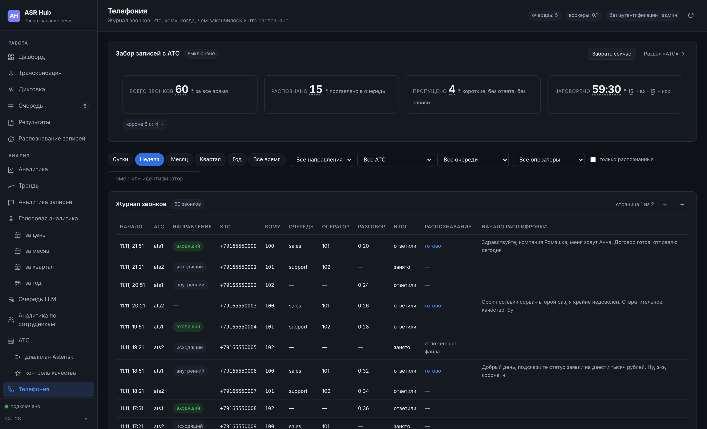
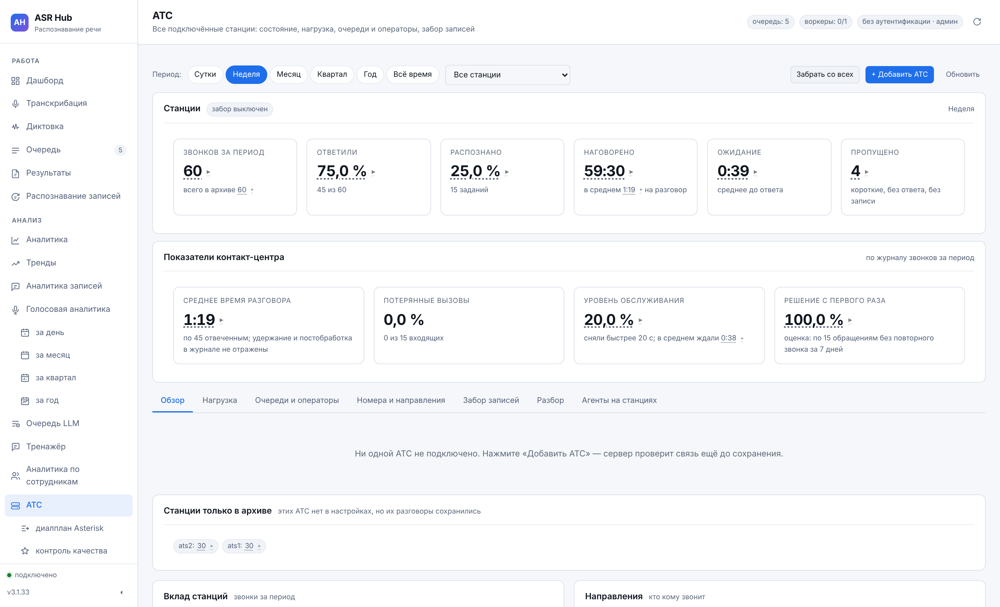

# Телефония: разговоры с АТС Asterisk



Речевая аналитика начинается не с распознавания, а с вопроса «где взять записи». Пока их носят руками, разбор охватывает те разговоры, о которых кто-то вспомнил, — то есть в основном скандальные, и выводы получаются про скандалы, а не про работу.

Здесь сервер забирает записи с Asterisk сам: каждую, со всеми полями звонка — кто звонил, кому, через какую очередь, сколько длился разговор, ответили ли. Дальше это обычное задание: очередь, распознавание, разбор содержания, смысловой слой, отчёты — но уже с разрезами по направлению, очереди и оператору.

## Несколько АТС

Станций может быть сколько угодно, и это не «две настройки вместо одной»: у каждой свой источник, свой каталог записей, свои длины внутренних номеров, свой владелец звонков и свои метки заданий. Головной офис и филиал редко настроены одинаково.

У каждой станции своя позиция чтения журнала. Общая означала бы, что вторая станция дочитывает за первой: та сдвинула позицию на три строки, вторая начинает читать свой журнал с четвёртой — и первые три её звонка не попадают в архив никогда, молча.

Идентификатор станции вычисляется из имени один раз при заведении и дальше живёт в настройке. Переименовать станцию можно: её архив останется привязан к ней. Если бы идентификатор пересчитывался из имени, переименование «Головного офиса» в «Центральный офис» сделало бы весь прежний архив ничьим — разрезы показали бы ноль звонков у живой станции и гору у станции, которой нет.

Сбой одной станции не отменяет обхода остальных: он попадает в ответ отдельной строкой со своим текстом и подсказкой. Раньше заход был один на всю телефонию, и исключение на первой же станции прекращало обход — записи живых станций ждали следующего круга, а при устойчивом сбое не приезжали никогда.

Одну станцию в один момент обходит один заход. Правка полей станции заводит новый поток, а прежний мог ещё доделывать свой заход; до 3.1.14 у каждого был свой замок, и оба брали одни и те же отложенные звонки — одна запись уезжала в распознавание двумя заданиями. Теперь замок общий на станцию. На нескольких серверах над общей базой станцию ведёт тот, кто взял её **аренду** (она живёт в базе и продлевается каждым заходом): второй сервер видит «станцию ведёт сервер такой-то» и не заходит, пока аренда не освободится или не истечёт — через десять минут после смерти держателя, а если держатель — умерший процесс этой же машины, то сразу.

**Выключить** станцию — не то же самое, что **убрать**. У выключенной сохраняются и поля, и позиция чтения: включив её обратно, сервер продолжит с того места, где остановился. Убранная исчезает из настроек, но её звонки остаются в архиве и в отчётах: разговоры прошлого года — это записи организации, а не свойство железки, которую сняли со стойки.

Две включённые станции на одном журнале CDR (или на одном каталоге у источника «каталог записей») не сохраняются: каждый звонок лёг бы в архив дважды — под двумя станциями, с двумя заданиями на одну запись. Выключенной копии можно. Поля станции проверяются и по типам: `owner_map` — объект «номер → владелец» или строка `101=sales, 102=support`, числа — числами, в адресе, учётной записи и пароле AMI не бывает перевода строки. Раньше `owner_map` строкой принимался, а падал уже разбор: раздел «АТС» отвечал 500, а после перезапуска сервер не поднимался. Общий `PUT /api/settings` и чтение `config.yaml` на запуске отвергают только то, что нельзя разобрать никак (`owner_map` без пар, `contexts` числом): на запуске такое значение заменяется пустым списком станций с красной полосой в интерфейсе, поэтому прежние вольности — один журнал у двух станций, число вне границ — там не отвергаются, их ловит раздел «АТС» при сохранении. Испорченную вручную станцию внутри списка сервер пропускает с записью в журнал, а не падает.

Пароль, присланный как `***` (так его показывает ответ) или пустым, при правке станции не меняется: клиент API, прочитавший станцию и отправивший её обратно, сохранял `***` паролем AMI.

Добавление, правка, включение и удаление станции сразу записываются в `config.yaml` — только набор станций, без того, что на странице настроек применено на пробу. До 3.1.18 набор жил в памяти процесса: «Станция добавлена», забор пошёл, а после перезапуска — хотя бы обновления — станции не было, и записи с АТС молча переставали приходить. Если записать не удалось (сервер запущен без файла конфигурации), сообщение говорит «действует до перезапуска», а ответ API — `"persisted": false` с причиной.

Удаление последней станции записывает пустой список, и он значит «станций нет»: прежняя станция из старых ключей `telephony_*` больше не воскресает. Сам выключатель `telephony_enabled` станцию не описывает — раньше галочка «Забирать записи с АТС», поставленная до заведения станций, порождала станцию «АТС» с путями по умолчанию.

Правка через общий `PUT /api/settings` (выключатель, список станций) доходит до потоков забора не позже чем через пятнадцать секунд: набор потоков сверяется с настройкой и сам, а не только из раздела «АТС». Раньше выключенный так забор продолжал ходить на станции, а включённый не заводил ни одного потока.

## Ключ звонка в архиве

У Asterisk `uniqueid` — это «эпоха.счётчик», и счётчик локален станции: он
свой у каждой АТС и сбрасывается при её перезапуске. Две станции в одну
секунду дают одинаковый идентификатор.

Поэтому ключ звонка в архиве собирается как `станция:идентификатор`, а
идентификатор, который дала станция, живёт рядом отдельным полем
(`pbx_uid`). Именно он показывается в журнале, по нему ищется файл записи
и по нему звонок узнают на самой АТС. Поиск в журнале принимает оба.

Архив, собранный до обновления, ничего не теряет: при обновлении схемы
прежние ключи переносятся в поле идентификатора станции как есть.

## Часовой пояс станции

Asterisk пишет время звонка в журнал и в событие AMI по местным часам станции — без пояса. Сервер читает его в поясе, заданном у станции полем **«Часовой пояс станции»**; пусто — в поясе самого сервера, как было всегда.

Пусто годится, пока станция и сервер живут по одним часам. Сервер в контейнере живёт по всемирному времени, и до 3.1.14 каждый звонок московской станции сдвигался на три часа: закончившийся десять минут назад звонок выглядел закончившимся через три часа, выдержка откладывала его как «ещё пишется» на все эти часы, запись по номерам не находилась в окне поиска, а отчёты, тепловые карты и сбор за период съезжали. То же с филиалом в другом поясе.

Понимается имя из базы поясов (`Europe/Moscow`, `Asia/Yekaterinburg`), `UTC` и смещение числом (`+03:00`, `UTC+5`). Смещение не знает перехода на летнее время — для России это неважно, для станций в странах с переходом пишите имя пояса. Неизвестное имя отвергается при сохранении станции. Базу поясов Python берёт у системы, а на Windows и в урезанном образе её нет — поэтому в зависимостях сервера пакет `tzdata`.

Тот же пояс действует на даты в шаблоне имени файла записи: MixMonitor называет файл по часам станции.

Если пояс не тот, это видно на вкладке «Разбор» (см. ниже): конец последнего звонка в журнале расходится со временем записи самого файла на целые часы, и проверка называет пояс, который из этого выходит.

## Проверка связи до сохранения

Кнопка «Проверить подключение» в форме станции работает **до** того, как станция сохранена. Проверка после сохранения означала бы «сначала заведите в настройках станцию неизвестно куда, а потом выясняйте, доедет ли до неё сервер»; закрытая на полпути вкладка оставляла бы в настройках полупустую АТС, которая молча пытается ходить непонятно куда.

Проверка отвечает по-разному на разные беды: «порт закрыт», «пароль не тот», «файла нет», «файл есть, но в нём ноль строк» — каждое из этих состояний чинится по-своему, и «не работает» здесь не диагноз.

Для журнала CDR проверка ещё и показывает, как сервер прочитает последние строки: идентификатор, кто, кому, направление, длительность, итог. Если направление определилось неверно — видно сразу, и поправить нужно длины внутренних номеров и контексты, а не гадать потом по отчёту.

У уже сохранённой AMI-станции форма правки не присылает пароль — интерфейс его не знает, — и до 3.1.14 проверка шла с пустым паролем: рабочая станция отвечала «АТС отклонила вход». Теперь проверка берёт сохранённый пароль — но только если адрес, порт и учётная запись в форме те же, что сохранены: иначе проверкой можно было бы отправить сохранённый пароль на любой узел.

## Несколько длин внутреннего номера

В организации, которая росла или объединялась, рядом живут трёхзначные добавочные старого офиса, четырёхзначные нового и шестизначные, совпадающие с табельными. Одна длина заставляла выбирать, чьи звонки считать правильно: при длине 3 четырёхзначные номера становились «внешними», и все разговоры между отделами уезжали в статистику как входящие с улицы.

Поэтому длина задаётся списком: `3, 4, 6`. Принимается и число, и список, и строка — настройку правят руками, и требовать ровно одного написания незачем.

## Несколько контекстов

Правила «контекст диалплана = направление» задаются списком, и **порядок в нём важен**: первое подходящее правило выигрывает, как в диалплане.

```
from-internal-out=исходящий, from-internal=внутренний
```

Контексты у Asterisk вложены по смыслу: `from-internal` попадает внутрь `from-internal-custom`, а `from-trunk-vip` — частный случай `from-trunk`. Если правила перемешать, звонок VIP-линии будет то одним направлением, то другим — в зависимости от того, как в этот раз легли ключи. Поэтому частные правила пишите выше общих.

## Четыре способа подключиться

| Источник | Что нужно | Когда выбирать |
|---|---|---|
| **Журнал CDR** (`Master.csv`) | доступ на чтение к файлу | сервер на той же машине или каталог смонтирован |
| **AMI** (события `Cdr`) | учётная запись в `manager.conf` | машины разные, монтировать нечего |
| **Каталог записей** | доступ на чтение к папке | до АТС не дотянуться вовсе |
| **Вызов из диалплана** (`dialplan`) | строки в `extensions.conf` и сценарий отправки | станция отдельно, важен оператор, ответивший в очереди, расшифровка нужна сразу |

**Вызов из диалплана** работает в обратную сторону: сервер к станции не ходит, станция сама в конце каждого разговора присылает звонок с записью (`POST /api/telephony/dialplan/call`). Поток такой станции только дозабирает отложенные записи на общем диске. Настройка для chan_pjsip и chan_sip, сценарий отправки и все поля запроса — в главе [31. Приём звонков из диалплана Asterisk](31-asterisk-dialplan.md) и в подразделе «Asterisk: диалплан» веб-интерфейса.

**Журнал CDR — путь по умолчанию.** Asterisk пишет строку на каждый завершённый разговор в обычный текстовый файл. Не нужно заводить учётную запись на станции, а значит, не появляется ещё одного пути внутрь неё. Файл читается с запомненной позиции: заход стоит столько, сколько появилось новых строк, а не сколько их всего.

Позиция — это пара «какой файл (его номер inode) и где в нём». Журнал поворачивают по расписанию, и до 3.1.14 ротация замечалась только по тому, что файл стал короче: всё, что станция дописала в старый файл между последним заходом и ротацией, терялось — при опросе раз в минуту это звонки последней минуты каждых суток. Теперь, если файл сменился, сервер сначала дочитывает хвост повёрнутого (`Master.csv.1`, `Master.csv-20260910`) с запомненного места, а потом переходит на новый файл с начала. При ротации с `copytruncate` (файл копируется и обрезается на месте, номер у него прежний) хвост дочитывается из свежей копии — по тем же смещениям, и только если запомненное место в копии совпадает с границей строки. Сжатые копии (`.gz`, `.bz2`, `.xz`) сервер не распаковывает: их хвост дочитать нечем, и тогда новый файл читается с начала, как раньше.

Позиция двигается **за каждым обработанным звонком**, а не за всей прочитанной порцией сразу. На звонок уходит доля секунды проверки, что запись дописана, порция из пятидесяти звонков — это десятки секунд, а остановка службы ждёт поток пять: до 3.1.12 перезапуск посреди захода терял необработанный остаток порции навсегда — из журнала он больше не приходил.

**Отказ очереди останавливает заход.** Если очередь распознавания полна или кончилось место, звонок откладывается — без срока, — а заход кончается: позиция журнала стоит перед необработанным, и остаток приходит следующими заходами. Свободного места в очереди нет вовсе — журнал не читается совсем. Раньше журнал читался дальше, всё уходило в отложенные «очередь отказала», а через сутки списывалось навсегда: первое подключение к архиву в сорок тысяч звонков теряло всё, что очередь не успела разобрать за день. Так же сбой базы (занята дольше `busy_timeout`, кончился диск) прерывает заход, не сдвигая позицию; раньше он считался «сбоем разбора» звонка, и порция терялась для архива.

**Сбор за период** читает журнал своей позицией и общую не трогает. До 3.1.12 он обнулял общую позицию и дочитывал журнал до конца, пропуская звонки вне окна без пометки, — и всё, до чего обычный заход ещё не дошёл, обычный заход больше не видел никогда.

**AMI** — сетевой интерфейс станции. Событие `Cdr` разовое: что станция прислала, пока сервер не был подключён, она не повторит. Поэтому, если у станции задан и **журнал CDR**, видимый серверу (общий диск или сервер на самой АТС), после каждого (пере)подключения — и при первом запуске — сервер дочитывает журнал от своей позиции до конца: звонки, завершившиеся без связи, приходят оттуда тем же ключом «станция:uniqueid», а пришедшие обоими путями не задваиваются. Пока связь цела, позиция журнала идёт следом за событиями с отставанием в один заход, чтобы следующий дочит начинался с места разрыва. Без журнала разрыв виден в состоянии станции (`ami_gap`: когда оборвалась связь и когда вернулась) и в журнале сервера с напоминанием, что звонки этого промежутка AMI не пришлёт. Поэтому всё, что уже прочитано, обрабатывается и при обрыве (раньше события, прочитанные перед «manager reload», выбрасывались), первая попытка переподключения идёт сразу, а не через минуту, событие, разрезанное паузой в сети, собирается целиком, а мёртвое соединение замечается: включена проверка живости TCP, а после двух минут тишины станции отправляется `Ping` (события, пришедшие за время ожидания ответа, не теряются). Соединение держится между заходами: вход на каждый заход это строка в журнале безопасности АТС раз в минуту и повод для подозрений у того, кто этот журнал читает. При входе сервер просит у станции только события о звонках (`Events: cdr`): поток читается пять секунд раз в минуту, и на загруженной станции события каналов, очередей и набора номера забивали буфер так, что до `Cdr` чтение не добиралось. Разбор забора входит со всеми событиями — ему нужно отличить «станция молчит» от «станция шлёт события, но не о звонках», — а проверка связи без событий вовсе.

**Каталог записей** — когда АТС недоступна. Звонком считается файл; полей у такого звонка ровно столько, сколько удалось прочитать в имени, и раздел показывает это как есть.

## Права: только чтение, и это не формальность

Клиент AMI умеет ровно шесть действий: `Login`, `Logoff`, `Ping`, `CoreSettings`, `CoreStatus`, `Events`. Всё, что меняет состояние станции — `Originate`, `Redirect`, `Command`, `Hangup`, — **не разрешено на уровне клиента** и не отправится, даже если попросить. Перевод строки в значении поля — тоже отказ: с ним пароль вида `x⏎⏎Action: Originate…` дописывал к входу второе действие в обход списка. Скомпрометированный сервер распознавания не должен уметь звонить от имени организации.

Учётную запись заводите отдельную:

```ini
[asrhub]
secret = длинный-случайный-пароль
read = cdr,call
write =
deny = 0.0.0.0/0.0.0.0
permit = 10.0.0.7/255.255.255.255      ; только адрес сервера ASR
```

Пароль AMI хранится как секрет: в ответах интерфейса и в журналах он замаскирован наравне с токенами и адресами обратного вызова.

Если станция на той же машине, AMI не нужно открывать наружу вовсе — оставьте `bindaddr=127.0.0.1` в `manager.conf`.

### AMI по сети: TLS и вход по MD5

События `Cdr` несут номера клиентов, а обычный вход в AMI передаёт пароль открытым текстом. Если станция в другой сети, у неё три поля:

| Поле станции | Что делает |
|---|---|
| «AMI по TLS» (`tls`) | соединение шифруется (`tlsenable=yes` и `tlsbindport=5039` в `manager.conf`); сертификат станции проверяется вместе с именем узла |
| «Центр сертификации AMI» (`ca_file`) | файл центра, которым подписан сертификат станции; для самоподписанного — сам этот сертификат; пусто — системные |
| «Способ входа в AMI» (`auth`) | `md5` — вход через `Challenge`: станция выдаёт вызов, сервер отвечает хешем вызова и пароля, и пароль по сети не идёт; `plain` — как раньше |

Каждое действие уходит со своим `ActionID`, и ответ берётся только с тем же номером: ответ на `Ping`, пришедший посреди потока событий, больше не путается с ответом на следующий запрос. Сокет читается фоновым потоком в буфер с пределом — между заходами станция не упирается в полный приёмный буфер TCP и не рвёт соединение как «медленного клиента».

## Как находится файл записи

Порядок поиска — от точного к приблизительному:

1. **По шаблону имени**, если он задан. Подстановки: `${UNIQUEID}`, `${SRC}`, `${DST}`, `${CLID}`, `${ACCOUNTCODE}`, `${USERFIELD}`, `${DIRECTION}`, `${QUEUE}`, `${AGENT}`, а также `${YEAR}`, `${MONTH}`, `${DAY}`, `${HOUR}`, `${MINUTE}`, `${DATE}`, `${TIME}` — и коротко `${YYYY}`, `${MM}`, `${DD}`, `${HH}` (так их показывала форма станции, а до 3.1.14 сервер их не знал, и шаблон по подсказке не находил ни одной записи). Работает и написание в фигурных скобках без доллара, и русские `{год}`, `{месяц}`, `{день}`, `{час}`, `{дата}`. Даты — по часам станции. **Звёздочка** (`*`, а также `?` и `[…]`) заменяет любую часть имени: `out-${DST}-${SRC}-${YEAR}${MONTH}${DAY}-*.wav` находит файл, у которого в имени ещё и время; из подошедших берётся ближайший по времени к началу разговора и не дальше окна подбора. До 3.1.14 звёздочка искалась буквально, хотя стояла в примере справки.
2. **По идентификатору звонка** — файл, в имени которого стоит `${UNIQUEID}`. Работает почти всегда: MixMonitor обычно зовут именно так. Идентификатор ищется **отдельным**, а не частью другого: до 3.1.14 звонок `1757500001.1` находил запись `1757500001.12.wav` — две записи в одну секунду на загруженной станции обычное дело.
3. **По паре номеров и времени** — ближайший по времени файл, в имени которого есть оба номера.

Шаблон обычно не нужен: оставьте поле пустым, и поиск по идентификатору справится. Шаблон полезен там, где в имени только номера и дата.

Близость по времени в подборе по номерам и по маске считается от **конца** разговора: время изменения файла — это конец записи. Раньше она считалась от начала, и звонку, сделанному через тридцать секунд после получасового разговора с тем же номером, доставалась запись того разговора. Файл, уже отданный другому звонку станции, в этом подборе второй раз не выдаётся. Звёздочка, `?` и `[` из номера звонящего маской не становятся: маска ли шаблон, решает сам шаблон, а значения полей в нём экранируются.

Каталог записей обходится не на каждый звонок и не на каждый заход: указатель живёт между заходами не меньше минуты и не меньше двадцати своих обходов по времени (каталог в сто тысяч файлов обходится секунды), а «Собрать весь архив» начинает со свежего обхода. Если свежему звонку запись не нашлась, обход повторяется (MixMonitor мог закрыть файл уже после обхода), но не чаще раза в полминуты.

**Записи без заголовка и две дорожки.** `.alaw`, `.ulaw` и `.sln` перед постановкой задания перекодируются в WAV (ffmpeg без подсказки формата их не читает — раньше такое задание падало), а пара `…-in` и `…-out` от `Monitor()` без сведения сводится в стерео: раньше распознавалась одна сторона разговора. Копия кладётся в каталог загрузок и живёт как файл задания; сама запись станции не трогается. Источник «каталог записей» берёт те же виды файлов, что и поиск по журналу (`.wav`, `.mp3`, `.ogg`, `.gsm`, `.alaw`, `.ulaw`, `.sln`), а пару дорожек — одним звонком.

**Номер звонящего в путь не пускается как есть.** Caller ID задаёт тот, кто звонит, и он попадает в путь, который сервер потом открывает на чтение: одного `../` в номере хватило бы, чтобы шаблон вида `${SRC}.wav` увёл поиск из каталога записей куда угодно, а расшифровка показала бы содержимое чужого файла в интерфейсе. Поэтому разделители и `..` из значений вычищаются, а найденный путь дополнительно проверяется на то, что он остался внутри каталога записей — уже после разрешения символических ссылок.

## Что не попадает в распознавание

**Слишком короткие.** Разговор в шесть секунд — это «ошиблись номером». Распознавать его незачем, а в статистике такие портят средние: сотня трёхсекундных звонков уводит среднюю длительность вниз и делает вид, что операторы стали быстрее. Порог — настройка, по умолчанию десять секунд.

**Неотвеченные.** `NO ANSWER`, `BUSY`, `FAILED` записи обычно не имеют вовсе, а если имеют — там только гудки.

**Свежие.** MixMonitor закрывает файл уже после того, как станция отчиталась о звонке, а иногда ещё и перекодирует его: запись, взятая через секунду после события, бывает обрезанной. Свежие звонки выдерживаются заданное число секунд — и от конца разговора по журналу, и от последнего изменения самого файла записи. Второе важно для источника «каталог записей»: журнала у него нет, а у WAV, который ещё пишется, в заголовке нули, и до 3.1.14 выдержка у такого файла не выполнялась вовсе. Файл, изменённый в последние десять минут, дополнительно проверяется на то, что перестал расти; старше — нет: у давнего файла мерить нечего, а сбор архива в сорок тысяч звонков тратил на эти полсекунды четыре с половиной часа.

**Пустые.** Файл нулевой длины сначала откладывается («файл ещё пуст»), а через десять минут помечается окончательно — «пустая запись»: это запись, которая не велась, и держать её в отложенных сутки незачем. До 3.1.14 пустой WAV в каталоге записей ронял весь заход по станции.

**Без записи.** Файла может не быть законно — запись не велась. Такой звонок помечается в журнале, чтобы не искать его файл на каждом заходе до скончания века. Свежему звонку (кончился меньше десяти минут назад, выдержка включена) запись ещё может приехать — rsync раз в пять минут, перекодирование после разговора, — поэтому он сначала откладывается «записи ещё нет». «Собрать весь архив» перепроверяет «нет записи» и «не дождались записи»: запись могла появиться позже.

**Отложенные.** Звонок, который нельзя взять сейчас (запись ещё пишется, очередь отказала, не задан каталог), кладётся в архив с пометкой «отложен» и разбирается следующими заходами. Срок жизни отложенного — сутки от **первого** откладывания: до 3.1.14 он считался от последнего, и каждое повторное откладывание продлевало жизнь безнадёжному звонку — он крутился по кругу вечно. Отложенный дольше суток помечается окончательно — «не дождались записи: <причина>». Отложенные из-за очереди («очередь отказала») срока не имеют: запись у них на месте, ждут они места в очереди.

Всё пропущенное **остаётся в журнале раздела и в счётчиках**: пропуск касается распознавания, а не учёта. По причинам пропуска сразу видно, что именно сломано: «нет записи ×48» и «короткий ×48» — это две разные поломки.

## Одно задание на один звонок

Идентификатор звонка — первичный ключ таблицы: повторный проход по журналу ничего не добавит, даже если позиция чтения потерялась. Это главный предохранитель раздела: импортёр, заводящий дубли, за сутки превращает архив в кашу, а очередь — в стену.

**Несколько строк CDR одного звонка.** Asterisk 12+ пишет строку на каждый Dial, попытку оператора очереди, follow-me и перевод — с одним и тем же `uniqueid`. Такие строки сводятся в один звонок: поля — от отвеченной и самой долгой по разговору ноги, время — от начала первой до конца последней. Нога, пришедшая позже (следующим заходом), сравнивается с тем, что уже в архиве: лучшая (отвеченная, дольше говорили) обновляет строку звонка, а если звонок был пропущен — разбирает его заново и ставит задание. Раньше вторая строка отбрасывалась как «уже импортирован»: «101 не ответил» ложился пропущенным «без ответа», а пять минут разговора с 102 не распознавались никогда. Та же строка, прочитанная снова, — повтор, а не новая нога.

**Ноги разговора с разными `uniqueid`** (перевод, очередь через Local-каналы) связывает `linkedid`. Сервер сохраняет `linkedid` и `sequence` из всех источников, которые их знают: журнал CDR с `newcdrcolumns=yes` в `cdr.conf` (Asterisk 12+ дописывает `peeraccount`, `linkedid`, `sequence` после `userfield`), таблица CDR в MySQL у агента (если колонки есть), вызов из диалплана (`${CDR(linkedid)}`) и событие AMI `Cdr`, если поля добавлены в `[mappings]` `cdr_manager.conf`. Карточка записи показывает остальные ноги того же разговора — кто, кому, итог, разговор — со ссылкой на их записи. Модель «разговор → ноги» в отчётах (кто из сотрудников участвовал, сколько длился перевод) — следующий шаг, см. главу [33](33-roadmap.md).

**Позиция журнала — по порядку файла.** Отложенный звонок, к которому в журнале пришла новая нога, раньше разбирался первым и уводил позицию за свою строку: если заход прерывался (очередь отказала), строки перед ней больше не читались. Теперь звонки порции разбираются в порядке файла.

## Направление, очередь, оператор

**Направление** берётся сначала из контекста диалплана: в `extensions.conf` он и заведён, чтобы отличать «звонят нам» от «звоним мы». Соответствие контекстов задаётся настройкой (`from-trunk → входящий`, `from-internal → исходящий`). Чего в ней нет — определяется по длине номера: внутренний короткий, городской длинный. Это догадка, и раздел называет её догадкой.

Направление нужнее, чем кажется: без него «средняя оценка оператора» смешивает приём заявок с холодным обзвоном, а это две разные работы с разными нормами.

**Очередь** берётся из данных приложения `Queue`, **оператор** — из имени канала: для входящего — канала назначения (`dstchannel`, «PJSIP/101-0000002a» — это 101), для исходящего и внутреннего — звонящего (`channel`); номер из канала берётся, только если похож на внутренний, иначе — номер из журнала, тоже только внутренний. Направление не определилось — оператора нет. Раньше оператором был `dst`: у звонка в очередь 500, который снял 101, оператором и ключом владельца становилась очередь, а у звонка на городской номер — сам номер. Направление, оператор и очередь записываются и пропущенным, и отложенным звонкам: раньше у пропущенных «без ответа» не было направления, и «потерянные входящие» не считались, а у звонка, прошедшего через «отложен», терялась очередь.

**Владелец записи** определяется по номеру оператора через сопоставление «номер → владелец». Разрез по владельцу — единственное, что отделяет отдел от отдела в отчётах: без него руководитель продаж видит разговоры техподдержки. Чего в сопоставлении нет, достаётся владельцу по умолчанию.

## Приоритет

Записи со станции приезжают потоком и легко вытесняют то, что человек загрузил руками и ждёт прямо сейчас. Поэтому приоритет заданий телефонии по умолчанию **ниже** ручной загрузки: 40 против 50. Поток звонков не должен заставлять человека ждать.

## Первый запуск

1. Настройки → «Телефония»: выберите источник и укажите путь к журналу и каталогу записей.
2. Нажмите **«Проверить связь»**. Проверка отвечает по-разному на «порт закрыт», «пароль не тот», «файла нет» и «файл есть, но в нём ноль строк» — каждое из этих состояний чинится по-своему. Для журнала CDR она ещё и показывает разобранные строки-образцы: видно, что поля разошлись, до того как в базу попадут звонки с чужими числами.
3. Нажмите **«Забрать сейчас»** — один заход по требованию, чтобы не ждать интервала опроса.
4. Убедитесь, что в журнале появились звонки с верными номерами и направлениями.
5. Включите **«Забирать записи с АТС»**.

Первый заход на живой АТС видит весь накопленный журнал, поэтому берёт не больше пятидесяти звонков (и не больше, чем свободно мест в очереди): без предела он поставил бы в очередь десятки тысяч заданий разом и занял бы сервер на сутки. Набранная целиком порция значит, что в журнале есть ещё, и следующий заход идёт через секунду, а не через интервал опроса. Строки старше **глубины просмотра** станции (`lookback_days`) обычный заход пропускает без поиска записи и без пометки в архиве — в своде это «старше глубины просмотра»: раньше журнал за три года шёл по пятьдесят строк в минуту, сутками, прежде чем дойти до сегодняшних звонков. Старое собирает «Собрать весь архив» — у него глубины нет.

## Программный интерфейс

```
GET  /api/telephony/status       состояние забора и счётчики звонков
POST /api/telephony/test         проверка связи с источником (администратор)
POST /api/telephony/scan         заход прямо сейчас (администратор)
GET  /api/telephony/calls        журнал с отбором
GET  /api/telephony/dimensions   очереди и операторы для отбора
POST /api/telephony/diagnose     разбор забора: почему не приходят звонки (администратор)
POST /api/telephony/collect      собрать весь архив станции или его часть (администратор)
GET  /api/telephony/collect      ход сбора (администратор)
POST /api/telephony/rewind       забыть позицию чтения журнала (администратор)
GET  /api/telephony/agents       агенты, поставленные на станции (администратор)
POST /api/telephony/dialplan/call  звонок от станции из диалплана (глава 31)
GET  /api/telephony/conversations  разговоры: ноги одного linkedid одной строкой
GET  /api/telephony/queues       ожидание и потери по журналу очередей (администратор)
POST /api/telephony/reconcile    сверить станции с архивом за вчера (администратор)
POST /api/telephony/agent/queue_log  строки журнала очередей от агента (глава 24)
POST /api/telephony/agent/cel        строки журнала CEL (события перевода) от агента
GET  /api/telephony/live         живые разговоры AudioSocket, которые идут сейчас (администратор)
```

Отбор журнала: `period`, `direction`, `queue`, `agent`, `search` (номер или идентификатор), `only_queued`, `limit`, `offset`.

Обычному ключу состояние отдаётся без адресов, путей и текста ошибки источника: по ним строится вход в телефонию организации, а не понимание своей работы. Без счётчиков потока станции и свода её последнего захода (кроме времени) тоже: они общие на станцию, а не по владельцу, и ключу отдела раскрывали объёмы чужих отделов и имя узла сервера. Свои звонки он видит в `calls`.

Станция в ответах несёт поле `timezone` — часовой пояс станции (пусто — пояс сервера). Заход по станции, которую ведёт соседний сервер над общей базой, возвращает `held_by` — кто её держит — и ничего не забирает.

`GET /api/telephony/overview`, `GET /api/telephony/status` и `GET /api/telephony/agents` несут `window` — границы `{since, until}` в секундах эпохи, по которым посчитаны их числа; у двух последних нижней границы нет (`null`): они считают за всё время. Верхняя граница — «сейчас» либо время последнего звонка плюс секунда, если оно позже: звонок с временем из будущего (часы станции спешат, пояс не задан) в своды входит, и из списка выпасть не должен. В своде раздела «АТС» точка линии нагрузки (`timeline`) несёт `until` — конец своей корзины (месяц режется календарный, а не тридцать суток), корзина длительностей (`durations`) — `from` и `to`, показатели (`kpi`) — счётчики `in_time` и `repeated` и точное окно повтора `repeat_window_s`. Список звонков по этим границам отдаёт `GET /api/drill` с основой `calls` — глава [08. Программный интерфейс](08-api.md).

## Разбор строки журнала

Строка `Master.csv` разбирается настоящим разбором CSV, а не делением по запятой: в имени звонящего запятые встречаются («Иванов, отдел продаж»), и деление по запятой сдвигало бы все поля правее — вместе с номером, длительностью и идентификатором звонка. Понимаются оба способа экранирования кавычки — удвоением, как пишет сам Asterisk, и обратной косой, как пишет часть надстроек над ним; какой из них применён, определяется по тому, похоже ли значение в поле идентификатора на идентификатор.

## Раздел «АТС»



Раздел «Телефония» отвечает на вопрос «что было в этом разговоре» — там журнал звонков. Раздел «АТС» отвечает на другой: «как живут станции». Смешать их значит получить страницу, на которой ни настройку не найти, ни звонок.

Семь вкладок:

- **Обзор** — карточка каждой станции: состояние, счётчики, линия последних суток и все действия рядом (проверить, забрать, изменить, выключить, убрать, открыть журнал). Действия именно на карточке: когда станция молчит, человек смотрит на неё, и «проверить связь» должно быть под рукой в этот момент. Ниже — вклад станций, направления и таблица «станции рядом» с одними и теми же показателями у всех: так видно, какая выпадает.
- **Нагрузка** — звонки во времени с разбивкой по направлениям, тепловая карта «день недели × час», распределение длительностей, суммы по часам и дням недели. Средняя длительность в три минуты бывает и у равномерных разговоров, и у сотни тридцатисекундных плюс десятка получасовых — это разные организации с разными проблемами, и гистограмма их различает.
- **Очереди и операторы** — кто принимает звонки, сколько разговаривает и как долго в среднем.
- **Номера и направления** — кто звонит чаще всего, кому, через какие контексты и чем заканчивается. Незнакомый контекст в списке — повод дописать правило.
- **Забор записей** — почему звонок не распознан (причина важнее счётчика: «нет записи ×48» и «короткий ×48» — две разные поломки), что доехало, и когда последний раз ходили на каждую станцию.
- **Разбор** — почему со станции не приходят звонки, по пунктам. См. ниже.
- **Агенты на станциях** — для АТС, до файлов которой сервер дотянуться не может. Готовая команда установки и список агентов: версия, последняя связь, сколько прислали, задания «собрать всё» и «новые». См. [24. Агент на станции Asterisk](24-agent.md).

Шаг линии нагрузки подбирается под период: сутки по часам, год по неделям. Иначе «за год» — это 8760 точек ради картинки шириной в 900.

### Счётчики раскрываются в звонки

«Пропущено 48» — это ещё не ответ; ответ — какие именно сорок восемь. Поэтому любое число раздела, за которым стоят звонки, по щелчку открывает их список: когда, направление, кто → кому, очередь, оператор, длительность разговора и итог. Как устроен сам список — как листается, почему не тормозит на большом журнале и почему совпадает с числом, — сказано в главе [05. Веб-интерфейс](05-web-interface.md), «Раскрытие числа в список записей».

Список здесь — **звонки, а не записи**. Звонок без записи в нём тоже есть: вместо ссылки стоит причина, по которой он не распознан («короткий», «без ответа», «нет записи»), — а у звонка с записью ссылка «Открыть» ведёт в карточку записи.

Раскрываются: плитки шапки («Звонков за период» и «всего в архиве», «Ответили», «Распознано», «Наговорено», «Ожидание», «Пропущено»), показатели контакт-центра, карточки станций и таблица «Станции рядом», столбцы «Вклада станций» и доли кольца направлений, точки линии нагрузки, клетки карты «день недели × час» и суммы по часам и дням, столбцы длительностей, очереди и операторы, номера, контексты и итоги, причины пропуска и полоса «Что доехало», счётчики заходов по станциям и «прислал N звонков» у агента.

Что при этом стоит знать:

- **Станция.** Когда свод посчитан по одной станции, список режется ею же; карточки и строки сравнения станций всегда раскрываются в свою станцию.
- **Точка линии** — звонки своей корзины времени. Крайняя корзина режется началом периода, как в самом своде: период начинается посреди часа, а корзина — с его начала.
- **Звонки без времени начала** в линию и карту не входят, а в числа «за всё время» входят; список повторяет и то и другое.
- **Ряд «без направления»** на линии — звонки, у которых направление не определено. Корзина их считала всегда, а линия не показывала; ряд рисуется, только когда такие звонки за период были.
- **Порядок.** Под «Наговорено» и средним временем разговора список идёт от самых долгих разговоров; под «Ожиданием» и «Уровнем обслуживания» — от ждавших дольше, и ожидание стоит в списке своим столбцом.
- **Не раскрываются** искра на карточке станции, счётчики вкладки «Разбор» (ход сбора живёт в памяти, строк журнала за ним нет) и пустые клетки карты.
- **Раздел сам не обновляется,** а заход за новыми звонками, запущенный при раскрытом списке, его не перерисовывает: итог захода говорит, что числа на экране прежние, и чем их обновить.

В «Телефонии» так же раскрываются числа над журналом — всего звонков, распознано, пропущено, наговорено, входящих и исходящих, причины пропуска, — все за всё время. Фишки станций остались отбором журнала: журнал под ними уже и есть список.

## Вкладка «Разбор»: почему не приходят звонки

Самый частый ответ станции — «заход прошёл, новых звонков ноль», и он же самый бесполезный: выглядит как исправная работа. Причин у него десяток, и почти все молчаливые.

Кнопка **«Разобрать забор»** проходит по ним по очереди и отвечает не «не работает», а «вот что именно не так и что с этим делать». Разбор ничего не меняет: позиция чтения журнала остаётся на месте, звонки в очередь не ставятся — он только читает.

Что проверяется:

| Проверка | Что ловит |
|---|---|
| Станция включена, поток забора | выключенная станция и не поднятый поток |
| Последний заход | сколько увидели, сколько поставили, по каким причинам пропустили |
| Журнал звонков | нет файла, нет прав на чтение, и главное — журнал, в который сутки ничего не дописали (значит, CDR пишется не сюда) |
| Позиция чтения | всё прочитано при старом файле; позиция больше размера — журнал повернули |
| Разбор строк | строки не разбираются вовсе или разбирается меньше половины: набор колонок свой; строки короче восемнадцати колонок — в `cdr.conf` выключен `loguniqueid` |
| Часовой пояс журнала | конец последнего звонка расходится со временем записи журнала на целые часы — время читается не в том поясе; называет пояс станции, который выходит из файла |
| События AMI | подключились, но `Cdr` не приходит ни одного — не загружен `cdr_manager` или у учётной записи нет права `read = cdr`; пришедшие события Cdr — образец для проверок записей и порогов |
| Каталог записей | пуст, недоступен, самый свежий файл давно не менялся |
| Записи к звонкам | по последним звонкам журнала запись не находится — обычно `MixMonitor` зовут без `${UNIQUEID}` |
| Глубина просмотра | (для источника «каталог записей») все файлы старше глубины, и забор их не видит |
| Пороги станции | порог длительности и «пропускать неотвеченные» отсекают весь образец |

У каждого пункта — состояние (в порядке, предупреждение, неисправность), то, что увидели, и подсказка. Наверху карточки — короткий вывод: первая причина, с которой стоит начать.

## Сбор архива

Обычный заход берёт порцию и уходит спать до следующего такта. На архиве в сорок тысяч звонков это недели, поэтому «поднять весь архив» кнопкой «Забрать сейчас» бессмысленно.

На вкладке «Разбор» есть три кнопки:

- **Собрать весь архив** — заходы идут подряд, пока журнал не дочитан. Звонки не задваиваются: уже импортированные пропускаются, а предел сбора (сто тысяч) считается по **новым** звонкам; остановившийся на пределе сбор следующим запуском продолжается с того же места. Раньше каждый запуск начинал с начала и вставал на том же пределе, а при отложенных звонках сбор не замечал конца журнала и крутился вхолостую. Пока очередь полна, сбор ждёт. Ход виден тут же: проходов, увидено, поставлено, пропущено и по каким причинам. По выключенной станции или при выключенном заборе сбор не начинается — с объяснением; «Забрать сейчас» работает и у выключенной.
- **Собрать за период** — то же, но только за промежуток дат. Звонки вне промежутка пропускаются молча и не помечаются в архиве: иначе «собрать за март» закрыл бы дорогу апрелю.
- **Забыть позицию чтения** — следующий заход пойдёт по журналу с начала. Нужно после подмены журнала или когда позиция уехала вперёд содержимого; звонки при этом не задваиваются.

Сбор идёт в отдельном потоке и уступает очереди: между заходами делается пауза, чтобы архив не вытеснял свежие звонки и загрузки людей.

## Когда до станции не дотянуться

Всё описанное выше работает, пока сервер распознавания видит файлы АТС. Если станция стоит за NAT, в другом городе или под чужим присмотром, помогает агент: он ставится на саму станцию и присылает звонки вместе с записями, а наружу станции не нужно открывать ни одного порта. Установка — одной командой по ssh; подробности в главе [24. Агент на станции Asterisk](24-agent.md). Если на станции можно поправить диалплан, есть путь ещё короче: станция сама присылает каждый разговор сразу после отбоя — глава [31. Приём звонков из диалплана Asterisk](31-asterisk-dialplan.md).

## Обратный звонок с опросом

Архив звонков — ещё и источник для **контроля качества**: после разговора с выбранными добавочными сервер перезванивает клиенту как обычный SIP-телефон станции, проговаривает вопросы группы и принимает оценки кнопками телефона. Настройка номера на станции, группы, тексты и отчёт — в [32. Контроль качества](32-quality-control.md). Опросу нужен добавочный ответившего сотрудника: в очередях Asterisk его надёжнее всего даёт приём из диалплана.

## Разрез по станциям в остальных разделах

Звонок помнит станцию, с которой приехал, и это поле работает везде: отбор в журнале звонков, разрез в аналитике записей, разрез в аналитике по сотрудникам. Станции, которых больше нет в настройках, но чьи звонки остались в архиве, показываются отдельно — с пометкой «только в архиве».


## Показатели контакт-центра

Всё нужное для них давно лежит в таблице звонков — не хватало только счёта.
Раздел «АТС» показывает их карточкой за выбранный период.

| Показатель | Как считается |
|---|---|
| Среднее время разговора | Сумма `billsec` по отвеченным, делённая на их число |
| Потерянные вызовы | Входящие, на которые не ответили, ко всем входящим |
| Уровень обслуживания | Доля отвеченных входящих, взятых быстрее норматива |
| Решение с первого раза | Доля обращений, после которых тот же номер не позвонил снова |

Каждое число карточки раскрывается в звонки, по которым посчитано:
«Среднее время разговора» — в отвеченные, самые долгие сверху; «Потерянные
вызовы» — во входящие без ответа; «Уровень обслуживания» — в отвеченные
входящие, снятые не позже норматива, а «в среднем ждали» под ним — во все
отвеченные входящие, ждавшие дольше — сверху; «Решение с первого раза» — в
обращения, после которых номер не перезвонил, «с повторным» — в те, после
которых перезвонил.

Чего в этих числах нет, и об этом сказано прямо в самой карточке:

**Среднее время разговора — это не полный AHT.** Настоящее «среднее время
обработки» включает ещё удержание и постобработку; ни того ни другого в
журнале CDR нет, и называть эту величину полным AHT было бы подлогом.
Постобработка (ACW) вообще не считается: журнал заканчивается на положенной
трубке, и без событий из самой CRM или панели оператора её взять неоткуда.

**Решение с первого раза — оценка, а не измерение.** Повторный звонок бывает и
по другому поводу. Зато считается без единого опроса и сразу по всему архиву.
Звонки без номера звонящего в расчёт не идут вовсе: у них нет ключа, по
которому узнают повторное обращение, и молча считать их решёнными значит
завышать показатель ровно на долю станций, которые номер не передают.

Повторный звонок ищется по всему архиву, а не внутри периода и не внутри
станции: клиент, позвонивший первого числа и перезвонивший третьего, решённым
не был — независимо от того, что отчёт запрошен по одному дню и что перезвонил
он в филиал.

**Уровень обслуживания считается от отвеченных**, а не от всех входящих:
потерянный вызов уже посчитан в «потерянных», и делить на всё входящее значило
бы внести один и тот же провал в отчёт дважды.

Ожидание берётся как разница между общей длительностью вызова и временем
разговора — столько вызов звонил, пока его не сняли. Норматив задаётся
настройкой «Уровень обслуживания: норматив ответа»; двадцать секунд — половина
классического «80 % за 20 секунд».

Период без звонков даёт прочерк, а не ноль. Ноль процентов потерянных и «не по
чему считать» — разные ответы, и пустой период, нарисованный как идеальная
работа, — это картинка, по которой принимают решения.

## Разговор из нескольких ног

Перевод с оператора на оператора в журнале — это несколько строк (ног) с общим `linkedid`. Счёт по ногам завышает и число звонков, и время каждого: один разговор с двумя переводами выглядит как три. Карточка «Разговоры и переводы» на вкладке «Очереди и операторы» сводит ноги в разговор: когда начался, кто участвовал по порядку (`101 → 205 → 310`), сколько было ног и переводов, сколько говорили в сумме и ссылка на запись одной из ног, у которой она есть. Над таблицей — сколько ног за период превратилось в сколько разговоров и какая доля из них с переводом.

`GET /api/telephony/conversations` отдаёт то же: `period` (`day`…`year`), `station`, `transferred=true` — только разговоры с переводом, `limit`. Звонок без `linkedid` — разговор из одной ноги. Обычный ключ сводит только свои ноги: чужие ноги того же разговора ему не видны.

**Кто говорил на каком отрезке записи.** Запись разговора с переводом обычно одна — на канале клиента, — и раньше вся она доставалась одному добавочному. С 3.1.37 карточка записи раскладывает её по участникам (блок «Кто говорил когда»): каждая нога с ответом — окно «от ответа до конца» на времени записи (ноль — ответ записанной ноги: MixMonitor с `b` пишет с соединения), реплика расшифровки идёт тому, в чьё окно попала её середина; в общем окне (консультация при переводе с предупреждением) — тому, кто подключился позже. По каждому участнику — сколько звучал его отрезок, доля разговора, слова и тональность; щелчок по отрезку переводит запись к нему. Обычному ключу чужие ноги видны временем, но без добавочного («другой участник»).

`GET /api/jobs/{id}/agents` отдаёт то же (`by_agent`: окна `windows`, отрезки `segments` с оценкой, итог `agents`, события перевода `transfers`); в карточке задания — поле `call.by_agent`. Точность по ногам CDR — секунды: время ног пишет станция, на границе перевода реплика может уйти соседу.

**Граница перевода по событиям AMI** (с 3.1.38). У станции с источником AMI сервер просит и события класса `call` (поле станции «События перевода», `transfers`, по умолчанию включено; учётной записи нужно `read = call,cdr`) и берёт из них два: `BlindTransfer` и `AttendedTransfer` с `Result: Success`. Момент перевода режет окна: переводивший ведёт разговор до него, принявший — с него. При переводе с предупреждением это и есть уточнение: второй оператор снимает трубку на консультации, пока клиент слушает музыку ожидания, и по CDR его окно начиналось раньше, чем клиент его слышит. Остальные события класса `call` (сотни в секунду на загруженной станции) отбрасываются при чтении. События хранятся в таблице `call_transfers` — станция, `linkedid` разговора клиента, момент, вид и добавочные «от» и «к»; номер вне станции (перевод на городской или мобильный) не хранится. Забываются вместе со звонками станции. Время — из `Timestamp` (`timestampevents = yes` в `manager.conf`), иначе момент приёма.

Станция без AMI (журнал CDR, каталог записей) отдаёт те же события **журналом CEL**: раздел «Asterisk: диалплан» собирает `cel_custom.conf` с отображением `asrhub-cel.csv` (событие, время, канал, `uniqueid`, `linkedid`, номер, `eventextra`), в `cel.conf` нужны `enable = yes` и события `BLINDTRANSFER,ATTENDEDTRANSFER`. Путь к журналу — поле станции «Журнал CEL» (`cel_file`, обычно `/var/log/asterisk/cel-custom/asrhub-cel.csv`); читается, как журнал очередей, с запомненной позиции, повёрнутый — с начала. Время CEL — секунды (по умолчанию) или по `dateformat` из `cel.conf` в поясе станции. Станция за агентом присылает тот же журнал строками (параметр агента `cel_file`, глава [24](24-agent.md)).

**Окна по мостам** (с 3.1.39) — самый точный источник. Записанный канал (на нём MixMonitor) слышит участника, только пока оба в одном мосту, поэтому окно участника — пересечение его пребывания в мосту с пребыванием там записанного канала, а ноль записи — первый вход записанного канала в мост. Сервер берёт `BridgeEnter`/`BridgeLeave` из того же потока AMI (класс `call`) или `BRIDGE_ENTER`/`BRIDGE_EXIT` из журнала CEL (раздел «Asterisk: диалплан» добавляет их в `events` файла `cel.conf`). Так узнаётся и участник очереди через `Local`-канал (`Local/101@from-queue-…;1` стоит в мосту с клиентом), и консультация при переводе с предупреждением не достаётся второму оператору: она идёт в отдельном мосту. У добавочного, о котором событий мостов нет, окна остаются по ногам CDR, а момент перевода режет окна поверх. События хранятся в таблице `bridge_events` — станция, `linkedid`, момент, вход или выход, `uniqueid` канала, мост и добавочный; имя канала, где бывает номер клиента, не хранится. У разговоров без перевода (меньше двух добавочных с разговором) события мостов удаляются через сутки, у остальных — вместе со звонками станции. Блок «Кто говорил когда» пишет, по чему построены окна (`note`, `zero` в `by_agent`).

**В разрезах по сотрудникам** (с 3.1.38). Фоновый проход раз в десять минут раскладывает записи с переводом по участникам (таблица `agent_segments`) и пересчитывает запись, когда пришла поздняя нога CDR, событие перевода или мостов. «Голосовая аналитика» (блок «По добавочным») и отчёты за период (таблица «Сотрудники») показывают столбец «С переводом»: в скольких разговорах с переводом участвовал добавочный, в скольких принял перевод, сколько звучал сам и долю отрицательных своих отрезков (глава [26](26-voice-analytics.md)). «Разговоров» по-прежнему считает запись за добавочный записанной ноги — запись одна.

## Ожидание и потери в очередях

Журнал звонков не отличает звонок, брошенный в очереди, от звонка «без ответа», и не знает, сколько клиент ждал и скольким операторам звонило, прежде чем взяли трубку. Это знает журнал очередей Asterisk — `queue_log`. Сервер берёт из него события `ENTERQUEUE`, `CONNECT`, `ABANDON`, `EXITWITHTIMEOUT`, `EXITEMPTY`, `EXITWITHKEY`, `RINGNOANSWER`, `COMPLETECALLER`, `COMPLETEAGENT`, `TRANSFER`, `RINGCANCELED`.

Источника три:

- поле станции «Журнал очередей» (`queue_log`, обычно `/var/log/asterisk/queue_log`) — если сервер видит файл; читается с запомненной позиции порциями по 4 МБ, повёрнутый журнал (другой inode или файл короче позиции) — с начала;
- агент на станции присылает строки сам (`POST /api/telephony/agent/queue_log`) — глава [24. Агент на станции Asterisk](24-agent.md);
- **события AMI** — у станции с AMI, чей `queue_log` серверу не виден: сервер просит у станции события класса `agent` вместе с `cdr` (`Events: cdr,agent`) и берёт из них `QueueCallerJoin`, `QueueCallerAbandon`, `AgentConnect`, `AgentComplete`, `AgentRingNoAnswer`. Учётной записи AMI нужно `read = cdr,call,agent`. Время события — из `Timestamp`, если в `manager.conf` включено `timestampevents = yes` (включите: иначе время — момент приёма). Виден журнал — события AMI не просятся, чтобы не считать одно дважды.

Карточка «Ожидание и потери в очередях» на вкладке «Очереди и операторы» (только администратору) по каждой очереди показывает: сколько встали, ответили, ушли без ответа и из них бросили сами, сколько в среднем ждали до ответа и сколько ждали те, кто ушёл, уровень обслуживания и сколько раз оператор не взял трубку; под таблицей — операторы, чаще других не бравшие трубку. Уровень обслуживания здесь считается как в Asterisk (`servicelevel`): доля ответивших не дольше норматива среди всех, кто дождался ответа или ушёл. `GET /api/telephony/queues` принимает `period`, `station` и `threshold_s` (норматив, по умолчанию 20 с).

События хранятся в таблице `queue_events` и забываются вместе со звонками станции.

## Живой разговор: AudioSocket

Сервер принимает звук разговора прямо во время звонка по протоколу AudioSocket (Asterisk 16.6+) и распознаёт его на лету той же сессией, что `/api/stream`. Включается портом: `audiosocket_port: 9092` и `audiosocket_host` — адрес, который видит станция (перезапуск службы). У протокола нет ни ключа, ни шифрования: открывайте порт только станции.

```ini
; Звук канала — в ASR Hub (бот, голосовое меню, запись сообщения):
exten => 555,1,Answer()
 same => n,AudioSocket(${UUID()},10.0.5.2:9092)
 same => n,Hangup()
```

Что приходит:

- по веб-сокету — события `call.live` с `uuid` разговора: `ready` (начало), `partial` (черновик фразы), `final` (закреплённая фраза), `done` (итог: весь текст и длительность). Адресат — администраторы и владелец из `audiosocket_owner`: текст живого разговора не уходит всем ключам подряд;
- в ленту событий — строка «audiosocket» с итоговым текстом разговора;
- `GET /api/telephony/live` (администратор) — какие разговоры идут сейчас: идентификатор, начало, сколько фраз и последняя.

Модель — `audiosocket_model` или модель сервера по умолчанию; лучше потоковая (Vosk, GigaAM v3, T-one). Звук станции — 8 кГц, сервер поднимает его до 16 кГц сам. Одновременных разговоров — не больше `stream_max_sessions` (16), тот же предел, что у диктовки: лишнему соединению сервер отвечает кадром ошибки и закрывает его, в журнале — строка «разговоров уже N».

Приложение `AudioSocket()` забирает звук канала себе; чтобы слушать разговор двух людей, нужен канал-«шпион». Его собирает раздел «Asterisk: диалплан» (поле «Живой разговор: приём AudioSocket»): `ChanSpy` через Local-канал отдаёт оба голоса разговора в AudioSocket — подробно в главе [31](31-asterisk-dialplan.md). Рецепт на живой станции не проверялся (глава [36. Известные ограничения](36-limitations.md)).

## Сверка «станция ↔ архив»

Самое неприятное в заборе звонков — молчаливые потери: журнал станции повернули, пока сервер лежал; сценарий диалплана не смог отправить и не дослал; каталог записей переехал. Звонки на станции есть, в архиве нет, а узнают об этом через месяц.

Раз в сутки (в суточном обслуживании, при включённом заборе) сервер сравнивает вчерашний день на станции с архивом:

| Источник станции | С чем сравнивается |
|---|---|
| Журнал CDR | число звонков в журнале (ноги сведены так же, как при заборе) против звонков в архиве |
| Диалплан, каталог записей | число файлов записей, законченных за день, против звонков архива с записью; вторая дорожка пары `Monitor()` не считается |
| AMI | не сверяется: события приходят один раз, независимого источника нет |

Расхождение больше допуска (два звонка или 2 % — звонок, начатый в 23:59, мог лечь в архив следующим днём) — событие в ленту, тревога на `alert_url` и красная фишка «сверка: потери» с пояснением в разделе «АТС». Сошлось — зелёная фишка «сверка за <день>: сошлось». Сверить прямо сейчас: `POST /api/telephony/reconcile`. Итог последней сверки отдаётся администратору в `GET /api/telephony/status` и в своде раздела полем `reconcile`.

Дослать потерянное: «Забрать со всех» с полным сбором за день — для журнала и каталога, `asrhub-dialplan --resend` на станции — для диалплана.
