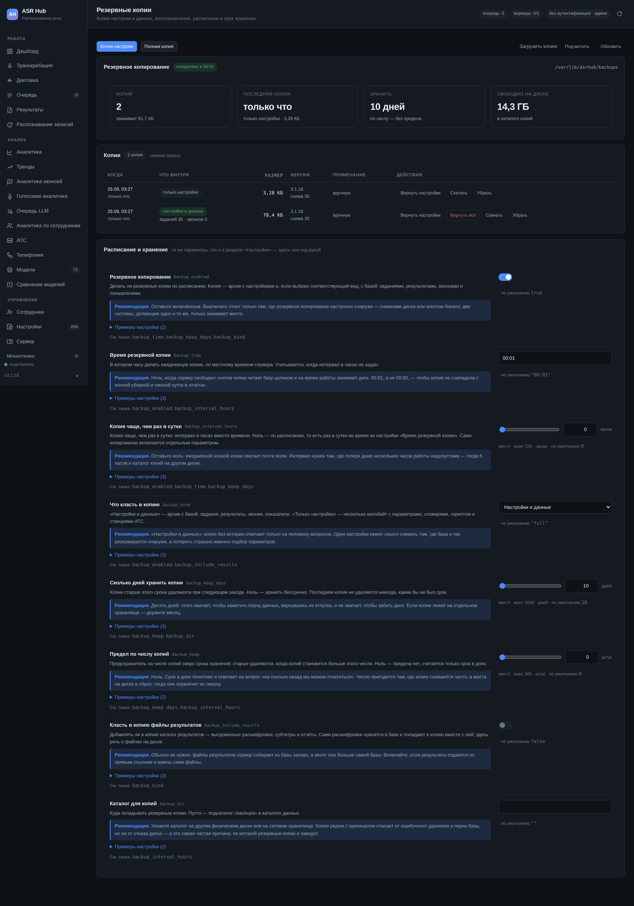

# Резервные копии и восстановление



Резервная копия нужна не тогда, когда ломается диск. Она нужна в тот день, когда кто-то поменял настройку и всё стало хуже, а как было — уже не вспомнить; когда обновление прошло не так; когда на новый сервер надо перенести то, что настраивали полгода.

Поэтому копий здесь две разновидности, и они отвечают на разные вопросы.

## Две копии

**Только настройки** — несколько килобайт: все параметры сервера, словари, категории, скрипт разговора, станции АТС, пороги мониторинга. Снимается мгновенно, переносится куда угодно, открывается любым архиватором. В ней вся работа, вложенная в подбор моделей, порогов и правил, — то, что восстановить по памяти невозможно, а потерять при переустановке проще всего.

**Настройки и данные** — то же самое плюс база: задания, расшифровки, результаты разбора, звонки, показатели, учётные записи. Весит столько же, сколько база.

Копия — это архив `.asrhub.tar.gz` с описью внутри. Опись (`manifest.json`) отвечает, откуда копия, какого она вида, какая в ней версия схемы базы и что лежит внутри. Без описи восстановление превращается в угадывание, а восстановление не из той копии — самая дорогая ошибка из возможных.

База копируется командой SQLite `.backup`, а не `cp`: в режиме WAL рядом с базой лежат файлы `-wal` и `-shm`, и обычная копия получается несогласованной — то есть выглядит как копия и ею не является.

Опись лежит в архиве **первой**, и каждый файл — ровно один раз. Раньше база попадала в архив дважды, а файлы результатов — трижды (рекурсивное добавление каталогов): копия весила вдвое-втрое больше нужного, а распаковка, складывавшая размеры всех записей, отвергала собственную исправную копию базы от 32 ГБ как «слишком велика». Старые копии с повторами восстанавливаются: предел считается по разным именам. Спутники снимка (`-wal`, `-shm`) в архив не кладутся. Список копий читает опись, не прогоняя через gzip всю базу; полная проверка, что архив не оборван, делается один раз на файл и запоминается в `.asrhub-checked.json` в каталоге копий (по размеру и времени файла) — свою только что снятую и принятую со стороны копию сервер проверяет при записи. Полная копия заранее проверяет, хватит ли места на её сборку.

В режиме журнала отката (`db_journal_mode: delete`) снимок идёт шагами под замком записи этого процесса: свои писатели ждут, а не получают «database is locked» через 30 секунд, писатели других серверов успевают между шагами.

## Расписание

По умолчанию: **каждый день в 00:01, хранить 10 дней**.

| Параметр | Значение | Что делает |
|---|---|---|
| `backup_enabled` | `true` | делать ли копии по расписанию |
| `backup_time` | `00:01` | в котором часу, по местному времени сервера |
| `backup_interval_hours` | `0` | копия чаще, чем раз в сутки; ноль — по расписанию |
| `backup_kind` | `full` | что класть: `full` или `settings` |
| `backup_keep_days` | `10` | сколько дней хранить; ноль — бессрочно |
| `backup_keep` | `0` | предохранитель на число копий; ноль — без предела |
| `backup_include_results` | `false` | класть ли файлы результатов |
| `backup_dir` | пусто | каталог копий; пусто — `backups` в каталоге данных |

Расписание проверяется по местному времени и по тому, была ли копия сегодня, а не по «прошло ли 24 часа». Пропущенный вчерашний заход догоняется: сервер, простоявший с назначенного часа до полуночи, снимает копию сразу после запуска, а не через сутки. Под арендой на снятие отметка перечитывается ещё раз, так что два сервера на общей базе не снимут две копии подряд. Сервер, постоявший выключенным полчаса, при счёте часов сдвигал бы копию каждый день, пока она не уезжала в разгар рабочего дня.

00:01, а не 00:00, — чтобы копия не совпадала с ночной уборкой и сменой суток в отчётах.

Снимок базы перед упаковкой проверяется (`PRAGMA quick_check`). «.backup» копирует страницы как есть, и база, испорченная на диске, давала такой же испорченный снимок — об этом узнавали в день восстановления. Теперь такая копия не снимается, а в журнале сервера — что рабочая база повреждена и что делать.

Отметка «копия снята» ставится только после успеха. До 3.1.16 она ставилась до попытки, и упавшая копия (полный диск, чужие права на каталог копий) повторялась только на следующие сутки: неделя сбоев — неделя без копий. Теперь повтор — через час. На общей базе копию снимает один сервер: тот, что взял аренду в базе.

**Последняя копия не удаляется никогда**, каким бы ни был срок хранения: каталог, в котором по правилам не должно остаться ни одной копии, — это не «чисто», а «резервных копий нет».

Срок, предел `backup_keep` и эта защита считаются **отдельно для копий настроек и для копий данных** (полные и копии базы прежнего образца — одна группа). Раньше предел считал все файлы подряд: при `backup_keep: 3` и трёх ночных полных копиях три «копии настроек перед правкой» удаляли все копии данных.

Прежние базы, которые восстановление оставляет рядом с рабочей (`asrhub.db.before-restore-<дата>`), видны в своде раздела (`previous_bases`) и убираются той же подчисткой по `backup_keep_days` — кроме самой свежей: это отмена последнего восстановления. Раньше они копились бессрочно, каждая размером с базу.

**Каталог копий лучше вынести на другой диск.** Копия рядом с оригиналом спасает от ошибочного удаления и порчи базы, но не от отказа диска — а это самая частая причина, по которой резервные копии и заводят.

## Вынос с сервера и шифрование

Копия на том же диске, что и база, от потери диска не спасает. Команда «после копии» (`backup_post_command`) запускается после каждой копии в фоне: `{file}` в ней заменяется путём копии — например, `rclone copy {file} backup:asrhub` или `scp -q {file} backup@10.0.0.30:/srv/asrhub/`. Задаётся она только в файле настроек или переменной `ASRHUB_BACKUP_POST_COMMAND`: запуск программы на сервере — не право администратора приложения, и из интерфейса этот параметр не меняется.

С паролем копий (`backup_password`) наружу уходит не открытый архив, а зашифрованный (`*.asrhub.tar.gz.enc`, openssl, AES-256 с PBKDF2); он удаляется после команды. Копии в каталоге копий остаются открытыми — их восстанавливает раздел. Зашифрованную копию можно загрузить обратно кнопкой «Загрузить копию» или восстановить из командной строки — она расшифровывается тем же паролем. Итог последнего выноса — строкой под шапкой раздела.

Исходные записи разговоров (`uploads`) по умолчанию в копию не входят — это самая большая часть данных. Флажок «Класть в копию исходные записи» (`backup_include_uploads`) добавляет их; без них восстановленный сервер показывает расшифровки, но не играет звук.

## Восстановление

**Настройки** применяются на ходу: значения из копии заменяют текущие, файл настроек переписывается, перезапуск не нужен. Их для того и снимают, чтобы поднять сервер как был.

**Данные** так не умеют: база открыта прямо сейчас. Подменять файл под работающим процессом нельзя — сервер продолжил бы писать в удалённый файл, и всё, что пришло после восстановления, пропало бы при перезапуске. Поэтому восстановление только **готовит** базу: копия проверяется и кладётся рядом под именем `asrhub.db.restore-pending`, а ответ говорит `restart_required: true`. Ставит её следующий запуск сервера — до того, как открыть базу. Прежняя база не удаляется, а остаётся рядом под именем `asrhub.db.before-restore-<дата>` (с её файлами `-wal` и `-shm`): восстановление не из той копии — обычная ошибка, и она обязана быть обратимой. В журнале событий запуск отмечает это событием `restore_applied`.

До 3.1.12 файл подменялся сразу, под работающим сервером. Если так восстанавливали на прежней версии и после этого сервер не перезапускали, перезапустите его и проверьте последние задания.

Целостность копии проверяется **до** того, как что-то готовить. Не хватило места на подготовку — рабочая база не тронута, и ответ говорит об этом прямо.

Порядок при «Вернуть данные»: настройки из копии читаются и проверяются → база проверяется и готовится → файлы результатов копируются → и только потом применяются настройки. Сбой после подготовки базы её подготовку снимает. Раньше настройки применялись первыми, и копия с повреждённой при переносе базой отвечала ошибкой, оставив чужие настройки — вместе со сроком хранения — применёнными и записанными. База **новее** этого сервера (по версии схемы) не восстанавливается: старый код читал бы её неверно.

**Подготовленная база видна.** Пока она ждёт перезапуска, свод раздела показывает её в `pending_restore` (когда подготовлена, сколько ждёт, почему не поставлена), самопроверка — строкой «Восстановление ждёт перезапуска». Передумали — `DELETE /api/backup/pending`. Копию, ждущую дольше 72 часов, запуск сам не ставит: за это время в рабочей базе накопилась работа. Её надо подтвердить (`POST /api/backup/pending/confirm`) или восстановить заново. Если запуск подмену отложил (соседи над базой, истёк срок), причина остаётся рядом с копией, а в журнале событий — `restore_deferred`. Раньше подготовленная база лежала до любого следующего запуска: нажали и не перезапустили — через две недели плановый перезапуск подменял базу двухнедельной копией.

«Вернуть только настройки» из полной копии распаковывает только опись и настройки, а не всю базу.

**Пути заданий** в базе абсолютные. Копию переносили на сервер с другим каталогом данных — и удаление записи (в том числе по требованию субъекта) и уборка по сроку не находили её файлов: расшифровка оставалась на диске без задания, прослушивание отвечало «файл не найден». Теперь начало путей, совпадающее с прежним каталогом данных, переписывается на нынешний; прежний берётся из описи копии, а у копии прежнего образца угадывается по самим путям (`<данные>/results/<номер задания>`). Записи из архива станции лежат вне каталога данных и остаются как есть; разделитель приводится к здешнему — копия с Windows приезжает с «\\». Ответ называет, сколько путей переписано (`paths_rewritten`) и откуда (`from_data_dir`).

**Соседи.** Над общей базой бывает несколько серверов, а подмену ставит запуск того, где нажали «Вернуть данные»: соседи держат прежний файл открытым и продолжили бы писать в него. Поэтому при живом соседе восстановление данных отказывает, а уже подготовленная подмена откладывается до запуска без соседей — с ошибкой в журнале сервера. Отметка остановленного сервера гаснет за пять минут; штатная остановка снимает её сразу.

Копия распаковывается в каталог временных файлов сервера (`temp_dir`, по умолчанию `<данные>/tmp`), а не в системный `/tmp`: на многих системах это tmpfs, то есть память, и полная копия ложилась в неё целиком — рядом с моделями.

**Из командной строки** (`sudo bash scripts/service.sh restore --from копия`) — копия базы `*.db` или архив `*.asrhub.tar.gz`, который снимает расписание (до 3.1.16 архив отвергался как «не похож на базу»); из архива берётся база, настройки возвращаются в разделе «Копии». Путь тот же, что у восстановления из интерфейса, только подмена ставится сразу: проверка копии, пути под этот каталог данных, прежняя база рядом вместе со своим журналом — под именем `…before-restore-<дата>-wal`, по которому SQLite его найдёт. Восстановление останавливает службу этой установки по имени и не идёт дальше, если она не остановилась, а при живых соседях над базой отказывает. Скрипт обычно запускают через sudo, а служба работает от своего пользователя — поэтому восстановленная база и каталог копий отдаются владельцу каталога данных. До 3.1.12 они оставались root: служба открывала базу только на чтение («attempt to write a readonly database» на первом же задании), а копии по расписанию переставали сниматься.

Копии закрыты от посторонних: каталог копий — 0700, каждая копия — 0600. В копии вся база разговоров, ключи доступа и токены.

Параметры, которых нет в каталоге этой версии, пропускаются молча: в копии со старого сервера они есть, а смысла у них здесь нет, и падать из-за них — значит сделать копию бесполезной после каждого обновления.

## Перенос на другой сервер

1. На старом: «Копия настроек» → «Скачать».
2. На новом: «Загрузить копию» → выбрать файл.
3. «Вернуть настройки» на загруженной копии.

Присланный архив проверяется до того, как попасть в список: файл без описи, с описью не того вида или оборванный в список не попадает, иначе его однажды выберут для восстановления. Загрузка копии ограничена не `max_upload_mb` (это предел для звука), а пределом распаковки — 64 ГБ: раньше перенос архивом больше 2 ГБ получал 413 с советом «разбейте файл на части». Имена внутри архива проверяются тоже — путь вида `../../etc` не кладёт файл мимо каталога, а общий размер распаковки ограничен.

Файл базы (`*.db`) принимается под именем `asrhub-…`: список, восстановление, удаление и подчистка видят только такие, и присланная «prod-2026-09-01.db» получала «принято», а в списке не появлялась — ни восстановить, ни удалить, и лежала в каталоге копий вечно. Заодно файл проверяется: база ли это, цела ли и есть ли в ней задания. Загрузка идёт в отдельном потоке: запись копии в гигабайты прежде шла в цикле событий и останавливала весь сервер. Черновик у каждой загрузки свой — две загрузки одного файла в одну секунду больше не пишут в один.

## Что внутри копии настроек

Секреты входят в копию как есть: пароли к АТС, ключи доступа, токены. Копия настроек, из которой сервер не поднимается без ручного ввода паролей, решает не ту задачу, ради которой её снимают.

**Из этого следует, что архив надо хранить как пароль.** Скачивание копии и её загрузка — действия администратора; обычный ключ доступа их не получает. Скачивание копии всегда попадает в журнал доступа, даже без `audit_reads`.

## Через программный интерфейс

```bash
# Список копий и состояние расписания
curl -H "X-API-Key: $KEY" http://localhost:8081/api/backup

# Снять копию прямо сейчас
curl -X POST -H "X-API-Key: $KEY" \
     "http://localhost:8081/api/backup?kind=settings" \
     -H 'content-type: application/json' -d '{"comment":"перед обновлением"}'

# Вернуть настройки из копии
curl -X POST -H "X-API-Key: $KEY" http://localhost:8081/api/backup/restore \
     -H 'content-type: application/json' \
     -d '{"name":"asrhub-20260911-000100-settings-srv.asrhub.tar.gz","what":"settings"}'

# Скачать копию
curl -H "X-API-Key: $KEY" -O -J \
     "http://localhost:8081/api/backup/<имя>/file"

# Или обычной ссылкой — с одноразовым билетом вместо ключа в адресе
TICKET=$(curl -s -X POST -H "X-API-Key: $KEY" http://localhost:8081/api/auth/ticket \
         | python3 -c 'import json,sys; print(json.load(sys.stdin)["ticket"])')
curl -O -J "http://localhost:8081/api/backup/<имя>/file?ticket=$TICKET"
```

Так же скачивает копию и интерфейс: файл бывает в гигабайты, и выкачивать его в память вкладки ради заголовка с ключом нельзя. Билет действует минуту и один раз; повторный переход по той же ссылке отвечает 401 «ссылка устарела». Вошедшему логином и паролем билет не нужен — его сессию несёт кука.

## Проверка копии

Копия, которую никто не пробовал восстановить, — это предположение о копии. Раз в квартал стоит поднять сервер из полной копии на любой свободной машине и убедиться, что он поднимается: пять минут работы против дня, в который выясняется, что копии были пустыми.

Проверить содержимое можно и не восстанавливая:

```bash
tar tzf asrhub-20260911-000100-full-srv.asrhub.tar.gz
tar xzf asrhub-20260911-000100-full-srv.asrhub.tar.gz -O manifest.json | python3 -m json.tool
sqlite3 /tmp/проверка/db/asrhub.db "PRAGMA integrity_check;"
```
