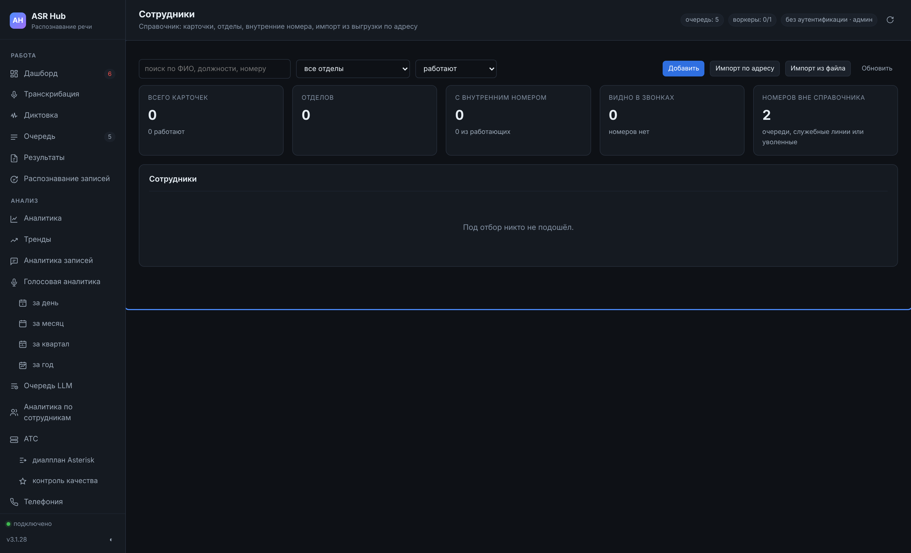

# Справочник сотрудников

## Зачем он нужен

Звонок знает внутренний номер — «457». Отчёт нужен по человеку: «Абдрахманова, отдел проектных продаж». Без справочника в аналитике по операторам стоят номера, отделов нет вовсе, а на вопрос «как работал отдел продаж в сентябре» ответить нечем.

Справочник — это таблица людей с внутренними номерами. По номеру звонок находит человека, по человеку — отдел и должность. Заводить карточки можно руками, но обычно они уже есть в кадровой системе или на внутреннем портале — тогда справочник забирается выгрузкой по адресу и обновляется сам.

Раздел — **«Сотрудники»** в меню «Управление». Не путать с «Аналитикой по сотрудникам»: там показатели работы, здесь — сами карточки.



## Карточка

| Поле | Зачем |
|---|---|
| Фамилия, имя, отчество | как человек называется в отчётах |
| Должность | разрез «менеджеры против руководителей групп» |
| Отдел | главный разрез аналитики: отдел — то, чем управляют |
| Внутренний номер | **ключевое поле**: по нему звонок находит человека |
| Рабочий телефон | городской номер, если он отдельный |
| Мобильный | приводится к виду `+7XXXXXXXXXX` |
| Электропочта | для сводок и выгрузок |
| Поставщики | кто с кем работает; поле из выгрузки заказчика, произвольный текст |
| Работает / Работает до | уволенные не исчезают, а помечаются |
| Примечание | что угодно, написанное руками. Импорт его не затирает |

Наверху раздела — пять чисел: всего карточек, отделов, сколько людей с внутренними номерами, сколько этих номеров встречается в журнале звонков и сколько номеров из журнала в справочнике не нашлось.

## Руками

Кнопка **«Добавить»**, форма, «Сохранить». Карточка заводится с источником «ручной» — и это не косметика: импорт справочника работает внутри своего источника и помечает уволенными только тех, кого он сам когда-то завёл. Карточка, заведённая руками, при первом же обновлении справочника иначе исчезла бы из штата.

Правка — кнопка «Правка» в строке. Удаление — крестик; звонки этого номера остаются в архиве: они привязаны к номеру, а не к карточке.

**Тёзки.** Карточка, заведённая руками, узнаётся по внутреннему номеру, а без номера — по ФИО. До 3.1.14 второй «Иванов Пётр» без номера молча сливался с первым: карточка первого переписывалась полями второго, и в справочнике оставался один человек из двух. Теперь тот же человек — это тот же номер **и** то же ФИО: такую карточку «Добавить» правит, как раньше. Полный тёзка без номера или другой человек на том же номере (общий телефон) получает свою карточку, а сохранение предупреждает: «Карточка „…“ с тем же ФИО (внутренним номером) уже есть — заведена вторая. Если это один человек, удалите лишнюю».

## Импорт

Четыре формата, тип определяется по содержимому, а не по расширению:

**Excel XML 2003 (SpreadsheetML)** — то, что отдают внутренние порталы и старый Excel; часто лежит с расширением `.xls`. Разбирается по заголовкам, а не по порядку колонок. Учтено всё, обо что обычно спотыкаются: необъявленные пространства имён `ss:`, пустые ячейки, атрибут `ss:Index`, который перескакивает через пустые колонки (без его учёта поля съезжают влево, и импорт «успешно» портит справочник), числа и даты. Разбор запрещает `<!DOCTYPE>` — это закрывает и внешние сущности, и «миллиард смешков».

**Книга Excel 2007+ (.xlsx)** — тот же разбор по заголовкам: первый лист, на котором заголовки узнаются. Число в ячейке («101.0» — Excel решил, что номер это число) становится целым. Дату («работает до») Excel хранит числом дней, а датой её делает формат ячейки — по нему она и узнаётся и ложится в карточку как ГГГГ-ММ-ДД, а не числом «45807». Распакованная книга не должна быть больше 64 МБ — иначе это не справочник, а «zip-бомба». Старый двоичный формат `.xls` (до 2007 года) не читается — сервер так и говорит и советует пересохранить файл как `.xlsx`, «Таблица XML 2003» или CSV. Книга под паролем тоже не читается, и ответ называет именно это: сначала снять пароль. Повреждённая книга (оборванная загрузка, испорченный архив) — отказ с понятной причиной, а не ошибка сервера.

**CSV** — разделитель определяется сам (запятая, точка с запятой, табуляция), кодировки `utf-8`, `utf-8-sig`, `cp1251`. В замечаниях импорта пишется, что именно распознано, — на случай кракозябр.

Один чужой байт кодировку не решает. Выгрузка в UTF-8 с одним тире из cp1251, вставленным руками, раньше целиком читалась как cp1251: все фамилии импортировались кракозябрами и по ключу внутреннего номера затирали настоящие карточки. Теперь, если правильных знаков UTF-8 в файле намного больше битых, он читается как UTF-8, битые знаки заменяются, а замечание говорит сколько: «кодировка utf-8 (с потерями: 1 знак.)». Настоящий cp1251 читается как прежде. То же для JSON.

**JSON** — список объектов с русскими или английскими ключами.

### Какие заголовки понимаются

| Поле | Заголовки |
|---|---|
| Фамилия | фамилия, last_name, lastname, surname, family name |
| Имя | имя, first_name, firstname, given name, name |
| Отчество | отчество, middle_name, patronymic, second_name |
| Должность | должность, position, title, job, job_title, role |
| Отдел | отдел, подразделение, department, dept, division, unit |
| Рабочий | тел. рабочий, телефон рабочий, рабочий, work, work_phone, телефон |
| Внутренний | тел. внутренний, внутренний, внутренний номер, добавочный, extension, ext, internal |
| Мобильный | тел. мобильный, мобильный, сотовый, mobile, cell, cellphone |
| Почта | электропочта, эл. почта, почта, email, e-mail, mail |
| Поставщики | поставщики, поставщик, suppliers, vendors |
| Работает | работает, активен, active, статус, status, enabled |
| Работает до | работает до, active_until, до, увольнение |

Регистр и лишние пробелы не важны. **Неизвестные колонки не теряются**: они складываются в примечание строкой «колонка: значение».

### Что делается со значениями

* **«Работает»**: `да`, `yes`, `+`, `1`, `активен` — работает; `нет`, `no`, `-`, `уволен` — нет. Пустое значение означает «колонку не заполнили», и уволенным такого человека не считают.
* **Разметка HTML** в любой ячейке снимается: выгрузка портала приносит отдел как «Отдел продаж &lt;span&gt;(МСК)&lt;/span&gt; &amp;nbsp; &lt;a href=…&gt; >> База знаний << &lt;/a&gt;». Ссылка уходит целиком, с подписью, от остальных тегов остаётся текст, `&nbsp;` становится пробелом: «Отдел продаж (МСК)». До 3.1.24 теги оставались в отделе — в карточке, в фильтре отделов и в отчётах, и «Отдел продаж (МСК)», набранный руками, был другим отделом. Повторный импорт той же выгрузки исправляет уже заведённые карточки.
* **Телефоны**: вычищаются пробелы, скобки, дефисы и точки. Мобильный приводится к `+7XXXXXXXXXX`, если это российский номер (`8XXXXXXXXXX` и `7XXXXXXXXXX` тоже).
* **Внутренний номер** — только цифры: «доб. 1043», «1043 (склад)» и «1043.0» дают «1043». Если в ячейке общий номер и личный — «137 (лич.149)», — берётся личный, `149`: звонок узнаёт человека по нему, а общий звонит у нескольких столов сразу. Общий номер уходит в примечание: «общий внутренний: 137». До 3.1.24 цифры склеивались в «137149», которого нет ни на одной станции. Два номера без пометки («101, 102») — берётся первый.
* **Почта**: обрезается, приводится к нижнему регистру, проверяется на «похоже на адрес».
* **ФИО**: схлопываются двойные пробелы, `ё` не трогается.

Ошибка в одной строке не роняет импорт: строка пропускается, а замечание с её номером попадает в список, который показывается после загрузки. Итог импорта называет и число пропущенных строк, и причины («нет фамилии и имени» — сколько раз); до 3.1.18 о пропущенных строках интерфейс не говорил ничего.

Список в разделе по умолчанию показывает работающих — так и подписан отбор; до 3.1.18 подпись «работают» стояла, а в списке были и уволенные.

### Откуда берётся выгрузка

**По адресу.** Кнопка «Импорт по адресу» берёт адрес из настройки `employees_url`. Скачивание — только `http` и `https`, с тайм-аутом, ограничением размера и запретом переходов на `file://` и `ftp://` (в том числе при перенаправлении). Сначала выгрузка разбирается пробным прогоном; если по ней кого-то отметят уволенным, интерфейс называет их число и спрашивает подтверждение — оборванная выгрузка или выгрузка одного отдела иначе молча «увольняла» остальных. Длинный справочник листается кнопкой «Показать ещё» по пятьсот карточек.

**Файлом.** Кнопка «Импорт из файла» — тот же разбор, но для разового случая, и с предпросмотром. Окно импорта принимает файл выбором или перетаскиванием (`.xml`, `.xls`, `.xlsx`, `.csv`, `.json`, `.txt`) и сразу разбирает его, **ничего не записывая**:

- плитки — сколько строк в файле и в каком формате, сколько карточек добавится, обновится и останется без изменений, сколько отметится уволенными, сколько строк пропущено и почему;
- «Как легли колонки» — каждая колонка файла и поле карточки, куда она ляжет; неузнанные помечены «в примечание»;
- раскрывающиеся перечни: кто добавится, у кого какие поля изменятся, кто будет отмечен уволенным (по полсотни имён), и замечания разбора;
- первые восемь карточек из файла — ФИО, должность, отдел, внутренний, мобильный, почта, «работает».

Флажок «Отметить уволенными тех, кого нет в файле» (по умолчанию — как настройка `employees_deactivate_missing`) пересчитывает предпросмотр сразу. Кнопка «Импортировать» записывает ровно то, что показано, и выводит итог. До 3.1.24 файл импортировался сразу по выбору, без предпросмотра, а узнать, что колонка не узналась, можно было только по пустым полям у сотен карточек.

В API предпросмотр — поле формы (или тела, или параметр адреса) `dry_run=true` у `POST /api/employees/import`: ответ тот же, что у импорта, плюс `dry_run`, `columns` (колонка → поле), `sample` (первые карточки) и `changes` (перечни `added`, `updated` с изменёнными полями, `deactivated`); в базу ничего не пишется. Перечни `changes` есть и в ответе настоящего импорта.

### Закрытый портал и каталог LDAP

**Портал с авторизацией.** Если кадровый портал отдаёт выгрузку только с ключом, впишите заголовок целиком в `employees_auth_header` — `Authorization: Bearer …`, `X-Api-Key: …`. Он хранится как секрет (в ответах интерфейса замаскирован) и уходит только на сам адрес выгрузки: при перенаправлении на другой узел заголовок не передаётся.

**Каталог LDAP / Active Directory.** `employees_url: ldap` — справочник берётся из того же каталога, что и вход по LDAP (`auth_ldap_url`, `auth_ldap_base_dn`, глава [29. Доступ](29-access.md)). Учётная запись для чтения — `employees_ldap_bind_dn` и `employees_ldap_password` (пусто — анонимно). Отбор по умолчанию — люди с телефоном: `(&(objectCategory=person)(objectClass=user)(|(ipPhone=*)(telephoneNumber=*)))`; свой — в `employees_ldap_filter`. Поля карточки берутся из атрибутов:

| Атрибут каталога | Поле карточки |
|---|---|
| `sn`, `givenName`, `middleName` (нет — `displayName`) | ФИО |
| `title` | должность |
| `department` | отдел |
| `ipPhone` | внутренний номер |
| `telephoneNumber`, `mobile`, `mail` | рабочий, мобильный, почта |
| `userAccountControl` (бит «отключена») | «работает» |

Дальше — обычный разбор той же выгрузки: предпросмотр, «отметить уволенными», обновление по расписанию.

### Пример выгрузки

```xml
<?xml version="1.0"?>
<?mso-application progid="Excel.Sheet"?>
<Workbook xmlns:ss="urn:schemas-microsoft-com:office:spreadsheet">
 <Worksheet ss:Name="Vodokomfort employees">
  <Table>
   <Row>
    <Cell><Data ss:Type="String">работает</Data></Cell>
    <Cell><Data ss:Type="String">работает до</Data></Cell>
    <Cell><Data ss:Type="String">фамилия</Data></Cell>
    <Cell><Data ss:Type="String">имя</Data></Cell>
    <Cell><Data ss:Type="String">отчество</Data></Cell>
    <Cell><Data ss:Type="String">должность</Data></Cell>
    <Cell><Data ss:Type="String">отдел</Data></Cell>
    <Cell><Data ss:Type="String">тел. рабочий</Data></Cell>
    <Cell><Data ss:Type="String">тел. внутренний</Data></Cell>
    <Cell><Data ss:Type="String">тел. мобильный</Data></Cell>
    <Cell><Data ss:Type="String">электропочта</Data></Cell>
    <Cell><Data ss:Type="String">поставщики</Data></Cell>
   </Row>
   <Row>
    <Cell><Data ss:Type="String">да</Data></Cell>
    <Cell><Data ss:Type="String"/></Cell>
    <Cell><Data ss:Type="String">Абдрахманова</Data></Cell>
    <Cell><Data ss:Type="String">Лилия</Data></Cell>
    <Cell><Data ss:Type="String">Рифатовна</Data></Cell>
    <Cell><Data ss:Type="String">Менеджер проектных продаж</Data></Cell>
    <Cell><Data ss:Type="String">Отдел проектных продаж <span>(ЧЛБ)</span></Data></Cell>
    <Cell><Data ss:Type="String"/></Cell>
    <Cell><Data ss:Type="String">457</Data></Cell>
    <Cell><Data ss:Type="String">+7-951-772-66-95</Data></Cell>
    <Cell><Data ss:Type="String">l.abdrakhmanova@vodokomfort.ru</Data></Cell>
    <Cell><Data ss:Type="String"/></Cell>
   </Row>
  </Table>
 </Worksheet>
</Workbook>
```

## Обновление по расписанию

| Параметр | По умолчанию | Что делает |
|---|---|---|
| Адрес выгрузки справочника (`employees_url`) | пусто | Откуда забирать: адрес выгрузки или `ldap` — из каталога (см. ниже) |
| Заголовок авторизации выгрузки (`employees_auth_header`) | пусто | Заголовок к запросу выгрузки, если портал её закрывает: `Authorization: Bearer …` или `X-Api-Key: …`. Хранится как секрет |
| Учётная запись каталога (`employees_ldap_bind_dn`), её пароль (`employees_ldap_password`), отбор (`employees_ldap_filter`) | пусто | Для `employees_url: ldap` |
| Обновлять по расписанию (`employees_sync_enabled`) | нет | Включает автоматическое обновление |
| Как часто (`employees_sync_hours`) | 24 ч | Раз в сутки достаточно: кадровые изменения не идут потоком |
| Помечать пропавших уволенными (`employees_deactivate_missing`) | да | См. ниже |
| Связывать звонки по внутреннему номеру (`employees_match_ext`) | да | Выключать имеет смысл только там, где номера в справочнике и на станции заведомо разные |

Обновление идёт в потоке фоновых работ и его не роняет: сбой попадает в журнал и в ленту событий, а следующая попытка будет по расписанию. Первое обновление происходит не сразу после включения, а через интервал — для «прямо сейчас» есть кнопка.

## Почему пропавшие не удаляются

Человек уволился — его карточка помечается неработающей, но остаётся. Удалить её нельзя: по ней есть звонки, и удаление превратило бы половину архива в разговоры неизвестно с кем. Это ещё и честнее: человек ушёл, а разговоры остались, и отчёт за прошлый квартал должен по-прежнему сходиться.

## Ключ карточки и смена номера

Карточка узнаётся при повторном импорте по паре «источник + внешний ключ». Внешним ключом становится **внутренний номер**, если он есть и уникален в выгрузке; иначе — «фамилия|имя|отчество» в нижнем регистре.

Номер устойчивее ФИО: фамилия меняется, а номер за рабочим столом — почти никогда. Уникальность обязательна: неуникальный номер — это комната на двоих или дежурная линия, и одна карточка на двоих означала бы, что второй молча перезаписал первого. На такие случаи импорт выдаёт замечание.

Если человеку сменили внутренний номер, ключ меняется: прежняя карточка при включённом «помечать пропавших» станет неработающей, рядом появится новая, а старые звонки останутся на старой. Это правильно: разговоры велись тогда, когда номер был тот.

Обратный случай — **номер уволенного отдали новому человеку**. Ключ тот же, но у карточки по этому номеру другие и фамилия, и имя. Импорт не переписывает её (до 3.1.26 переписывал: прежний человек исчезал из справочника, его примечание переезжало к новому, а сверка приписывала новому звонки прежнего). Прежняя карточка отмечается неработающей — с датой в «Работает до», если её там не было, — и остаётся в справочнике со своим примечанием; новый человек получает свою карточку. В итоге импорта это строка «новых людей на прежних номерах», в предпросмотре — перечень «Новый человек на прежнем номере» с именем прежнего. Смена одной фамилии (замужество) или исправленное имя — тот же человек: карточка обновляется, как раньше.

## Неполная выгрузка

Выгрузка, в которой не хватает людей, при включённом «помечать пропавших» отметила бы их уволенными. Поэтому импорт не верит ей на слово:

- **Передача оборвалась.** Если портал заявил длину файла (`Content-Length`), а пришло меньше, импорт отказывает: «получен не целиком». Справочник не меняется. До 3.1.26 обрыв соединения выглядел как конец файла, и оборванная на трети выгрузка «увольняла» две трети штата.
- **Незакрытая кавычка в CSV.** Ячейка, начатая кавычкой без пары («"Ромашка ООО»), заставляет разбор CSV проглотить остаток файла одним полем. Импорт видит такую ячейку (больше восьми переводов строки в одной ячейке) и отказывает с её началом в сообщении; ответ 500 на большом файле тоже стал понятным отказом.
- **Пропало слишком много.** Если по выгрузке уволенными стало бы больше трети работающих карточек источника (и больше пяти человек), импорт никого не увольняет, а говорит об этом замечанием и полем `deactivation_blocked` в ответе. Остальное — новые и изменившиеся карточки — записывается как обычно. Если штат и правда сократился, повторите импорт с `force=true` (в окне импорта файла — флажок «Да, штат сократился», в «Импорте по адресу» — ответ «ОК» на вопрос). Расписание повторять не будет: событие «Справочник обновлён» в ленте называет, сколько не уволено и почему.
- **Тело запроса с ошибкой в JSON** (`{"url": "…", "deactivate_missing": false,}` с лишней запятой) — отказ 400. Прежде оно молча становилось пустым, и импорт шёл по адресу из настроек и с увольнением пропавших.

## Сверка со звонками

Звонок находит человека по полю оператора в журнале звонков. Туда добавочный попадает тремя путями: импорт с АТС, поле `agent` в `POST /api/jobs` и поле `internalPhone` в `POST /process-call` (интеграция поверх phone_asr). Станция и `internalPhone` дают его одними цифрами — так же, как он хранится в справочнике («доб. 101» становится «101»); поле `agent` записывается как прислали, поэтому присылайте в нём сам номер. Дальше сверка, «Аналитика по сотрудникам» и карточка записи («добавочный 101 — Петрова Мария Ивановна») работают одинаково.

Число «Видно в звонках» — главное в разделе. Справочник, где внутренние номера есть у всех, но ни один не встречается в журнале, выглядит здоровым и при этом не работает.

Если совпадений ноль, раздел говорит об этом прямо и показывает номера из журнала, которых в справочнике нет. Причины обычно две: на станции к номеру приписан префикс филиала («812457» против «457»), или в журнале стоит не внутренний номер, а имя канала. Лечится либо правкой выгрузки, либо настройкой правил станции — см. главу о телефонии.

Число «Видно в звонках» раздел пересчитывает сам при каждом обновлении. Подробная сверка — сколько звонков приходится на каждого сотрудника и какие номера из журнала в справочнике не нашлись — запрос `POST /api/employees/link` (кнопки для него в разделе нет). Архив при этом не меняется: связь считается на лету по совпадению номера с полем «оператор» в журнале звонков.

Звонки общего номера (комната на двоих) показываются у каждого, кто его делит, с пометкой `shared_ext` — сколько человек на номере, — а в итог `calls_matched` входят один раз. «Неизвестные» номера сверяются со всем справочником, а не с прочитанной порцией: до 3.1.26 в справочнике больше `limit × 4` карточек настоящие сотрудники попадали в «номера, которых в справочнике нет».
