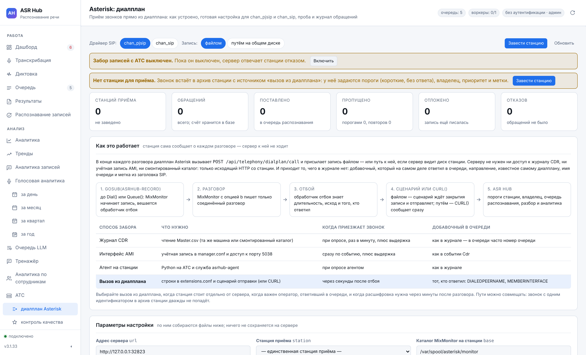

# Приём звонков из диалплана Asterisk

## Что это и когда выбирать

Три прежних пути забора — журнал CDR, интерфейс AMI и каталог записей — устроены одинаково: сервер распознавания сам ходит к станции и ищет, что появилось нового. Агент на станции ([24. Агент на станции Asterisk](24-agent.md)) делает то же самое, только живёт на АТС. Приём из диалплана работает в обратную сторону: **в конце каждого разговора станция сама сообщает о нём** — из обработчика отбоя (hangup handler) или командой по окончании MixMonitor — и присылает запись файлом либо путь к ней на общем диске.

| Способ забора | Что нужно | Когда приезжает звонок | Добавочный в очереди |
|---|---|---|---|
| Журнал CDR | чтение `Master.csv` (та же машина или смонтированный каталог) | при опросе, раз в минуту, плюс выдержка | как в журнале — в очереди часто номер очереди |
| Интерфейс AMI | учётная запись в `manager.conf` и доступ к порту 5038 | сразу по событию, плюс выдержка | как в событии `Cdr` |
| Агент на станции | Python на АТС и служба `asrhub-agent` | при опросе агентом | как в журнале |
| **Вызов из диалплана** | строки в `extensions.conf` и сценарий отправки (или функция `CURL()`) | **через секунды после отбоя** | **тот, кто ответил**: `DIALEDPEERNAME`, `MEMBERINTERFACE` |

Выбирайте вызов из диалплана, когда:

- **станция стоит отдельно** от сервера распознавания — за NAT, в другом городе, у подрядчика. Серверу не нужен ни журнал, ни учётная запись AMI, ни смонтированный каталог: только исходящий HTTP со станции;
- **важен оператор, ответивший в очереди**. В журнале CDR у входящего в очередь получателем часто записан номер очереди или Local-канал; диалплан в момент отбоя знает, кто именно взял трубку;
- **расшифровка нужна быстро**: звонок приезжает сразу после отбоя, без опроса, а запись — уже закрытой, без выдержки «а вдруг ещё пишется»;
- в диалплане есть то, чего нет в журнале: направление, известное самому диалплану, имя очереди, метка из заголовка SIP (номер сделки из CRM).

Пути можно совмещать. Если станцию с журналом CDR назвать в запросе явно, звонок встаёт в её архив тем же ключом «станция:идентификатор», что и при чтении журнала, и дважды не попадёт.

Раздел веб-интерфейса **Asterisk: диалплан** (в меню под «АТС») собирает всю настройку из этой главы под ваш адрес сервера, станцию, драйвер и способ передачи — с кнопками «Скопировать» и «Скачать», — отправляет пробный звонок и показывает журнал обращений станции.



## Как это устроено

1. **`Gosub(asrhub-record,…)`** — в вашем контексте, до `Dial()` или `Queue()`. Подпрограмма запускает `MixMonitor` и вешает на канал обработчик отбоя. Повторный вход (перевод, Local-канал участника очереди) второй записи не заводит: признак `__ASRHUB_UID` наследуется дочерними каналами.
2. **Разговор.** MixMonitor с опцией `b` пишет только соединённый разговор — без гудков, музыки ожидания и голосового меню.
3. **Отбой.** Обработчик отбоя (`asrhub-hangup`) знает то, чего не знала подпрограмма в начале: длительность (`CDR(billsec)`), исход (`CDR(disposition)`) и того, кто ответил.
4. **Передача.** Файлом — обработчик зовёт сценарий `asrhub-dialplan`; тот сразу уходит в фон, ждёт, пока MixMonitor закроет файл, и отправляет звонок вместе с записью. Путём — функция `CURL()` сообщает о звонке сразу, а запись сервер читает сам с общего диска.
5. **Сервер.** `POST /api/telephony/dialplan/call` выбирает станцию, применяет её пороги (короткие, без ответа), назначает владельца по карте номеров, ставит задание в очередь распознавания и записывает звонок в журнал телефонии. Дальше — обычная жизнь задания: распознавание, разбор содержания, голосовая аналитика.

Решение «брать или нет» принимает тот же код, что и для журнала CDR (`Импортёр._взять`): один и тот же звонок не может пройти одним путём и быть отсеян другим. Добавочный, направление и очередь, названные диалпланом, сервер **не перевычисляет**: диалплан знает их лучше.

## Настройка за десять минут

1. **Ключ доступа.** Раздел «Сервер», ключи доступа: новый ключ с ролью `user` (право записи), отдельный для станции. Его можно отозвать, не трогая остальных, а в журнале приёма видно, что звонки пришли именно им. Если звонков больше 120 в минуту — поднимите ключу предел частоты запросов (`rate_limit`).
2. **Станция приёма.** Раздел «АТС» → «Добавить станцию», источник «вызов из диалплана» — или кнопка «Завести станцию» в разделе «Asterisk: диалплан». У станции задаются пороги («Минимальная длительность», «Пропускать без ответа»), владелец и карта номеров, приоритет, метки, длины внутренних номеров и правила контекстов (по ним сервер определит направление, если диалплан его не назвал), часовой пояс. «Каталог записей» нужен только для приёма путём.
3. **Забор записей включён** — параметр `telephony_enabled` («Забирать записи с АТС»). Раздел «Asterisk: диалплан» предлагает включить его кнопкой, если он выключен.
4. **Сценарий отправки** на станции (для приёма файлом) — команды ниже.
5. **Диалплан**: файл `extensions_asrhub.conf`, строка `#include` в `extensions.conf`, `dialplan reload`.
6. **Вызов из ваших контекстов**: строка `Gosub(asrhub-record,…)` перед `Dial()` и `Queue()`.
7. **Очереди**: `setinterfacevar = yes` в `queues.conf`.
8. **Проверка**: `asrhub-dialplan --test`, пробный звонок, журнал обращений в разделе.

### Сценарий отправки

<!-- dialplan driver=pjsip mode=upload file=install -->
```sh
# На станции, от root. Ключ — тот, что заведён для станции в разделе «Доступ».
t=$(mktemp) && curl -fsS -H 'X-API-Key: ah_ВАШ_КЛЮЧ' -o "$t" \
     'http://asr.example.ru:8081/api/telephony/dialplan/asrhub-dialplan?station=main' &&
  sh "$t" --install; rm -f "$t"         # /usr/local/bin, /etc/asrhub, очередь повтора
editor /etc/asrhub/dialplan.conf         # вписать ключ
asrhub-dialplan --test                   # адрес, ключ и станция — без записи в архив

# Дослать то, что не ушло, когда сервер был недоступен (раз в пять минут):
echo '*/5 * * * * asterisk /usr/local/bin/asrhub-dialplan --resend' > /etc/cron.d/asrhub-dialplan
```

`--install` кладёт сценарий в `/usr/local/bin`, заводит `/etc/asrhub/dialplan.conf` (владелец root, группа asterisk, права `0640` — ключ не должен читаться всеми), каталоги очереди повтора с владельцем `asterisk`, досылку в `/etc/cron.d/asrhub-dialplan` (раз в пять минут) и ротацию журнала в `/etc/logrotate.d/asrhub-dialplan`. Существующие файлы не перезаписывает — строка `echo … > /etc/cron.d/…` выше нужна только там, где `/etc/cron.d` нет. `asrhub-dialplan --status` показывает очередь повтора, отвергнутые звонки, есть ли досылка в cron и последние строки журнала.

<!-- dialplan driver=pjsip mode=upload file=script_conf -->
```sh
# /etc/asrhub/dialplan.conf — настройки сценария asrhub-dialplan.
# Права: владелец root, группа asterisk, 0640 — ключ не должен читаться всеми.
ASRHUB_URL=http://asr.example.ru:8081
ASRHUB_KEY=ah_ВАШ_КЛЮЧ
ASRHUB_STATION=main
# upload — отправлять файл записи; path — только путь (общий диск с сервером).
ASRHUB_SEND_MODE=upload
# Каталог MixMonitor: от него считаются относительные пути (FreePBX).
ASRHUB_RECORDINGS=/var/spool/asterisk/monitor
# Сколько ждать, пока MixMonitor закроет файл, с.
ASRHUB_WAIT_S=120
# Попыток отправки при недоступном сервере (пауза растёт: 5, 15, 30, 60, 120 с).
ASRHUB_RETRIES=5
# Очередь повтора и журнал.
ASRHUB_SPOOL=/var/spool/asrhub-dialplan
ASRHUB_LOG=/var/log/asterisk/asrhub-dialplan.log
# Свой корневой сертификат для https (пусто — системные).
ASRHUB_CACERT=
```

## Файлы для chan_pjsip

### Диалплан: запись и передача

<!-- dialplan driver=pjsip mode=upload file=dialplan -->
```ini
; ===========================================================================
; ASR Hub: запись разговоров и передача их на распознавание
; Драйвер: chan_pjsip; запись передаётся файлом через сценарий отправки.
; Собрано разделом «Asterisk: диалплан».
;
; Куда положить: /etc/asterisk/extensions_asrhub.conf
; Подключить:    в конец /etc/asterisk/extensions.conf — строку
;                    #include extensions_asrhub.conf
;                затем в консоли Asterisk: dialplan reload
; Проверить:     asterisk -rx "dialplan show asrhub-record"
;                asterisk -rx "dialplan show asrhub-hangup"
; ===========================================================================

[globals]
; Каталог MixMonitor (astspooldir/monitor). Записи ASR Hub ложатся в
; подкаталог asrhub/ГГГГ/ММ/ДД; права на запись — у пользователя asterisk.
ASRHUB_BASE=/var/spool/asterisk/monitor
; Сценарий отправки (раздел «Asterisk: диалплан» → «Сценарий отправки»).
; Адрес сервера, ключ и станция — в /etc/asrhub/dialplan.conf, не здесь:
; диалплан виден любому, кто может открыть консоль Asterisk.
ASRHUB_SEND=/usr/local/bin/asrhub-dialplan

; ---------------------------------------------------------------------------
; Начать запись разговора и подготовить его передачу в ASR Hub.
; Вызывайте ДО Dial() или Queue():
;   same => n,Gosub(asrhub-record,s,1(<направление>,<номер>[,<очередь>[,<метка>]]))
; направление — in (входящий), out (исходящий) или internal (внутренний);
; номер — набранный номер: ${EXTEN} вызывающего контекста (внутри
; подпрограммы ${EXTEN} уже «s»); очередь — имя очереди для Queue();
; метка — что угодно для поиска (номер сделки из заголовка SIP и т. п.).
; ---------------------------------------------------------------------------
[asrhub-record]
exten => s,1,NoOp(ASR Hub: запись ${UNIQUEID}, ${ARG1}, ${ARG2})
 ; Звонок уже пишется: он вернулся в контекст (перевод, Local-канал
 ; участника очереди). Вторая запись того же разговора не нужна.
 same => n,GotoIf($["${ASRHUB_UID}" != ""]?done)
 same => n,Set(__ASRHUB_UID=${UNIQUEID})
 same => n,Set(ASRHUB_DIRECTION=${ARG1})
 same => n,Set(ASRHUB_DST=${ARG2})
 same => n,Set(ASRHUB_QUEUE=${ARG3})
 same => n,Set(ASRHUB_TAG=${ARG4})
 same => n,Set(ASRHUB_STARTED=${EPOCH})
 same => n,Set(ASRHUB_REL=asrhub/${STRFTIME(${EPOCH},,%Y/%m/%d)}/${UNIQUEID}.wav)
 ; «Не записывать»: согласие не дано (см. asrhub-norec) — звонок уйдёт в
 ; журнал без записи.
 same => n,GotoIf($["${ASRHUB_RECORD}" = "0"]?handler)
 ; b — писать только соединённый разговор: без гудков, музыки ожидания и
 ; голосового меню. Каталоги по датам MixMonitor создаёт сам.
 same => n,MixMonitor(${ASRHUB_BASE}/${ASRHUB_REL},b)
 ; Передача — в обработчике отбоя: к нему уже известны длительность и исход.
 same => n(handler),Set(CHANNEL(hangup_handler_push)=asrhub-hangup,s,1)
 same => n(done),Return()

; ---------------------------------------------------------------------------
; «Не записывать этот звонок»: вызовите до asrhub-record (например, в голосовом
; меню «нажмите 1, если не согласны на запись»), а посреди разговора —
; чтобы остановить уже идущую запись. Звонок попадёт в журнал ASR Hub без
; записи с пометкой «не записывать», запись (если началась) не отправится.
;   same => n,Gosub(asrhub-norec,s,1)
; ---------------------------------------------------------------------------
[asrhub-norec]
exten => s,1,Set(__ASRHUB_RECORD=0)
 same => n,ExecIf($["${ASRHUB_UID}" != ""]?StopMixMonitor())
 same => n,Return()

; Метка звонка для поиска и меток задания (номер сделки, тема): из голосового
; меню или по заголовку SIP — до или во время разговора.
;   same => n,Gosub(asrhub-tag,s,1(<метка>))
[asrhub-tag]
exten => s,1,Set(__ASRHUB_TAG2=${FILTER(0-9A-Za-z_.-,${ARG1})})
 same => n,Return()

; ---------------------------------------------------------------------------
; Обработчик отбоя: передать звонок сценарию отправки. Сценарий сразу уходит
; в фон — канал не ждёт ни сети, ни сервера, — дожидается, пока MixMonitor
; закроет файл, и отправляет запись. Сервер недоступен — повторяет, потом
; копит очередь повтора (asrhub-dialplan --resend).
;
; Всё, что приходит снаружи, — только через FILTER(): значения попадают в
; командную строку, и без фильтра номер звонящего «1;rm -rf /» выполнился бы
; на станции. Фильтр оставляет цифры, латиницу и «+._» — пробела, кавычек,
; «;», «&», «$» и «`» в аргументах не бывает. В идентификаторе звонка — ещё
; «-»: с systemname в asterisk.conf ${UNIQUEID} выглядит как
; «pbx-1-1700000000.12». «--.» в начале фильтра — диапазон от «-» до «.»:
; одиночный дефис FILTER() читает как знак диапазона.
; ---------------------------------------------------------------------------
[asrhub-hangup]
exten => s,1,NoOp(ASR Hub: отправка ${ASRHUB_UID})
 ; Добавочный сотрудника. Исходящий и внутренний — кто звонил (оконечная точка PJSIP
 ; этого канала). Входящий — кто ответил: имя соединённого канала
 ; (PJSIP/101-0000002a → 101), а в очереди — участник, ответивший на звонок
 ; (PJSIP/101 или Local/101@from-queue → 101; нужен setinterfacevar=yes).
 same => n,Set(ASRHUB_AGENT=${CHANNEL(endpoint)})
 same => n,ExecIf($["${ASRHUB_DIRECTION}" = "in"]?Set(ASRHUB_AGENT=${CUT(CUT(DIALEDPEERNAME,/,2),-,1)}))
 same => n,ExecIf($["${MEMBERINTERFACE}" != ""]?Set(ASRHUB_AGENT=${CUT(CUT(MEMBERINTERFACE,/,2),@,1)}))
 same => n,System(${ASRHUB_SEND} uniqueid=${FILTER(--.0-9A-Za-z_,${ASRHUB_UID})} linkedid=${FILTER(--.0-9A-Za-z_,${CDR(linkedid)})} sequence=${FILTER(0-9,${CDR(sequence)})} direction=${FILTER(a-z,${ASRHUB_DIRECTION})} src=${FILTER(0-9+,${CALLERID(num)})} dst=${FILTER(0-9+,${ASRHUB_DST})} agent=${FILTER(0-9A-Za-z_.,${ASRHUB_AGENT})} queue=${FILTER(0-9A-Za-z_.,${ASRHUB_QUEUE})} userfield=${FILTER(0-9A-Za-z_.,${ASRHUB_TAG})} started_at=${FILTER(0-9,${ASRHUB_STARTED})} duration=${FILTER(0-9,${CDR(duration)})} billsec=${FILTER(0-9,${CDR(billsec)})} disposition=${FILTER(A-Z,${CDR(disposition)})} record=${FILTER(0-9,${ASRHUB_RECORD})} tag=${FILTER(0-9A-Za-z_.,${ASRHUB_TAG2})} file=${ASRHUB_BASE}/${ASRHUB_REL})
 same => n,Return()
```

### Вызов из ваших контекстов

<!-- dialplan driver=pjsip mode=upload file=contexts -->
```ini
; Пример: как включить запись в ваших контекстах (chan_pjsip).
; Имена контекстов, номера и транк «provider» замените своими. Главное —
; строка Gosub(asrhub-record,…) перед Dial() или Queue().

[from-trunk]                      ; входящие с городских линий
exten => _X.,1,NoOp(Входящий на ${EXTEN} от ${CALLERID(num)})
 same => n,Gosub(asrhub-record,s,1(in,${EXTEN}))
 same => n,Dial(PJSIP/101&PJSIP/102,30,tT)
 same => n,Hangup()

; Входящий в очередь: имя очереди — третьим аргументом, а метка из заголовка
; SIP (если провайдер или CRM её присылает) — четвёртым.
exten => 74950000000,1,Gosub(asrhub-record,s,1(in,${EXTEN},sales,${PJSIP_HEADER(read,X-CRM-Id)}))
 same => n,Queue(sales,tT)
 same => n,Hangup()

[from-internal]                   ; звонки сотрудников
exten => _XXX,1,Gosub(asrhub-record,s,1(internal,${EXTEN}))
 same => n,Dial(PJSIP/${EXTEN},30,tT)
 same => n,Hangup()

exten => _8XXXXXXXXXX,1,Gosub(asrhub-record,s,1(out,${EXTEN}))
 same => n,Dial(PJSIP/${EXTEN}@provider,60,tT)
 same => n,Hangup()
```

### Очереди

<!-- dialplan driver=pjsip mode=upload file=queues -->
```ini
; /etc/asterisk/queues.conf — чтобы в обработчике отбоя был известен
; оператор, ответивший в очереди, очередь должна ставить MEMBERINTERFACE.
[sales]
strategy = rrmemory
setinterfacevar = yes            ; без этого добавочный в очереди не узнать
member => PJSIP/101
member => PJSIP/102
```

## Файлы для chan_sip

chan_sip устарел с Asterisk 17 и удалён в 21: на новых станциях используйте chan_pjsip. Для приёма звонков отличий немного — добавочный звонящего берётся из `CHANNEL(peername)` вместо `CHANNEL(endpoint)`, и иначе пишутся `Dial()` и участники очереди. Подпрограмма `asrhub-record` та же самая.

<!-- dialplan driver=sip mode=upload file=dialplan -->
```ini
; ===========================================================================
; ASR Hub: запись разговоров и передача их на распознавание
; Драйвер: chan_sip; запись передаётся файлом через сценарий отправки.
; Собрано разделом «Asterisk: диалплан».
;
; Куда положить: /etc/asterisk/extensions_asrhub.conf
; Подключить:    в конец /etc/asterisk/extensions.conf — строку
;                    #include extensions_asrhub.conf
;                затем в консоли Asterisk: dialplan reload
; Проверить:     asterisk -rx "dialplan show asrhub-record"
;                asterisk -rx "dialplan show asrhub-hangup"
; ===========================================================================

[globals]
; Каталог MixMonitor (astspooldir/monitor). Записи ASR Hub ложатся в
; подкаталог asrhub/ГГГГ/ММ/ДД; права на запись — у пользователя asterisk.
ASRHUB_BASE=/var/spool/asterisk/monitor
; Сценарий отправки (раздел «Asterisk: диалплан» → «Сценарий отправки»).
; Адрес сервера, ключ и станция — в /etc/asrhub/dialplan.conf, не здесь:
; диалплан виден любому, кто может открыть консоль Asterisk.
ASRHUB_SEND=/usr/local/bin/asrhub-dialplan

; ---------------------------------------------------------------------------
; Начать запись разговора и подготовить его передачу в ASR Hub.
; Вызывайте ДО Dial() или Queue():
;   same => n,Gosub(asrhub-record,s,1(<направление>,<номер>[,<очередь>[,<метка>]]))
; направление — in (входящий), out (исходящий) или internal (внутренний);
; номер — набранный номер: ${EXTEN} вызывающего контекста (внутри
; подпрограммы ${EXTEN} уже «s»); очередь — имя очереди для Queue();
; метка — что угодно для поиска (номер сделки из заголовка SIP и т. п.).
; ---------------------------------------------------------------------------
[asrhub-record]
exten => s,1,NoOp(ASR Hub: запись ${UNIQUEID}, ${ARG1}, ${ARG2})
 ; Звонок уже пишется: он вернулся в контекст (перевод, Local-канал
 ; участника очереди). Вторая запись того же разговора не нужна.
 same => n,GotoIf($["${ASRHUB_UID}" != ""]?done)
 same => n,Set(__ASRHUB_UID=${UNIQUEID})
 same => n,Set(ASRHUB_DIRECTION=${ARG1})
 same => n,Set(ASRHUB_DST=${ARG2})
 same => n,Set(ASRHUB_QUEUE=${ARG3})
 same => n,Set(ASRHUB_TAG=${ARG4})
 same => n,Set(ASRHUB_STARTED=${EPOCH})
 same => n,Set(ASRHUB_REL=asrhub/${STRFTIME(${EPOCH},,%Y/%m/%d)}/${UNIQUEID}.wav)
 ; «Не записывать»: согласие не дано (см. asrhub-norec) — звонок уйдёт в
 ; журнал без записи.
 same => n,GotoIf($["${ASRHUB_RECORD}" = "0"]?handler)
 ; b — писать только соединённый разговор: без гудков, музыки ожидания и
 ; голосового меню. Каталоги по датам MixMonitor создаёт сам.
 same => n,MixMonitor(${ASRHUB_BASE}/${ASRHUB_REL},b)
 ; Передача — в обработчике отбоя: к нему уже известны длительность и исход.
 same => n(handler),Set(CHANNEL(hangup_handler_push)=asrhub-hangup,s,1)
 same => n(done),Return()

; ---------------------------------------------------------------------------
; «Не записывать этот звонок»: вызовите до asrhub-record (например, в голосовом
; меню «нажмите 1, если не согласны на запись»), а посреди разговора —
; чтобы остановить уже идущую запись. Звонок попадёт в журнал ASR Hub без
; записи с пометкой «не записывать», запись (если началась) не отправится.
;   same => n,Gosub(asrhub-norec,s,1)
; ---------------------------------------------------------------------------
[asrhub-norec]
exten => s,1,Set(__ASRHUB_RECORD=0)
 same => n,ExecIf($["${ASRHUB_UID}" != ""]?StopMixMonitor())
 same => n,Return()

; Метка звонка для поиска и меток задания (номер сделки, тема): из голосового
; меню или по заголовку SIP — до или во время разговора.
;   same => n,Gosub(asrhub-tag,s,1(<метка>))
[asrhub-tag]
exten => s,1,Set(__ASRHUB_TAG2=${FILTER(0-9A-Za-z_.-,${ARG1})})
 same => n,Return()

; ---------------------------------------------------------------------------
; Обработчик отбоя: передать звонок сценарию отправки. Сценарий сразу уходит
; в фон — канал не ждёт ни сети, ни сервера, — дожидается, пока MixMonitor
; закроет файл, и отправляет запись. Сервер недоступен — повторяет, потом
; копит очередь повтора (asrhub-dialplan --resend).
;
; Всё, что приходит снаружи, — только через FILTER(): значения попадают в
; командную строку, и без фильтра номер звонящего «1;rm -rf /» выполнился бы
; на станции. Фильтр оставляет цифры, латиницу и «+._» — пробела, кавычек,
; «;», «&», «$» и «`» в аргументах не бывает. В идентификаторе звонка — ещё
; «-»: с systemname в asterisk.conf ${UNIQUEID} выглядит как
; «pbx-1-1700000000.12». «--.» в начале фильтра — диапазон от «-» до «.»:
; одиночный дефис FILTER() читает как знак диапазона.
; ---------------------------------------------------------------------------
[asrhub-hangup]
exten => s,1,NoOp(ASR Hub: отправка ${ASRHUB_UID})
 ; Добавочный сотрудника. Исходящий и внутренний — кто звонил (абонент sip.conf
 ; этого канала). Входящий — кто ответил: имя соединённого канала
 ; (SIP/101-0000002a → 101), а в очереди — участник, ответивший на звонок
 ; (SIP/101 или Local/101@from-queue → 101; нужен setinterfacevar=yes).
 same => n,Set(ASRHUB_AGENT=${CHANNEL(peername)})
 same => n,ExecIf($["${ASRHUB_DIRECTION}" = "in"]?Set(ASRHUB_AGENT=${CUT(CUT(DIALEDPEERNAME,/,2),-,1)}))
 same => n,ExecIf($["${MEMBERINTERFACE}" != ""]?Set(ASRHUB_AGENT=${CUT(CUT(MEMBERINTERFACE,/,2),@,1)}))
 same => n,System(${ASRHUB_SEND} uniqueid=${FILTER(--.0-9A-Za-z_,${ASRHUB_UID})} linkedid=${FILTER(--.0-9A-Za-z_,${CDR(linkedid)})} sequence=${FILTER(0-9,${CDR(sequence)})} direction=${FILTER(a-z,${ASRHUB_DIRECTION})} src=${FILTER(0-9+,${CALLERID(num)})} dst=${FILTER(0-9+,${ASRHUB_DST})} agent=${FILTER(0-9A-Za-z_.,${ASRHUB_AGENT})} queue=${FILTER(0-9A-Za-z_.,${ASRHUB_QUEUE})} userfield=${FILTER(0-9A-Za-z_.,${ASRHUB_TAG})} started_at=${FILTER(0-9,${ASRHUB_STARTED})} duration=${FILTER(0-9,${CDR(duration)})} billsec=${FILTER(0-9,${CDR(billsec)})} disposition=${FILTER(A-Z,${CDR(disposition)})} record=${FILTER(0-9,${ASRHUB_RECORD})} tag=${FILTER(0-9A-Za-z_.,${ASRHUB_TAG2})} file=${ASRHUB_BASE}/${ASRHUB_REL})
 same => n,Return()
```

<!-- dialplan driver=sip mode=upload file=contexts -->
```ini
; Пример: как включить запись в ваших контекстах (chan_sip).
; Имена контекстов, номера и транк «provider» замените своими. Главное —
; строка Gosub(asrhub-record,…) перед Dial() или Queue().

[from-trunk]                      ; входящие с городских линий
exten => _X.,1,NoOp(Входящий на ${EXTEN} от ${CALLERID(num)})
 same => n,Gosub(asrhub-record,s,1(in,${EXTEN}))
 same => n,Dial(SIP/101&SIP/102,30,tT)
 same => n,Hangup()

; Входящий в очередь: имя очереди — третьим аргументом, а метка из заголовка
; SIP (если провайдер или CRM её присылает) — четвёртым.
exten => 74950000000,1,Gosub(asrhub-record,s,1(in,${EXTEN},sales,${SIP_HEADER(X-CRM-Id)}))
 same => n,Queue(sales,tT)
 same => n,Hangup()

[from-internal]                   ; звонки сотрудников
exten => _XXX,1,Gosub(asrhub-record,s,1(internal,${EXTEN}))
 same => n,Dial(SIP/${EXTEN},30,tT)
 same => n,Hangup()

exten => _8XXXXXXXXXX,1,Gosub(asrhub-record,s,1(out,${EXTEN}))
 same => n,Dial(SIP/provider/${EXTEN},60,tT)
 same => n,Hangup()
```

## chan_sip и chan_pjsip: в чём разница

| Что | chan_sip | chan_pjsip |
|---|---|---|
| Модуль и файл настройки | `chan_sip`, `sip.conf` | `chan_pjsip`, `pjsip.conf` |
| Вызов сотрудника | `Dial(SIP/101)` | `Dial(PJSIP/101)`; на все его телефоны — `Dial(${PJSIP_DIAL_CONTACTS(101)})` |
| Вызов через транк | `Dial(SIP/provider/${EXTEN})` | `Dial(PJSIP/${EXTEN}@provider)` |
| Кто звонит (имя абонента) | `${CHANNEL(peername)}` | `${CHANNEL(endpoint)}` |
| Имя канала | `SIP/101-0000002a` | `PJSIP/101-0000002a` |
| Кто ответил (после `Dial()`) | `${CUT(CUT(DIALEDPEERNAME,/,2),-,1)}` | то же самое |
| Заголовок SIP входящего | `${SIP_HEADER(X-CRM-Id)}` | `${PJSIP_HEADER(read,X-CRM-Id)}` |
| Адрес телефона | `${CHANNEL(peerip)}` | `${CHANNEL(pjsip,remote_addr)}` |
| Участник очереди | `member => SIP/101` | `member => PJSIP/101` |
| Где есть | Asterisk 16–20 (устарел с 17-й, удалён в 21-й) | Asterisk 12 и новее; единственный в 21+ |

Универсальный способ узнать абонента канала для обоих драйверов — `${CUT(CUT(CHANNEL,/,2),-,1)}`: из `PJSIP/101-0000002a` и `SIP/101-0000002a` он даёт `101`. Он не годится, если в имени абонента есть дефис.

## Путём на общем диске: CURL() без сценария

Когда сервер распознавания видит каталог записей станции (та же машина, NFS, SMB), запись передавать не нужно. Обработчик отбоя сообщает о звонке функцией `CURL()` — без оболочки и без сценария. Запись в этот момент ещё дописывается: сервер откладывает звонок («ещё пишется») и дозабирает его потоком станции, как только файл закрыт и выдержка станции прошла.

<!-- dialplan driver=pjsip mode=path file=dialplan -->
```ini
; ===========================================================================
; ASR Hub: запись разговоров и передача их на распознавание
; Драйвер: chan_pjsip; запись передаётся путём на общем диске (CURL).
; Собрано разделом «Asterisk: диалплан».
;
; Куда положить: /etc/asterisk/extensions_asrhub.conf
; Подключить:    в конец /etc/asterisk/extensions.conf — строку
;                    #include extensions_asrhub.conf
;                затем в консоли Asterisk: dialplan reload
; Проверить:     asterisk -rx "dialplan show asrhub-record"
;                asterisk -rx "dialplan show asrhub-hangup"
; ===========================================================================

[globals]
; Каталог MixMonitor (astspooldir/monitor). Записи ASR Hub ложатся в
; подкаталог asrhub/ГГГГ/ММ/ДД; права на запись — у пользователя asterisk.
ASRHUB_BASE=/var/spool/asterisk/monitor
; Куда сообщать о звонках.
ASRHUB_URL=http://asr.example.ru:8081/api/telephony/dialplan/call?station=main
; Ключ доступа ASR Hub с правом записи — отдельный, только для станции.
ASRHUB_KEY=ah_ВАШ_КЛЮЧ

; ---------------------------------------------------------------------------
; Начать запись разговора и подготовить его передачу в ASR Hub.
; Вызывайте ДО Dial() или Queue():
;   same => n,Gosub(asrhub-record,s,1(<направление>,<номер>[,<очередь>[,<метка>]]))
; направление — in (входящий), out (исходящий) или internal (внутренний);
; номер — набранный номер: ${EXTEN} вызывающего контекста (внутри
; подпрограммы ${EXTEN} уже «s»); очередь — имя очереди для Queue();
; метка — что угодно для поиска (номер сделки из заголовка SIP и т. п.).
; ---------------------------------------------------------------------------
[asrhub-record]
exten => s,1,NoOp(ASR Hub: запись ${UNIQUEID}, ${ARG1}, ${ARG2})
 ; Звонок уже пишется: он вернулся в контекст (перевод, Local-канал
 ; участника очереди). Вторая запись того же разговора не нужна.
 same => n,GotoIf($["${ASRHUB_UID}" != ""]?done)
 same => n,Set(__ASRHUB_UID=${UNIQUEID})
 same => n,Set(ASRHUB_DIRECTION=${ARG1})
 same => n,Set(ASRHUB_DST=${ARG2})
 same => n,Set(ASRHUB_QUEUE=${ARG3})
 same => n,Set(ASRHUB_TAG=${ARG4})
 same => n,Set(ASRHUB_STARTED=${EPOCH})
 same => n,Set(ASRHUB_REL=asrhub/${STRFTIME(${EPOCH},,%Y/%m/%d)}/${UNIQUEID}.wav)
 ; «Не записывать»: согласие не дано (см. asrhub-norec) — звонок уйдёт в
 ; журнал без записи.
 same => n,GotoIf($["${ASRHUB_RECORD}" = "0"]?handler)
 ; b — писать только соединённый разговор: без гудков, музыки ожидания и
 ; голосового меню. Каталоги по датам MixMonitor создаёт сам.
 same => n,MixMonitor(${ASRHUB_BASE}/${ASRHUB_REL},b)
 ; Передача — в обработчике отбоя: к нему уже известны длительность и исход.
 same => n(handler),Set(CHANNEL(hangup_handler_push)=asrhub-hangup,s,1)
 same => n(done),Return()

; ---------------------------------------------------------------------------
; «Не записывать этот звонок»: вызовите до asrhub-record (например, в голосовом
; меню «нажмите 1, если не согласны на запись»), а посреди разговора —
; чтобы остановить уже идущую запись. Звонок попадёт в журнал ASR Hub без
; записи с пометкой «не записывать», запись (если началась) не отправится.
;   same => n,Gosub(asrhub-norec,s,1)
; ---------------------------------------------------------------------------
[asrhub-norec]
exten => s,1,Set(__ASRHUB_RECORD=0)
 same => n,ExecIf($["${ASRHUB_UID}" != ""]?StopMixMonitor())
 same => n,Return()

; Метка звонка для поиска и меток задания (номер сделки, тема): из голосового
; меню или по заголовку SIP — до или во время разговора.
;   same => n,Gosub(asrhub-tag,s,1(<метка>))
[asrhub-tag]
exten => s,1,Set(__ASRHUB_TAG2=${FILTER(0-9A-Za-z_.-,${ARG1})})
 same => n,Return()

; ---------------------------------------------------------------------------
; Обработчик отбоя: сообщить серверу о звонке функцией CURL(). Оболочки здесь
; нет, сценарий не нужен; значения кодируются URIENCODE(), чтобы запятая или
; «&» в номере не разломали запрос. Запись сервер читает сам с общего диска
; (путь — относительно ASRHUB_BASE) и, если она ещё дописывается,
; дозабирает её позже. Канал ждёт ответа сервера не дольше httptimeout.
; ---------------------------------------------------------------------------
[asrhub-hangup]
exten => s,1,NoOp(ASR Hub: передача ${ASRHUB_UID})
 ; Добавочный сотрудника. Исходящий и внутренний — кто звонил (оконечная точка PJSIP
 ; этого канала). Входящий — кто ответил: имя соединённого канала
 ; (PJSIP/101-0000002a → 101), а в очереди — участник, ответивший на звонок
 ; (PJSIP/101 или Local/101@from-queue → 101; нужен setinterfacevar=yes).
 same => n,Set(ASRHUB_AGENT=${CHANNEL(endpoint)})
 same => n,ExecIf($["${ASRHUB_DIRECTION}" = "in"]?Set(ASRHUB_AGENT=${CUT(CUT(DIALEDPEERNAME,/,2),-,1)}))
 same => n,ExecIf($["${MEMBERINTERFACE}" != ""]?Set(ASRHUB_AGENT=${CUT(CUT(MEMBERINTERFACE,/,2),@,1)}))
 same => n,Set(CURLOPT(conntimeout)=3)
 same => n,Set(CURLOPT(httptimeout)=10)
 ; Ключ — заголовком (Asterisk 16.7, 17.1, 13.30 и новее). Заголовки
 ; CURLOPT добавляются к каналу и не заменяются: ставим их один раз.
 same => n,Set(CURLOPT(httpheader)=X-API-Key: ${ASRHUB_KEY})
 ; Любой свой заголовок снимает Content-Type по умолчанию — возвращаем.
 same => n,Set(CURLOPT(httpheader)=Content-Type: application/x-www-form-urlencoded)
 same => n,Set(ASRHUB_ANSWER=${CURL(${ASRHUB_URL},uniqueid=${URIENCODE(${ASRHUB_UID})}&direction=${ASRHUB_DIRECTION}&src=${URIENCODE(${CALLERID(num)})}&dst=${URIENCODE(${ASRHUB_DST})}&agent=${URIENCODE(${ASRHUB_AGENT})}&queue=${URIENCODE(${ASRHUB_QUEUE})}&userfield=${URIENCODE(${ASRHUB_TAG})}&started_at=${ASRHUB_STARTED}&duration=${CDR(duration)}&billsec=${CDR(billsec)}&disposition=${URIENCODE(${CDR(disposition)})}&record=${ASRHUB_RECORD}&tag=${URIENCODE(${ASRHUB_TAG2})}&recording=${URIENCODE(${ASRHUB_REL})})})
 same => n,NoOp(ASR Hub ответил: ${ASRHUB_ANSWER})
 same => n,Return()
```

Что важно:

- У станции в разделе «АТС» задайте **«Каталог записей»** — путь, под которым каталог MixMonitor станции (`ASRHUB_BASE`) виден на сервере. Диалплан присылает путь **относительно** него (`asrhub/2026/10/27/1793000000.11.wav`), поэтому точки монтирования на станции и на сервере могут различаться. Пути вне этого каталога сервер не принимает — и после раскрытия символических ссылок тоже.
- Выдержка («Выдержка перед забором») и интервал опроса станции решают, как быстро запись уйдёт в распознавание: для приёма путём хватает 10–15 секунд и опроса раз в 30 секунд.
- Ключ — заголовком: `CURLOPT(httpheader)` есть в Asterisk 13.30, 16.7, 17.1 и новее. Заголовки CURLOPT добавляются к каналу и не заменяются, а любой свой заголовок снимает `Content-Type` по умолчанию — поэтому он ставится заново, а сервер принимает тело формы и без него. На старых версиях выберите в параметрах раздела передачу ключа в адресе: он попадает в `ASRHUB_URL` (`…/call?station=main&api_key=…`) и виден в `dialplan show globals`.
- `CURL()` синхронна: канал после отбоя ждёт ответа сервера не дольше `httptimeout` (10 с), и повторов у неё нет. Звонок, о котором сервер так и не узнал (перезапуск, 429, 5xx), подбирает **сверка каталога**: раз в десять минут поток станции просматривает каталоги дат (`asrhub/ГГГГ/ММ/ДД` и `ГГГГ/ММ/ДД`) за глубину просмотра станции (до семи суток) и заводит звонок по каждой записи старше десяти минут, которой нет в архиве, — тем же ключом «станция:uniqueid», так что опоздавшее обращение ответит «уже импортирован». Полей у такого звонка — сколько видно по имени файла (идентификатор, у имён FreePBX — номера и направление), в поле `userfield` — «сверка каталога».

## FreePBX и Issabel

<!-- dialplan driver=pjsip mode=upload file=freepbx -->
```sh
# FreePBX, Issabel и другие сборки, где записью управляет модуль Call Recording.
# Свой MixMonitor там не нужен: включите запись звонков как обычно, а в
#   Settings → Advanced Settings → Post Call Recording Script
# впишите строку ниже (одной строкой, без кавычек). FreePBX вызывает её,
# когда MixMonitor закрыл файл, поэтому ready=1: ждать сценарию нечего.
/usr/local/bin/asrhub-dialplan ready=1 uniqueid=^{UNIQUEID} src=^{FILTER(0-9+,^{CALLERID(num)})} agent=^{FILTER(0-9A-Za-z_.,^{FROMEXTEN})} started_at=^{EPOCH} file=^{MIXMON_DIR}^{YEAR}/^{MONTH}/^{DAY}/^{CALLFILENAME}.^{MIXMON_FORMAT}

# Направление сценарий берёт из начала имени файла FreePBX: in- и q- —
# входящий, out- — исходящий, exten- — внутренний. Длительность сервер
# измерит по самому файлу. Оператор, ответивший в очереди, на момент
# начала записи FreePBX не известен — для очередей точнее способ с
# обработчиком отбоя. Проверено не на всех версиях FreePBX: после
# настройки сделайте пробный звонок и посмотрите журнал
# /var/log/asterisk/asrhub-dialplan.log.
```

## Проверка

<!-- dialplan driver=pjsip mode=upload file=check -->
```sh
# 1. Диалплан подключён и разобран:
asterisk -rx "dialplan reload"
asterisk -rx "dialplan show asrhub-record"
asterisk -rx "dialplan show asrhub-hangup"

# 2. Сервер принимает (пробный звонок, в архив не попадает):
curl -sS -H 'X-API-Key: ah_ВАШ_КЛЮЧ' -F dry_run=1 -F uniqueid=test.1 \
     -F src=79161234567 -F dst=101 -F direction=in -F station=main 'http://asr.example.ru:8081/api/telephony/dialplan/call'

# 3. Позвоните на станцию и посмотрите, что ушло:
tail -f /var/log/asterisk/asrhub-dialplan.log
asterisk -rx "core set verbose 3"        # строки «ASR Hub: …» в консоли
```

В разделе «Asterisk: диалплан» то же самое делает кнопка «Отправить пробу»: она шлёт тот же запрос, что пришлёт станция, — формой, с секундой тишины в wav и полем `dry_run=1` — и показывает, что сервер сделал бы со звонком: станцию, ключ архива, направление, добавочный, владельца и приоритет, или причину пропуска. В архив проба не попадает.

**Журнал обращений** в том же разделе — последние двести обращений станции с ответами сервера: время, адрес, ключ, станция, идентификатор, номера, добавочный, способ передачи, итог (поставлен, пропущен, отложен, повтор, отказ, проба) и причина, а для поставленных — кнопка «Открыть» карточки задания. В нём видны и **отказы до проверки ключа** (401, 403): при наладке это самые нужные строки. Над журналом — счёт обращений по суткам за две недели (поставлено, пропущено, отложено, отказов). Журнал, счётчики и счёт по суткам (за месяц) хранятся в базе и переживают перезапуск сервера; сами звонки лежат в журнале телефонии.

**Пульс сценария.** Каждая досылка из cron (раз в пять минут) присылает серверу короткое сообщение `POST /api/telephony/dialplan/pulse`: сколько звонков ждёт в очереди повтора, сколько отвергнуто, возраст самого старого и версия сценария. В строке станции раздела видно «сценарий: пульс 3 мин назад»; пульс старше двадцати минут («cron молчит») или непустая очередь повтора подсвечены. По пульсу же работают метрики `asrhub_dialplan_pulse_age_seconds` и `asrhub_dialplan_spool_pending` и встроенные тревоги (глава [16](16-monitoring.md)).

Состояние приёма видно и в разделе «АТС»: вкладка «Разбор» для станции с источником «вызов из диалплана» вместо журнала проверяет, приходили ли обращения и не отказывал ли им сервер, а «Проверить подключение» показывает число обращений и последний отказ. Сводка дашборда предупреждает, если станция обращается, а сервер ей только отказывает.

## Рекомендации

- **Отдельный ключ на станцию** с правом записи. Ключ живёт в `/etc/asrhub/dialplan.conf` (root:asterisk, `0640`), передаётся curl через stdin и не виден ни в диалплане, ни в списке процессов.
- **wav, а не GSM.** Несжатый звук 8 кГц распознаётся заметно точнее: GSM (`WAV`, он же wav49, и `gsm`) съедает согласные. Место на диске станции — 128 кбит/с, около 1 МБ на минуту.
- **Опция `b` у MixMonitor**: в записи только разговор — без гудков и музыки ожидания, а короткие «сорвавшиеся» звонки не занимают очередь.
- **Моно, а не стерео.** Опция `D` (раздельные каналы) пишет только в `.raw` — без заголовка, с частотой, которую не прочитать из файла; такие записи сервер не принимает.
- **`Gosub(asrhub-record,…)` в каждом контексте**, где начинается разговор: входящем, исходящем и внутреннем. Направление — первым аргументом; если его не передать, сервер определит направление по правилам контекстов и длине номеров станции.
- **`setinterfacevar = yes`** у каждой очереди — иначе добавочный оператора, ответившего в очереди, в обработчике отбоя не узнать, и разговор достанется номеру очереди.
- **Пороги — у станции.** Короткие и неотвеченные звонки остаются в журнале звонков с причиной пропуска и считаются в сводках, просто не распознаются.
- **Часовой пояс станции** нужен, только если вы передаёте время строкой (`${CDR(start)}`). Готовые файлы передают `${EPOCH}` — секунды эпохи, без пояса и формата.
- **Сообщайте о записи** до соединения (Playback с предупреждением в голосовом меню): этого требует закон о персональных данных.
- **https между станцией и сервером**, если они в разных сетях: в записях — персональные данные. Свой корневой сертификат — `ASRHUB_CACERT` в настройках сценария, `CURLOPT(ssl_cainfo)` для CURL().
- **Очередь повтора** — `asrhub-dialplan --resend` раз в пять минут из cron: звонки, которые не ушли, пока сервер был недоступен, дойдут сами.

## Безопасность

- **Командная строка.** Номер и имя звонящего, набранный номер и заголовки SIP задаёт тот, кто звонит. В `System()` они попадают только через `FILTER()`: фильтр оставляет цифры, латиницу и «+._», и номер вида `1;rm -rf /` не выполнится на станции. Сценарий проверяет значения ещё раз: значение с пробелом, кавычкой, `;`, `&`, `$`, обратной кавычкой или начинающееся с `@` и `<` отбрасывается целиком и записывается в журнал сценария. Текстовые поля уходят в curl через `--form-string` — curl не читает файл, даже если значение похоже на `@/etc/passwd`.
- **CURL().** Оболочки нет, значения кодируются `URIENCODE()`: запятая или амперсанд в номере не разломают запрос.
- **Путь к записи** принимается только внутри «Каталога записей» станции, после раскрытия ссылок, и только с расширением звукового файла. Иначе приём превратился бы в «прочитай любой файл сервера».
- **Идентификатор звонка** — латиница, цифры, точка, двоеточие, `@`, дефис и подчёркивание: он становится частью ключа архива и образцом поиска записи.
- **Журнал обращений** — с номерами телефонов и адресами станций: его видит только администратор.
- **Станция закреплена за ключом.** Звонки станции принимаются от ключа, который первым прислал ей звонок, и от ключей той же группы; чужой ключ с правом записи получает 403 «принимает звонки от другого ключа». Иначе ключ одного подразделения заводил бы звонки — и задания — от имени другого. За каким ключом станция, видно в разделе «Asterisk: диалплан» (столбец «Владелец и приоритет»); там же ссылка «отвязать» — станция перейдёт к следующему ключу, который пришлёт звонок. Ключ отозвали — станция переходит к пришедшему сама. Администратору можно всегда.
- **Квота ключа.** Суточная квота заданий и часов звука действует и здесь: считаются звонки станции за сутки (задания звонков записаны на владельца из карты станции, а не на ключ). Исчерпана — 429, сценарий держит звонок у себя и дошлёт его позже.
- **Проба не выдаёт файлы.** Ответ пробы (`dry_run=1`) с путём к записи говорит `recording_exists` только администратору: иначе проба становилась способом узнавать, какие файлы лежат в каталоге записей.

## Программный интерфейс

```
POST   /api/telephony/dialplan/call             звонок от станции: поля и запись
POST   /api/telephony/dialplan/pulse            пульс сценария отправки: очередь повтора, отвергнутые
GET    /api/telephony/dialplan/status           станции приёма, счётчики, журнал обращений (администратор)
DELETE /api/telephony/dialplan/log              очистить журнал обращений (администратор)
DELETE /api/telephony/dialplan/key/{station}    отвязать станцию от ключа доступа (администратор)
GET    /api/telephony/dialplan/config           готовые файлы настройки Asterisk
GET    /api/telephony/dialplan/asrhub-dialplan  сценарий отправки с подставленным адресом
```

### Приём звонка

Поля принимаются формой (`multipart/form-data` с файлом или `application/x-www-form-urlencoded` — в том числе **без** `Content-Type`, как присылает `CURL()` со своим заголовком), JSON или в адресе запроса; значение из тела важнее значения из адреса. Пустые значения не считаются переданными: диалплан подставляет пустую строку вместо переменной, которой нет. Ключ — заголовком `X-API-Key`, `Authorization: Bearer` или параметром `api_key`.

| Поле | Другие имена | Что это | Откуда взять, что если не прислать |
|---|---|---|---|
| `uniqueid` | `uid`, `call_id` | идентификатор звонка — **обязательно** | `${UNIQUEID}` канала, на котором идёт запись. Ключ архива — «станция:uniqueid» |
| `station` | | идентификатор или имя станции приёма | не нужен, если станция с источником «вызов из диалплана» одна |
| `file` | | файл записи | wav, WAV, gsm, mp3, ogg, opus, flac, m4a, alaw, ulaw, sln, g722 |
| `recording` | `path` | путь к записи на общем диске | только внутри каталога записей станции; относительный — от него |
| `ready` | | `1` — запись уже закрыта | сервер не ждёт выдержку |
| `src` | `callerid`, `caller`, `from`, `cid` | номер звонящего | `${CALLERID(num)}` |
| `dst` | `exten`, `did`, `to`, `callee` | набранный номер | `${EXTEN}` вызывающего контекста |
| `agent` | `extension`, `operator`, `member` | добавочный сотрудника | не прислали — во входящем это `dst`, в остальных `src` |
| `direction` | | `in`, `out`, `internal` или «входящий», «исходящий», «внутренний» | не прислали — по правилам контекстов и длине номеров станции |
| `queue` | | имя очереди | |
| `disposition` | `status`, `dialstatus` | исход | `${CDR(disposition)}` (`ANSWERED`, `NO ANSWER`, `BUSY`, `FAILED`, `CONGESTION`) или `${DIALSTATUS}` (`ANSWER`, `NOANSWER`, `CANCEL`, `CHANUNAVAIL`…) |
| `answered` | | `1` или `0` — был ли разговор | не прислали — по исходу, по разговорной части или по наличию записи |
| `billsec` | `talk_s` | длительность разговора, с | `${CDR(billsec)}`; не прислали — мерится по файлу записи |
| `duration` | | длительность звонка с гудками, с | `${CDR(duration)}` |
| `started_at` | `start`, `started`, `epoch` | начало звонка | `${EPOCH}` или «ГГГГ-ММ-ДД ЧЧ:ММ:СС» в поясе станции; не прислали — конец минус длительность |
| `userfield` | | метка для поиска, до 1024 символов | |
| `clid`, `context`, `channel`, `dstchannel`, `accountcode` | | как в журнале CDR | |
| `dry_run` | `test` | `1` — проба: ответ без записи в архив | |

Непонятое значение (направление, исход, время) не роняет приём: оно не записывается, а объяснение возвращается в поле `warnings`. Неизвестные поля перечисляются в `ignored`.

Ответы:

| Код | `result` | Что значит |
|---|---|---|
| 200 | `queued` | поставлен в очередь распознавания; `job_id` — задание |
| 200 | `skipped` | пропущен по порогам станции: `skipped` — «короткий», «без ответа», «нет записи», «пустая запись». Звонок записан в журнал телефонии, присланный файл удалён |
| 200 | `duplicate` | такой звонок уже есть (`job_id` — его задание): повтор безопасен |
| 200 | `dry_run` | проба: `would` (`queue` или `skip`), `reason`, `owner`, `priority` |
| 202 | `deferred` | принят, но запись на общем диске ещё пишется (`deferred` — почему); его дозаберёт поток станции |

Ошибки — обычные ошибки API (`code`, `message`, `hint`): 400 — станция не найдена или их несколько, забор выключен, станция выключена, нет идентификатора, путь без каталога записей у станции; 401 и 403 — ключ (в том числе путь вне каталога станции); 413 — запись больше `max_upload_mb`; 415 — не звуковой файл; 429 — предел частоты запросов ключа. Сценарий отправки повторяет запрос на 408, 409, 423, 425, 429 и 5xx, а на 413 и 415 отправляет звонок ещё раз без записи — чтобы он остался в журнале.

Примеры:

```bash
# Файлом — так отправляет сценарий:
curl -sS -H 'X-API-Key: ah_ВАШ_КЛЮЧ' 'http://asr.example.ru:8081/api/telephony/dialplan/call' \
     -F station=main -F uniqueid=1793000000.11 -F direction=in -F src=79161234567 \
     -F dst=74950000000 -F agent=102 -F queue=sales -F billsec=95 -F disposition=ANSWERED \
     -F file=@/var/spool/asterisk/monitor/asrhub/2026/10/27/1793000000.11.wav
# {"ok":true,"uniqueid":"1793000000.11","key":"main:1793000000.11","station":"main",
#  "direction":"входящий","agent":"102","owner":"support","warnings":[],"ignored":[],
#  "bytes":1520044,"result":"queued","job_id":"job_5f068b6eaf3b4560"}

# Путём на общем диске — так присылает CURL():
curl -sS -H 'X-API-Key: ah_ВАШ_КЛЮЧ' \
     'http://asr.example.ru:8081/api/telephony/dialplan/call?station=main' \
     -d 'uniqueid=1793000000.12&src=79161234567&dst=101&direction=out&billsec=40&recording=asrhub%2F2026%2F10%2F27%2F1793000000.12.wav'
```

### Готовые файлы и сценарий

`GET /api/telephony/dialplan/config` собирает файлы настройки: `driver` (`pjsip` или `sip`), `mode` (`upload` — файлом, `path` — путём), `station`, `url` (пусто — адрес из параметра `public_url` или адрес запроса), `base` (каталог MixMonitor на станции), `format` (`wav`, `WAV`, `gsm`), `key_in` (`header` или `query` — для CURL()), `trunk` и `internal_len` для примеров. В ответе — `files` (`id`, `title`, `path`, `text`), `differences` (таблица драйверов), `tips` (рекомендации). Негодное значение (адрес с переводом строки, станция с пробелом, `..` в каталоге) — 400: эти значения попадают в файлы для станции текстом.

`GET /api/telephony/dialplan/asrhub-dialplan?station=main` отдаёт сценарий отправки с подставленными адресом сервера, станцией и версией. Нужен ключ с правом записи.

## Сценарий отправки

| Режим | Что делает |
|---|---|
| `asrhub-dialplan поле=значение …` | отправить звонок (так зовёт диалплан): записать в очередь повтора, уйти в фон, дождаться закрытия записи, отправить |
| `--test` | проверить адрес, ключ и станцию пробным звонком; в архив ничего не попадает |
| `--resend` | дослать очередь повтора (из cron раз в пять минут); брошенные отправки старше часа возвращаются в неё |
| `--resend-failed` | дослать то, что сервер отверг, — после исправления ключа или станции |
| `--install` | поставить себя в `/usr/local/bin`, завести настройки, каталоги, досылку в cron и ротацию журнала |
| `--status` | очередь повтора и отвергнутые по каталогам, есть ли досылка в cron, последние строки журнала |
| `--version` | версия |

| Настройка | По умолчанию | Что это |
|---|---|---|
| `ASRHUB_URL` | адрес сервера, откуда скачан сценарий | куда отправлять |
| `ASRHUB_KEY` | — | ключ доступа с правом записи |
| `ASRHUB_STATION` | станция, указанная при скачивании | станция приёма; поле `station` из диалплана важнее |
| `ASRHUB_SEND_MODE` | `upload` | `upload` — файл записи; `path` — только путь (общий диск) |
| `ASRHUB_RECORDINGS` | `/var/spool/asterisk/monitor` | от него считаются относительные пути (FreePBX) |
| `ASRHUB_WAIT_S` | 120 | сколько ждать, пока MixMonitor закроет файл |
| `ASRHUB_RETRIES` | 5 | попыток при недоступном сервере; паузы 5, 15, 30, 60, 120 с, дальше — по 120 с |
| `ASRHUB_FAILED_DAYS` | 30 | сколько суток хранить отвергнутые сервером звонки в `failed/`; 0 — вечно |
| `ASRHUB_SEND_TIMEOUT_S` | 600 | предел на одну отправку |
| `ASRHUB_SPOOL` | `/var/spool/asrhub-dialplan` | очередь повтора: `sending/`, `pending/`, `failed/` |
| `ASRHUB_LOG` | `/var/log/asterisk/asrhub-dialplan.log` | журнал сценария |
| `ASRHUB_CACERT` | — | свой корневой сертификат для https |
| `ASRHUB_INSECURE` | `no` | `yes` — не проверять сертификат (только для наладки) |
| `ASRHUB_DOWN_S` | 300 | предохранитель: сколько секунд после отправки, на которую сервер не ответил ни разу, новые звонки сразу ложатся в `pending/`; 0 — выключен |

Звонок сначала записывается в файл очереди — синхронно, до ухода в фон: так он не пропадёт, даже если сервер лежит, а процесс убьют. Запись считается закрытой, когда её размер две секунды не меняется. Нет записи за `ASRHUB_WAIT_S` — звонок уходит без неё и остаётся в журнале телефонии с причиной «нет записи». У несоединённого звонка (`disposition` не `ANSWERED`, `DIALSTATUS` не `ANSWER`, `answered=0` или `billsec=0`) запись ждётся пять секунд: MixMonitor с опцией `b` для него файла не создаёт, и раньше каждый неотвеченный звонок появлялся в журнале через две минуты.

Если сервер не принял запись (413 — велика, 415 — не тот формат), звонок уходит без неё с пометкой «сервер не принял запись (код N)», а копия звонка вместе с записью остаётся в `failed/`. Поднимите предел (`max_upload_mb`) или поправьте формат — `--resend-failed` дошлёт запись тем же `uniqueid`, и сервер примет её к уже лежащему звонку. Так же досылается запись к звонку с пометкой «нет записи», «запись не читается» или «не дождались записи».

**Предохранитель «сервер недоступен».** Если сервер не ответил ни на одну попытку (нет соединения), сценарий ставит метку `.down_until` в каталоге очереди: следующие `ASRHUB_DOWN_S` секунд новые звонки сразу ложатся в `pending/`, без пяти повторов с паузами на каждый отбой. Без метки час простоя сервера на станции в двести звонков — это двести фоновых процессов, каждый по пять минут. Досылку ведёт `--resend` из cron: одна проба за заход; первый же ответ сервера снимает метку. `--status` показывает, до какого времени она стоит.

**Стороны раздельно.** Флажок «Стороны раздельно» в разделе «Asterisk: диалплан» (только при отправке файлом) добавляет к `MixMonitor` опции `r()` и `t()`: кроме общей смеси пишутся две дорожки — что станция слышит (клиент) и что отдаёт в канал (оператор). Обработчик отбоя передаёт их полями `file_in` и `file_out`; сервер сводит их в стерео (клиент слева, оператор справа), и разбор по ролям идёт по каналам, а не по голосу. Дорожек нет или одна не дописалась — уходит смесь, как без флажка.

**«Не записывать» и метка звонка.** В созданном файле есть две подпрограммы:

| Подпрограмма | Когда звать | Что получится |
|---|---|---|
| `Gosub(asrhub-norec,s,1)` | до `asrhub-record` (клиент не согласен на запись в голосовом меню) или посреди разговора | запись не начинается или останавливается; звонок ложится в журнал без записи с пометкой «не записывать: попросили в разговоре», поле `record=0` |
| `Gosub(asrhub-tag,s,1(<метка>))` | до или во время разговора: номер сделки из голосового меню, заголовок SIP | поле `tag` — метка задания и строка для поиска в «Результатах» |

**Код «не записывать» в разговоре.** Поле «Код «не записывать»» в разделе «Asterisk: диалплан» (например, `*7`) добавляет к собранным файлам раздел `[applicationmap]` для `features.conf` (во FreePBX — `features_applicationmap_custom.conf`), а в `asrhub-record` — строку `DYNAMIC_FEATURES`. Оператор набирает код посреди разговора — запись останавливается (та же `asrhub-norec`), звонок уходит без неё с пометкой «не записывать». У входящего код набирает оператор-callee, а MixMonitor идёт на канале клиента (`peer/callee`); у исходящего — оператор-caller на своём канале (`self/caller`). После правки — `asterisk -rx "module reload features"`. В запросе `GET /api/telephony/dialplan/config` — параметр `norec_code`.

**Ответы, после которых сценарий повторяет:** 408, 409 (тот же звонок ещё принимается другим запросом), 425, 429 (предел частоты или квота), 5xx — в том числе 503 с `Retry-After`, когда забор записей или сама станция выключены на время обслуживания. Такие звонки остаются в `pending/` и досылаются `--resend` сами. Прочие отказы (неверный ключ, станция закреплена за другим ключом) — окончательные: звонок уходит в `failed/` вместе с ответом сервера.

**Каталог очереди недоступен** (нет прав, переполнен диск): звонок пишется в запасной `~/.asrhub-dialplan` пользователя станции (у `asterisk` — `/var/lib/asterisk/.asrhub-dialplan`), а если и туда нельзя — в новый каталог со случайным именем в `/tmp`, о чём сценарий пишет в свой журнал и в syslog с командой досылки. `--resend` смотрит и основной, и запасной каталог.

**`--resend` идёт под замком** (`.resend.lock` в каталоге очереди): cron запускает его раз в пять минут, а проход по сотне звонков при лежащем сервере длится дольше, и два прохода брали бы одни и те же файлы. Замок старше двух часов считается брошенным. Если сервер не отвечает вовсе (нет соединения), проход прерывается на первом звонке — остальные дошлются следующим запуском, а не ждут по десять секунд каждый. Направление, если диалплан его не передал, сценарий берёт из начала имени файла FreePBX (`in-`, `q-` — входящий, `out-` — исходящий, `exten-` — внутренний).

**Ноги разговора.** Обработчик отбоя передаёт и `linkedid`, и `sequence` (`${CDR(linkedid)}`, `${CDR(sequence)}`): по ним карточка записи показывает остальные ноги того же разговора — перевод, очередь, второго оператора. `uniqueid` проходит фильтр с дефисом: с `systemname` в `asterisk.conf` он выглядит как `pbx-1-1793000000.12`.

Сценарий написан на POSIX sh и нужен ему только curl: он работает на CentOS 7, Debian, Ubuntu, AlmaLinux и в образах FreePBX, Issabel и VitalPBX без доустановки.

## Устранение неполадок

| Что видно | Почему | Что делать |
|---|---|---|
| В журнале обращений пусто | диалплан не зовёт сценарий: файл не подключён, `Gosub` не вызывается или обработчик отбоя не повешен | `dialplan show asrhub-hangup`; `core set verbose 3` и звонок — в консоли должны быть строки «ASR Hub: запись …» и «ASR Hub: отправка …»; журнал сценария |
| «отказ», `auth_error` | ключ не передан или неверен | `ASRHUB_KEY` в `/etc/asrhub/dialplan.conf`; `asrhub-dialplan --test` |
| «отказ», `forbidden` | ключ только на чтение — или путь к записи вне каталога станции | ключ с ролью `user`; «Каталог записей» станции |
| «Нет станции для приёма» | станция с источником «вызов из диалплана» не заведена | кнопка «Завести станцию» |
| «Станций для приёма … непонятно, к какой» | их несколько, а `station` не передан | `ASRHUB_STATION` или `?station=` |
| «Забор записей с АТС выключен», 503 | `telephony_enabled` выключен | кнопка «Включить» в разделе; звонки за это время ждут в `pending/` и дошлются сами |
| 403 «принимает звонки от другого ключа» | станция закреплена за другим ключом | ключ той станции в `ASRHUB_KEY` или «отвязать» в разделе |
| 409 «уже принимается другим запросом» | повтор пришёл, пока первый запрос ещё шёл | ничего: сценарий повторит сам |
| Добавочный у входящих в очередь — номер очереди | `MEMBERINTERFACE` не ставится | `setinterfacevar = yes` у очереди |
| Добавочный у входящих — городской номер | ответившего не узнать по `DIALEDPEERNAME` (например, вызов через `Local`-каналы без очереди) | поправьте вычисление `ASRHUB_AGENT` в `asrhub-hangup` под свою схему вызова |
| Все звонки «короткий» | порог станции больше реальных разговоров | «Минимальная длительность» станции; длительность в журнале обращений и `${CDR(billsec)}` в консоли |
| «отложен» и не уходит | путь на сервере не совпадает с путём станции | «Каталог записей» станции — тот, под которым `ASRHUB_BASE` виден на сервере; права на чтение у пользователя сервера |
| «нет записи» | файл не появился за `ASRHUB_WAIT_S`: MixMonitor не пишет (нет прав на каталог) или пишет не туда | права пользователя `asterisk` на `ASRHUB_BASE`; путь в журнале сценария |
| Звонки в `pending/` | сервер был недоступен | cron с `--resend`; `asrhub-dialplan --resend` руками |
| Звонки в `failed/` | сервер отверг звонок — ответ лежит рядом (`.answer`) | исправить причину, `asrhub-dialplan --resend-failed` |
| В журнале сценария «недопустимые символы» | значение не прошло проверку: в пути к записи кириллица или пробел, в поле — символы оболочки | латинские имена каталогов; `FILTER()` в диалплане |

## Ограничения

- Журнал обращений хранится в базе, но ведёт его каждый процесс: на двух серверах над общей базой выигрывает записавший последним (журнал наладки, а не учёт — сами звонки в архиве не теряются).
- Если на двух серверах над общей базой станция присылает отложенный звонок в тот самый момент, когда поток станции на другом сервере его дозабирает, теоретически возможны два задания на один звонок: замок станции общий только внутри процесса.
- Настройка FreePBX проверена не на всех версиях: модуль Call Recording по-разному вычисляет переменные «Post Call Recording Script». После настройки сделайте пробный звонок и посмотрите журнал сценария.
- `CDR(billsec)` в обработчике отбоя верен на Asterisk 12 и новее; на более старых версиях разговорная часть берётся из файла записи.
- При переводе звонка запись продолжается на канале звонящего, а добавочным становится последний, с кем его соединили.
