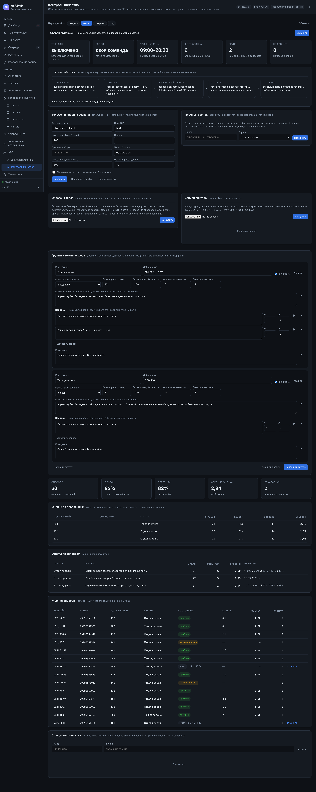

# Контроль качества: обратный звонок с опросом

## Что это

После разговора клиента с сотрудником сервер **сам перезванивает клиенту**, голосом проговаривает текст опроса и просит оценить обслуживание **нажатием кнопки на телефоне**. Ответы складываются в отчёт: по группам, добавочным и вопросам.

Опрашиваются не все звонки, а разговоры с **выбранными добавочными**. Добавочные объединяются в **группы**, и у каждой группы — **свой текст**: приветствие, вопросы со шкалой и прощание. Отдел продаж можно спрашивать о вежливости и о том, всё ли понятно по условиям, техподдержку — решён ли вопрос.

Сервер звонит **как обычный SIP-телефон, подключённый к Asterisk**: у него внутренний номер и пароль, он регистрируется на станции и набирает клиента через её исходящий маршрут — так же, как это сделал бы сотрудник с аппарата на столе. Серверу не нужны ни AMI, ни AGI, ни правка рабочего диалплана, ни модули на станции. Подходит любая станция, к которой подключается SIP-телефон: Asterisk с chan_pjsip или chan_sip, FreePBX, Issabel и другие.



## Как это работает

1. **Разговор.** Клиент поговорил с добавочным; звонок лёг в архив телефонии любым из путей забора ([21. Телефония](21-telephony.md), [31. Приём звонков из диалплана Asterisk](31-asterisk-dialplan.md)).
2. **Отбор.** Служба контроля качества раз в несколько секунд смотрит новые звонки архива. Опрос заводится, если звонок внешний и отвеченный, известен добавочный сотрудника и номер клиента, добавочный входит во включённую группу с вопросами, направление и длительность подходят группе, звонок попал в выборку, номера нет в списке «не звонить» и этому номеру не звонили с опросом в последние `qc_cooldown_days` дней.
3. **Пауза.** Опрос ждёт `qc_delay_s` секунд (по умолчанию 5 минут) и часов обзвона `qc_hours`. Опрос по разговору старше суток не начинается: клиент уже не вспомнит, о чём шла речь.
4. **Обратный звонок.** Перед набором номер ещё раз сверяется со списком «не звонить»: клиент мог отказаться от опросов в другом звонке. Телефон сервера шлёт станции `INVITE` на номер клиента (с префиксом `qc_dial_prefix`, если он задан). Не ответил или занято — повтор через `qc_retry_min` минут, всего `qc_max_attempts` попыток; трубку не сняли за `qc_answer_timeout_s` — вызов отменяется (`CANCEL` повторяется, пока станция его не подтвердит, а если клиент всё же снял трубку в этот миг, сервер сразу её кладёт). Отказ **этому номеру** — его нет (404, 410, 484, 485, 604) или на него нельзя звонить (403) — закрывает опрос со статусом «ошибка». Отказ **самой станции** (неверный пароль, станция молчит или перегружена) попытку клиента не тратит: обзвон приостанавливается на две минуты. Так же ждёт и опрос, для которого не готовится голос (не установлен синтезатор, сломан ffmpeg): опросы не сгорают, пока настройку не поправят, — их закроет только срок давности.
5. **Опрос.** Клиент снял трубку — звучит приветствие, затем вопросы по очереди. Кнопку можно нажать, не дослушав вопрос. Нажата кнопка вне шкалы — «Ответ не распознан», вопрос повторяется (число повторов задаётся в группе). Два вопроса подряд без ответа — опрос заканчивается: на той стороне автоответчик или человек не слушает.
6. **Оценка.** Ответы записываются, считается средняя оценка и её доля от шкалы. Клиент, нажавший кнопку отказа, попадает в список «не звонить»; его ждущие опросы снимаются сразу — в любом написании номера.

Регистрация телефона продлевается и между звонками (`qc_sip_register`): раньше её обновлял только очередной вызов, и в тихие часы станция показывала номер недоступным, а раздел — всё ещё «зарегистрирован». Одна кнопка, пришедшая двумя способами (событием RFC 4733 и тоном в звуке, или INFO и тоном), считается одним нажатием — лишняя цифра не становится ответом на следующий вопрос.

Два дополнения к этой схеме описаны ниже: режим **«только номера из 3 и 4 знаков»** — обзвон внутренних номеров станции вместо клиентов — и **образец голоса** — запись, голосом которой синтезатор проговаривает тексты.

Первое включение не обзванивает историю: опросы заводятся по разговорам, пришедшим в архив после включения.

## Номер на станции

Заведите для сервера отдельный внутренний номер — как для нового телефона. Ниже номер `900` и отдельный контекст `asrhub-qc`, из которого можно звонить только наружу.

### chan_pjsip (`pjsip.conf`)

```ini
[900]
type=endpoint
context=asrhub-qc
disallow=all
allow=alaw,ulaw
dtmf_mode=rfc4733
direct_media=no
auth=900
aors=900
callerid="Контроль качества" <900>

[900]
type=auth
auth_type=userpass
username=900
password=ДЛИННЫЙ_ПАРОЛЬ

[900]
type=aor
max_contacts=1
```

### chan_sip (`sip.conf`)

```ini
[900]
type=friend
host=dynamic
secret=ДЛИННЫЙ_ПАРОЛЬ
context=asrhub-qc
disallow=all
allow=alaw,ulaw
dtmfmode=rfc2833
directmedia=no
callerid="Контроль качества" <900>
```

### Контекст для исходящих (`extensions.conf`)

```ini
[asrhub-qc]
exten => _X.,1,NoOp(Опрос качества: ${EXTEN})
 same => n,Set(CALLERID(num)=74951234567)   ; ваш городской номер
 same => n,Dial(PJSIP/${EXTEN}@trunk,40)
 same => n,Hangup()
```

Строку `Dial()` возьмите из своего исходящего маршрута: имя транка и правила преобразования номера у каждой станции свои. Если наружу звонят через «9», задайте префикс набора в настройках сервера либо добавьте его в шаблон контекста. После правки — `pjsip reload` (или `sip reload`) и `dialplan reload`.

**FreePBX.** «Applications → Extensions → Add Extension → Add New PJSIP Extension»: номер 900, имя «Контроль качества», пароль (Secret). На вкладке Advanced — DTMF Signaling «RFC 4733», Direct Media «No». Исходящие правила действуют те же, что для остальных внутренних номеров; ограничить номер можно отдельным классом исходящих маршрутов.

Что важно:

- **Кодеки** — G.711: `alaw` и `ulaw`. Других телефон сервера не предлагает; если на номере разрешён только G.729 или Opus, станция ответит 488.
- **Кнопки (DTMF).** Телефон принимает нажатия всеми тремя способами одновременно: события RTP (RFC 4733/2833), сообщения SIP INFO и тон в самом звуке (inband). Рекомендуется `rfc4733`: от оператора связи нажатия обычно приходят именно так, и станция передаёт их без потерь.
- **`direct_media=no`** — звук идёт через станцию. Иначе станция попробует соединить сервер с оператором напрямую, и за NAT звука не будет.
- **Запись опроса.** Если на станции включена запись всех разговоров, опросы тоже запишутся и придут на распознавание как обычные звонки. Исключите номер 900 из записи либо оставьте — тогда расшифровка опроса окажется в архиве; повторного опроса не будет: добавочного 900 нет в группах.
- **Один звонок за раз.** По умолчанию сервер ведёт один опрос одновременно (`qc_parallel`); больше — если станция и транк позволяют.

## Настройка сервера

Раздел **Контроль качества** в меню под «АТС» (виден администратору).

1. **Телефон и правила обзвона**: адрес станции, порт SIP, номер и пароль, префикс набора, часы обзвона, пауза перед звонком, пауза между опросами одного номера. «Проверить телефон» регистрируется на станции прямо сейчас и говорит словами, чем кончилось: «станция не приняла логин или пароль телефона», «станция не отвечает на запросы SIP».
2. **Голос.** Плитка «Голос» показывает, каким синтезатором будет проговариваться текст (см. ниже). Кнопка ▶ у каждой фразы проигрывает её так, как услышит клиент: тот же голос и та же телефонная полоса.
3. **Группы и тексты опроса.** «Добавить группу»: имя, добавочные, после каких звонков опрашивать, тексты. «Сохранить группы» проверяет всё и называет ошибку с именем группы.
4. **Пробный звонок.** Номер своего телефона, группа, «Позвонить»: сервер звонит сразу, мимо часов обзвона и списка «не звонить». Строка с пометкой «проба» появляется в журнале и в отчёт не идёт.
5. **«Включить»** — с этой минуты опросы заводятся по новым разговорам.

### Группа

| Поле | Что значит |
|---|---|
| Имя группы | под ним оценки стоят в отчёте; имена не повторяются |
| Добавочные | номера и отрезки: `101, 102, 110-119`. Отрезок сравнивает номера той же длины: `110-119` не включает `1150` |
| Отделы справочника | отделы из справочника сотрудников через запятую: добавочный сотрудника из такого отдела входит в группу без перечисления номеров. Регистр и лишние пробелы не важны. Можно вместе с добавочными или вместо них |
| После каких звонков | входящих (клиент звонил нам — перезваниваем на номер звонившего), исходящих (звонили клиенту — на набранный номер) или любых |
| Разговор не короче | секунды разговора: короткие и сорвавшиеся не опрашиваются |
| Опрашивать, % звонков | выборка: 20 — каждый пятый подходящий разговор. Выбор устойчив: один и тот же звонок при повторном разборе даёт то же решение |
| Кнопка «не звонить» | цифра, `*` или `#`: нажавший вносится в список «не звонить». Назовите её в приветствии |
| Повторов вопроса | сколько раз переспросить при неверной кнопке или молчании (0–3) |
| Приветствие, вопросы, прощание | текст, который проговорит синтезатор. До 600 знаков на фразу, до 10 вопросов |
| Шкала вопроса | наименьшая и наибольшая принимаемая кнопка: 1–5 для оценки, 1–2 для «да/нет» |


Если добавочный входит в несколько групп, опрос ведётся по первой подходящей в списке.

Советы по тексту: называйте кнопки вслух («оцените от одного до пяти, где пять — отлично»); один вопрос — одна мысль; два-три вопроса клиент проходит охотно, на пятом кладёт трубку; представьтесь в приветствии и скажите, сколько времени это займёт.

### Только короткие номера

Флажок **«Перезванивать только на короткие номера»** в карточке «Телефон и правила обзвона» (параметр `qc_short_numbers_only`) ограничивает обзвон короткими — внутренними — номерами станции. Сколько цифр в коротком номере, задаёт поле рядом (`qc_short_lengths`): по умолчанию `3,4`, можно диапазоном — `2-5` для станций с двузначными или пятизначными внутренними номерами.

- опрос заводится, только если собеседник сотрудника группы звонил с номера такой длины либо ему звонили на такой номер;
- учитываются и **внутренние звонки** (без флажка они пропускаются): собеседником считается тот из двоих, кто не сотрудник группы;
- городские и мобильные номера сервер **не набирает вовсе** — ни по каким звонкам;
- префикс набора к номерам короче пяти знаков не добавляется;
- направление группы («после входящих», «после исходящих») к внутренним звонкам не применяется.

Когда это нужно: служба поддержки внутри организации, которую оценивают сами сотрудники; проверка всего пути без единого звонка наружу. Пробный звонок от флажка не зависит.

### Запись диктора вместо синтеза

Любая фраза — приветствие, вопрос, прощание — может быть готовой записью. Загрузите файл в карточке «Записи диктора» (до 50 МБ и 15 минут) и впишите вместо текста `audio:имя файла` — либо укажите путь к файлу на сервере: `file:/путь/к/записи.wav`. Файл приводится к телефонному виду сам. Так опрос звучит голосом, которым говорит ваше голосовое меню.

## Голос: синтезатор речи

Речь синтезирует программа, установленная на сервере рядом с ASR Hub. Сервер сам находит первую из известных, в таком порядке:

| Синтезатор | Установка | Голос (`qc_tts_voice`) |
|---|---|---|
| **RHVoice** — живые русские голоса, работает на процессоре | Debian/Ubuntu: `apt install rhvoice rhvoice-russian`; прочие — пакеты проекта RHVoice | `anna` (по умолчанию), `elena`, `aleksandr`, `irina` |
| **Piper** — нейросетевой, самый естественный | `pip install piper-tts` и файл голоса `.onnx` (например, `ru_RU-irina-medium.onnx`) | путь к файлу `.onnx` — обязательно |
| **eSpeak NG** — «робот», зато есть везде | `apt install espeak-ng` | `ru` (по умолчанию) |

Для звонков клиентам берите RHVoice или Piper; eSpeak годится, чтобы проверить весь путь до установки хорошего голоса.

Свой синтезатор (в том числе облачный, через сценарий-обёртку) подключается параметром `qc_tts_command`. В команде `{out}` — куда записать WAV, `{text}` — файл с текстом в UTF-8, `{voice}` — голос; текст подаётся и на стандартный ввод. Команда запускается без оболочки: текст вопроса командой стать не может.

```text
/opt/tts/say.sh --voice {voice} --input {text} --output {out}
```

### Образец голоса

Синтезатор можно научить говорить **голосом из вашей записи** — диктора, которым говорит голосовое меню, или сотрудника, знакомого клиентам. В карточке **«Образец голоса»** загрузите запись: 10–30 секунд ровной речи одного человека, без музыки, шума и других голосов (принимается от 3 секунд до 3 минут; WAV, MP3, OGG, FLAC, M4A). С этой минуты приветствие, вопросы и прощание всех групп проговариваются этим голосом. «Проверить синтез» произносит пробную фразу, «убрать» возвращает обычный голос.

Говорить по образцу умеет не всякий синтезатор — RHVoice, Piper и eSpeak NG не умеют. Нужен нейросетевой синтезатор с копированием голоса по короткой записи:

- **Coqui XTTS** — сервер находит его сам, если установлена программа `tts` (`pip install coqui-tts`); русский язык поддерживается. При первом запуске XTTS скачивает модель (около 2 ГБ) и просит принять её лицензию — запустите `tts` один раз вручную от имени пользователя сервера.
- **Свой синтезатор** — командой в `qc_tts_command`: `{sample}` — файл образца (WAV, моно, 22,05 кГц), `{say}` — текст фразы отдельным аргументом, `{out}` — куда писать результат.

```text
tts --model_name tts_models/multilingual/multi-dataset/xtts_v2 --language_idx ru --speaker_wav {sample} --text {say} --out_path {out}
```

Что стоит знать:

- **Скорость.** Нейросеть готовит фразу на процессоре от десятков секунд до минут, на видеокарте — секунды. Каждая фраза синтезируется один раз и берётся из кеша; звук готовится до набора номера, так что клиент пауз не слышит. Первый звонок после смены текста или образца начнётся позже.
- **Если синтезатора по образцу нет**, образец не теряется, но и не используется: тексты проговаривает обычный голос, а раздел пишет об этом в карточке и на плитке «Голос».
- **Согласие.** Загружайте голос только с согласия его владельца; копирование голоса человека без согласия во многих странах незаконно.
- Связка с Coqui XTTS проверена на подменной команде в тестах; на настоящей модели XTTS не прогонялась.

Нужен `ffmpeg` (он уже требуется серверу для звука): он приводит голос к 8 кГц, G.711, телефонной полосе и ровной громкости. Каждая фраза синтезируется один раз и лежит в кеше `data/qc/tts`; образец голоса — в `data/qc/voice`, записи диктора — в `data/qc/audio`.

## Отчёт, журнал и список «не звонить»

- **Плитки**: опросов за период, доля дозвона (сняли трубку), доля ответивших, средняя оценка, число отказавшихся.
- **Оценки по добавочным**: сколько опросов, дозвон, сколько оценили и средняя — с именем сотрудника из справочника.
- **Ответы по вопросам**: сколько раз задан, сколько ответили, средняя и распределение нажатий.
- **Журнал опросов**: клиент, добавочный, группа, состояние, нажатые кнопки, оценка, число попыток; ссылка «разговор» открывает исходную запись в «Результатах», «отменить» снимает ждущий опрос.
- **Список «не звонить»**: номера нажавших кнопку отказа и внесённые вручную. Номера сравниваются по последним десяти цифрам: `8 (999) …` и `+7 999 …` — один номер.
- **Выгрузить CSV** под журналом — все опросы периода (`GET /api/qc/surveys/export`, тот же отбор, что у журнала): дата, группа, добавочный и сотрудник, номер клиента, итог, оценка и по колонке на каждый вопрос. Разделитель «;», UTF-8 с BOM — открывается в Excel; значения, начинающиеся с `=`, `+`, `-`, `@`, Excel как формулы не исполнит.

**Оценка в карточке записи.** Карточка разговора в «Результатах» показывает оценку клиента из опроса по этому звонку: среднюю, процент шкалы, группу и нажатую кнопку на каждый вопрос.

**Уведомление о завершённом опросе.** `qc_webhook_url` — адрес, куда уходит POST с JSON при каждом завершённом опросе (кроме пробных и отменённых): `event: qc_survey_finished`, опрос целиком и готовая строка `text` для чата. Отправка — в фоне, с тремя попытками; адреса внутренней сети — по той же настройке `webhook_allow_internal`, что и у прочих уведомлений.

**Метрики и тревоги.** `asrhub_qc_registered` (телефон зарегистрирован), `asrhub_qc_waiting` (опросов в очереди), `asrhub_qc_surveys_day` (итоги за сутки), `asrhub_qc_score_pct_day` (средняя оценка за сутки, от трёх оценок) и `asrhub_qc_unreached_share_day` (доля недозвонов, от пяти опросов) — со встроенными тревогами: регистрация потеряна, средняя оценка ниже 60 % шкалы, недозвон больше 60 %. Пороги меняются в разделе «Мониторинг», см. главу [16](16-monitoring.md).

Состояния опроса:

| Состояние | Что произошло |
|---|---|
| ждёт | в очереди: пауза, часы обзвона или повтор |
| звонит | идёт вызов или разговор |
| пройден | ответил на все вопросы |
| частично | ответил на часть вопросов |
| без ответа | снял трубку, но ни одной кнопки не нажал |
| отказ | нажал кнопку «не звонить» |
| не дозвонились | попытки кончились: не отвечает, занято |
| ошибка | номера нет, станция отвергла вызов, не готовится голос |
| устарел | не успели позвонить за сутки после разговора |
| отменён | снят администратором |

Средняя оценка считается по нажатым цифрам; «% шкалы» приводит вопросы с разными шкалами к одному виду: 0% — нижняя кнопка, 100% — верхняя.

## Параметры

Все параметры — в «Настройках», группа «Контроль качества», и в [4. Справочник параметров](04-parameters.md).

| Параметр | По умолчанию | Назначение |
|---|---|---|
| `qc_enabled` | выключено | заводить опросы и обзванивать |
| `qc_groups` | пусто | группы: добавочные и тексты |
| `qc_sip_host`, `qc_sip_port` | —, 5060 | адрес и порт станции (UDP) |
| `qc_sip_user`, `qc_sip_password` | — | номер и пароль телефона; пароль — секрет, наружу не отдаётся |
| `qc_sip_register` | да | регистрироваться на станции; «нет» — только звонить (станции со статическим адресом телефона) |
| `qc_sip_local_ip` | авто | адрес сервера, который увидит станция, — если у сервера несколько сетей |
| `qc_dial_prefix` | пусто | приставка к номеру клиента; к номерам короче пяти знаков не добавляется |
| `qc_short_numbers_only` | выключено | перезванивать только на короткие номера |
| `qc_short_lengths` | `3,4` | сколько цифр в коротком номере: через запятую или диапазоном |
| `qc_caller_name` | «Контроль качества» | имя звонящего для станции |
| `qc_tts_command`, `qc_tts_voice` | авто | синтезатор и голос; в команде `{sample}` — образец голоса, `{say}` — текст фразы |
| `qc_hours`, `qc_timezone` | `09:00-20:00`, пояс сервера | когда можно звонить; пусто — круглые сутки |
| `qc_weekdays` | пусто — каждый день | дни обзвона: 1 — понедельник … 7 — воскресенье, `1-5` — будни |
| `qc_holidays` | пусто | дни без обзвона: `ГГГГ-ММ-ДД` или ежегодные `ММ-ДД` через запятую |
| `qc_webhook_url` | пусто | куда сообщать о завершённых опросах (POST с JSON) |
| `qc_delay_s` | 300 | пауза после разговора |
| `qc_max_attempts`, `qc_retry_min` | 2, 30 | попытки дозвона и пауза между ними |
| `qc_cooldown_days` | 30 | не чаще одного опроса на номер за столько дней |
| `qc_parallel` | 1 | одновременных звонков |
| `qc_answer_timeout_s`, `qc_digit_timeout_s` | 30, 7 | сколько ждать ответа и нажатия |

## API

Все маршруты — только администратору: в настройках учётные данные телефона, в журнале — номера клиентов.

```text
GET    /api/qc/status                 состояние: телефон, голос, очередь, часы
GET    /api/qc/groups                 группы
PUT    /api/qc/groups                 заменить список групп
POST   /api/qc/tts                    фраза голосом опроса (WAV)
POST   /api/qc/check                  регистрация на станции сейчас
POST   /api/qc/test-call              пробный звонок
GET    /api/qc/surveys                журнал опросов
GET    /api/qc/surveys/export         журнал опросов в CSV (тот же отбор, все строки)
POST   /api/qc/surveys/{id}/cancel    отменить ждущий опрос
GET    /api/qc/summary                оценки за период
GET    /api/qc/stoplist               список «не звонить»
POST   /api/qc/stoplist               внести номер
DELETE /api/qc/stoplist/{number}      убрать номер
GET    /api/qc/audio                  записи диктора
POST   /api/qc/audio                  загрузить запись (форма, поле file)
GET    /api/qc/audio/{name}           скачать запись
DELETE /api/qc/audio/{name}           удалить запись
GET    /api/qc/voice-sample           образец голоса: загружен ли и чем используется
POST   /api/qc/voice-sample           загрузить образец (форма, поле file)
GET    /api/qc/voice-sample/audio     прослушать образец
DELETE /api/qc/voice-sample           убрать образец
```

```bash
# Группы: заменить список целиком
curl -X PUT "$ASRHUB_URL/api/qc/groups" -H "X-API-Key: $ASRHUB_API_KEY" \
  -H "Content-Type: application/json" -d '{"groups": [{
    "name": "Отдел продаж", "extensions": "101, 110-119", "direction": "in",
    "optout_digit": "0",
    "greeting": "Здравствуйте! Вы недавно звонили в нашу компанию. Ответьте на два вопроса. Чтобы мы больше не звонили, нажмите ноль.",
    "questions": [
      {"text": "Оцените вежливость оператора от одного до пяти.", "min": 1, "max": 5},
      {"text": "Решён ли ваш вопрос? Один — да, два — нет.", "min": 1, "max": 2}]}]}'

# Пробный звонок и оценки за неделю
curl -X POST "$ASRHUB_URL/api/qc/test-call" -H "X-API-Key: $ASRHUB_API_KEY" \
  -H "Content-Type: application/json" -d '{"number": "101", "group": "Отдел продаж"}'
curl "$ASRHUB_URL/api/qc/summary?since_days=7" -H "X-API-Key: $ASRHUB_API_KEY"

# Образец голоса для синтезатора
curl -X POST "$ASRHUB_URL/api/qc/voice-sample" -H "X-API-Key: $ASRHUB_API_KEY" -F "file=@voice.wav"
```

Журнал фильтруется параметрами `status`, `group`, `ext`, `search` (часть номера), `since_days`, `limit`, `offset`. Удаление данных по требованию (`POST /api/maintenance/erase`, [10. Эксплуатация](10-operations.md)) убирает и опросы номера.

## Правила и здравый смысл

Обратный звонок с опросом — это звонок клиенту по инициативе организации. Прежде чем включать:

- **Согласие и закон.** Убедитесь, что у вас есть основание звонить клиенту с опросом: согласие в договоре или оферте, предупреждение в голосовом меню («после разговора мы можем перезвонить для оценки качества»). Требования к таким звонкам и к обработке номеров зависят от страны и отрасли — сверьтесь с юристом.
- **Часы.** Оставьте часы обзвона дневными и задайте часовой пояс клиентов, а не сервера.
- **Отказ.** Задайте кнопку «не звонить» и назовите её в приветствии. Список отказавшихся сервер соблюдает сам.
- **Частота.** Пауза в 30 дней на номер стоит по умолчанию не случайно: постоянный клиент, которому звонят после каждого обращения, перестанет брать трубку.
- **Выборка.** На большом потоке опрашивайте долю звонков: оценки сойдутся к тем же значениям, а линия и транк останутся свободны.
- **Номер звонящего.** Клиент охотнее ответит на звонок с того же номера, на который звонил сам: задайте его в контексте `asrhub-qc`.

## Если не работает

| Что видно | Причина и что делать |
|---|---|
| «Станция … не отвечает на запросы SIP» | адрес или порт; межсетевой экран не пропускает UDP 5060 от сервера к станции; станция слушает SIP только по TCP/TLS (телефон сервера работает по UDP) |
| «Станция не приняла логин или пароль» (401/403) | пароль; в chan_pjsip имя раздела `auth` и `username` должны совпадать с номером; fail2ban на станции мог заблокировать адрес сервера после неудачных попыток |
| Проверка проходит, опрос — «ошибка», «номера нет» (404) | контекст номера не умеет набирать наружу: проверьте шаблон в `[asrhub-qc]` и префикс набора. Опрос с таким отказом закрывается сразу и остальной обзвон не держит |
| Отказ 488 | на номере не разрешён G.711: `allow=alaw,ulaw` |
| Клиент снимает трубку, но тишина | звук не доходит: `direct_media=no`; сервер за NAT от станции — задайте `qc_sip_local_ip` и откройте к серверу UDP-порты RTP; для chan_pjsip за NAT — `rtp_symmetric=yes`, `force_rport=yes` на номере |
| Клиент слышит текст, но кнопки не принимаются | оператор связи отдаёт нажатия не тем способом, каким их ждёт станция: проверьте `dtmf_mode` транка; на пробном звонке с внутреннего аппарата кнопки работают — значит, дело в транке |
| «Нечем проговорить текст», опросы ждут | не установлен синтезатор или для Piper не задан файл голоса. Опросы остаются в очереди, пока голос не начнёт готовиться (кнопка ▶ у фразы покажет ту же ошибку) |
| Опросы не заводятся | раздел называет причину в плашке состояния: обзвон выключен, нет включённых групп, вне часов. В архиве у звонка должен быть добавочный сотрудника: в очередях Asterisk его даёт приём из диалплана (глава 31) |
| Опрос «устарел» | за сутки не нашлось окна в часах обзвона или линия была занята другими опросами |

В журнале сервера записи службы идут под именем `asrhub.qc`.

## Чего пока нет

- Только SIP по UDP и звук без шифрования (RTP): TLS и SRTP не поддерживаются — телефон сервера должен быть в одной доверенной сети со станцией.
- Ответ распознаётся только по кнопкам: голосовые ответы («да», «пять») не принимаются.
- Сценарий линейный: вопросы идут подряд, без ветвлений («если оценка ниже трёх — спросить почему»).
- Опрос не различает человека и автоответчик иначе как по молчанию на двух вопросах подряд.
- Оценка видна в карточке записи, но в аналитику по сотрудникам и в «Результаты» отдельной колонкой пока не входит.
- Раздел только для администратора: руководителю отдела нужен отчёт по своей группе без доступа к остальным.

Эти пункты стоят в плане: [33. Что доделать и улучшить](33-roadmap.md).
